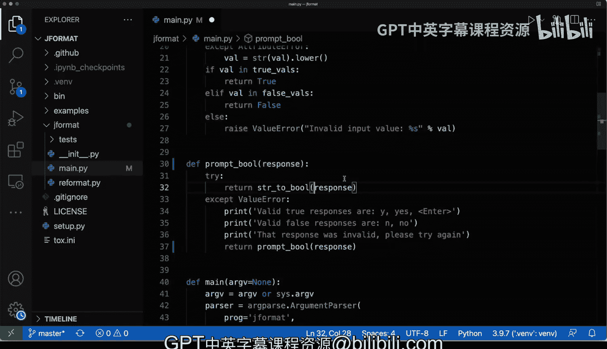

# 杜克大学｜Python、Bash和SQL数据工程基础2-4Python Bash and SQL Essentials for Data Engineering p173 39_04_03_代码检查工具入门.zh_en -BV1XS421X7tw_p173-

LinIn is one of those things that if you don't know about it。

 it will change the way you develop LinkIn is available for many different languages in different situations regarding coding and professional software development and in this case we're dealing with the Python project as you already know now how can we use LinkedIn over here I'm using VS code。

 but let's just for a second forget about the fact about what text data I'm using I'm going to open up terminal。

And in this terminal， the first thing you will notice is that， well， I am， I am using here a。嗯。

I'm using a virtual environment， and it has been activated。

 and the Li that I usually like is called Flake 8。 So I'm going to go ahead and install that and we'll get into the details as to why that's important。

 I'm going to do paper install Fake 8。And I will go ahead and install Fake 8。 Now within the project。

 I'm going to do ala。 There's a main， reformant and some tests。

 So if I do flake8 and run it without any arguments。

You will see that there are some warnings so what it's doing is going into every single Python file and it's checking for certain things that I might have missed in my coding so you can see here mainpi has this code F401 OS imported but not used and similar you know I have several things that I've imported like that's not good like I should clean up。

RightNow by default， VS code will have a L installed and we show you。

 I'll show you how that looks in the text editor， but it is useful to know that this is a tool that you can actually run on the terminal。

 usually these tools， these L tools from text editorators will rely on command line tools that you can install。

In in the virtual environment and make it available to Python the text editorator can use in turn to show you things that might be problematic Now I'm going to close these now that you see kind of like the output I close these and let's see what it looks like first we'll check this OS imported but unused right here I made up Python when I close these。

And if I go to line 3， you'll see that this is a little bit dim。

 Like it might be hard to see R par is is is's okay， but O S is not not okay。

 You can see it's a little bit dim。 Now， that's indicated like if I hover， you'll see。

Let's see if I click these removed and used import。

 so you get these little light bulb that it's telling you hey。

 you know you're not using these so yeah let's let's start cleaning up same with these one remove the used import and and then that's fine now。

LinkedIn is not only for unused imports。 it can catch other more。

Problematic things that you might be missing。 So say， for example， right here on this function。

 we have this prompt bull function and we have an underline here。

 If you take a second to try to figure out why that may be highlighted with that yellow underline curly underline the reason is that we have responses input like this is a parameter for the function。

 it's being used here in line 37 at the bottom， However。

 question is not coming from anywhere where is this coming from And if I hover。

 you can see that it says question is not defined P is what the text data in this case。

 VS code is using behind the scenes。 So if we quickly we can say be a problem or quick fix。

 Yeah sure quick fix this will try to figure out why you may want in this case this is not the right the right solution。

 the right solution is to go and say。This is a response now it's using the same variable here and there and everywhere actually within these functions。

 So that's alin like if you have the Python extension installed in the text state or VS code in this case。

 it will work otherwise you can use something like flakecate or enable any other Li that you may want differentlins will have different types of warnings and errors and things that might not be exactly you know to your liking so for example。

 if it's a styling thing I could I could certainly do something like these。

And other other taxators would or otherlins would complain about that。 In this case， Pyance doesn't。

 But flake8 or another P 8 Li will will probably complain。 So that's it。 That's， that's a Li。

 That's how it it's useful。 And it helps keep our code clean and makes us aware of things that we might be missing。

