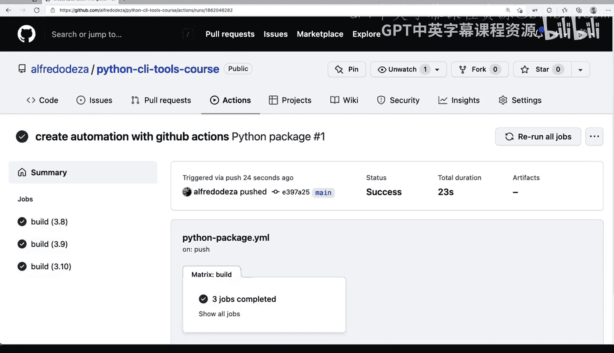
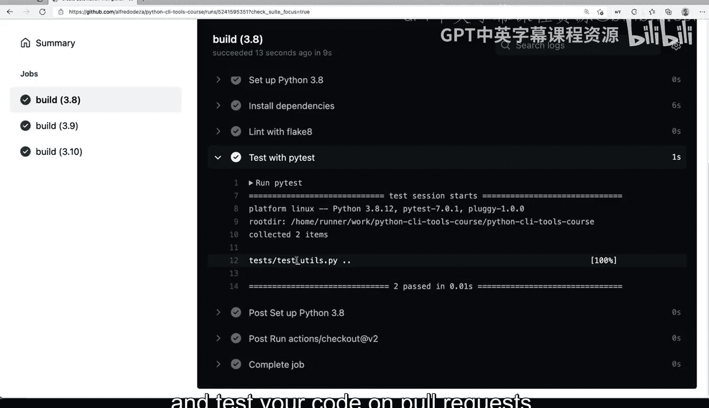
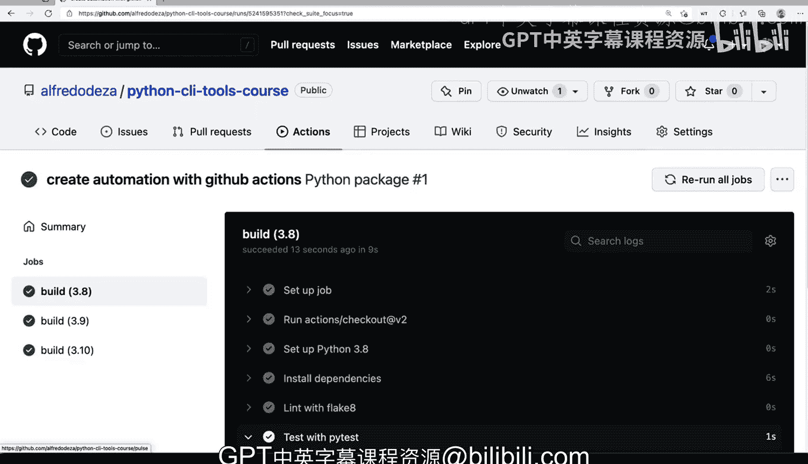

# 杜克大学｜Python、Bash和SQL数据工程基础2-4Python Bash and SQL Essentials for Data Engineering p174 40_04_04_使用GitHub Actions自动化测试.zh_en -BV1XS421X7tw_p174-

Now that our project is pushed onto Github here in this case。

 my repository is called Python CI tools course， where I'm adding all of the examples。

 including our J format commandline tool that already has a setup up pie and is declaring some dependencies and we know how to test So one of the things that you can do is set up some automation。

 you don't want to necessarily be running test like if someone opens up a pull request and is collaborating with you you want to start automating things。

 Now you can certainly add these things manually， but GiHub does it very easily for you because can you can go to these menu called actions。

And then you can get very quickly get started with GiHub actions。 In this case， you're gonna say。

 you're gonna search for Python and test and。We are going to do this one。

 We're going select this Python package and want a set configure。 Now。

 this is not doing anything just yet。 However， it is pre populating everything that you need to do here。

 So it has your dot Github directory， a sub directory called workflows and then Python package。

 So what it's doing here， it's。It was given some some recommendations here what it's doing here is it will install the Python dependencies and runom tests and in different Python versions even so you will have the ability to check different Python versions like 3839 and 310。

Now， let's， let's go through very quickly about the things that this， this is doing。 So first。

 it sets up the。TheThe container and the correct Python version and it will install some dependencies。

 So in this case， it's doing Python Pip install that great Pip。

 that's fine it will ensure that their latest Pip is installed and then it will install flakeate and py test by default default like I didn't install that or declare that but it understands that Pyth is a good popular test runners it will probably run that and it will want to link with flakeate and then test with Py test So one of the problems is that I don't have a requirements that text so what will I will need to do like if I had that that would work but what I need to do is I need to do Python set up the p develop and then that will ensure that everything is set right so I'm gonna remove that and LinkIn with flakeate is fine。

 it will catch if there's anything that is wrong with me。

So these will allow me to run these whenever there's a push to the main branch or there's a pull request that is going to the main branch。

 so I'm going to start a commit right there from the web interface I'm going to say create automation with Github actions。

And then I'm going to commit the new file。Once I commit the new file。

 you might not see anything different other in the new file here in the subdirecty。

 but if you go to actions， you will see that now there's something running。

 So create automation with Github actions is now running and hopefully things will work correctly。

 but if they don't you will see that there's some work that we need to do in order to figure out。

 So it's building Python 38，39 and 310 and testing against these different versions。

 let's take a look at 38， for example。 So all of the different specific parts of it are are being displayed here。

 let's take a look at test with Py test。 So you can see here that is testing tests test underscore your just like we were doing before。

 So if your path is different， but you will need to adapt that。

 but everythings being said automatically for you。 So this is。

definitelyfinitely a way that you can。You can set GiHub actions and test your code on pull requests and also whenever there's a change in domain Ma。

 like if you're like in my case， testing directly on the web。

