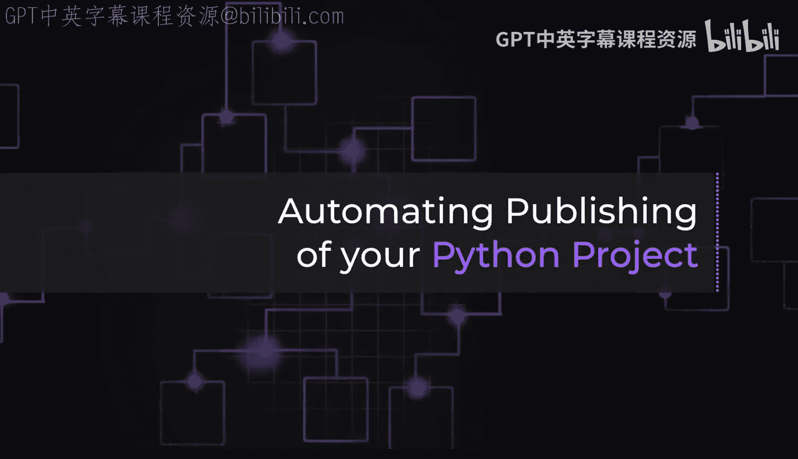
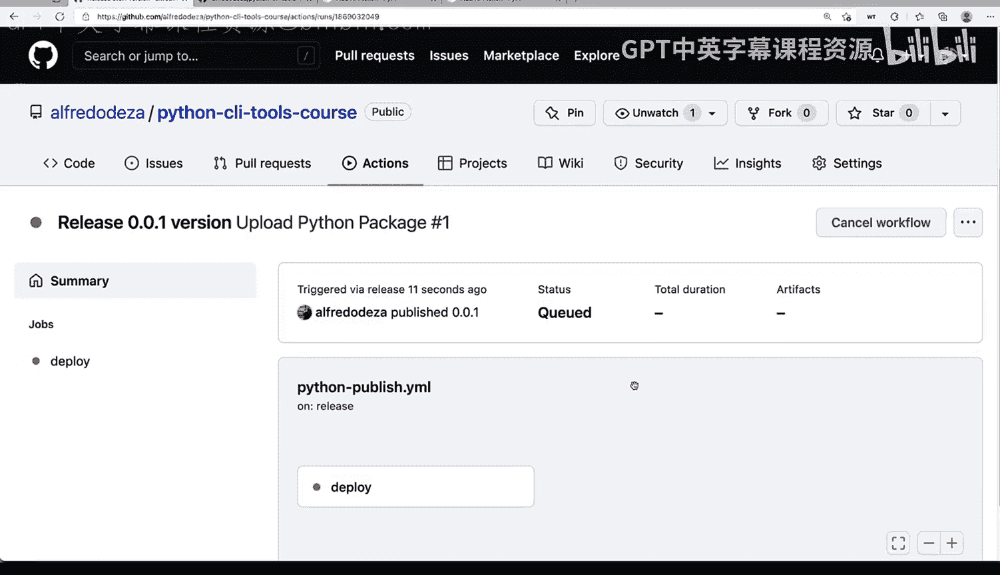
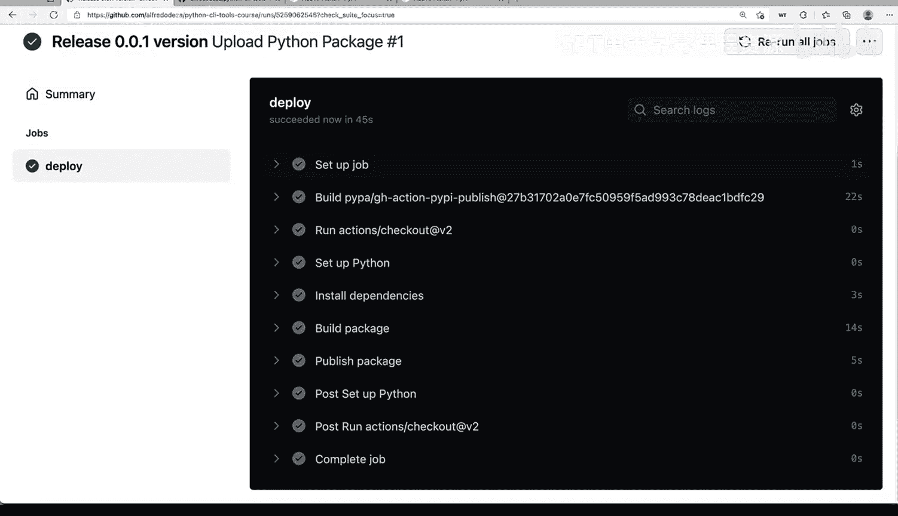
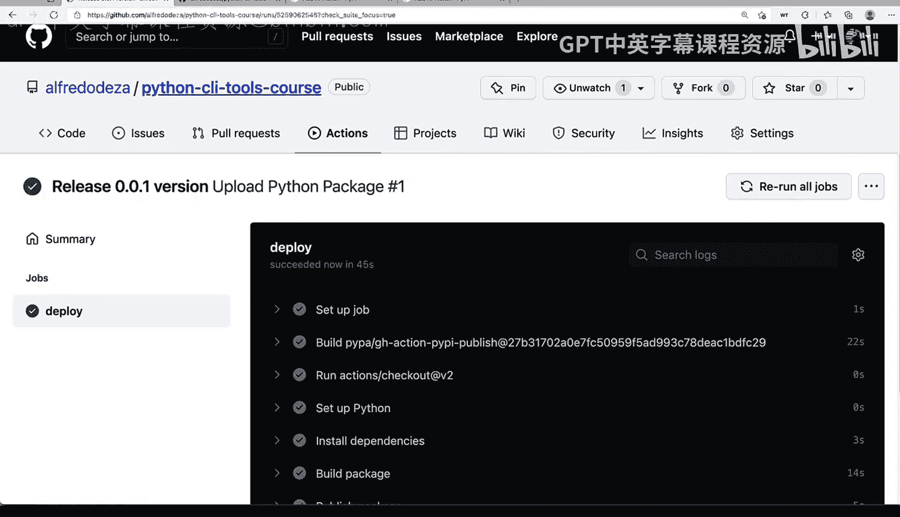
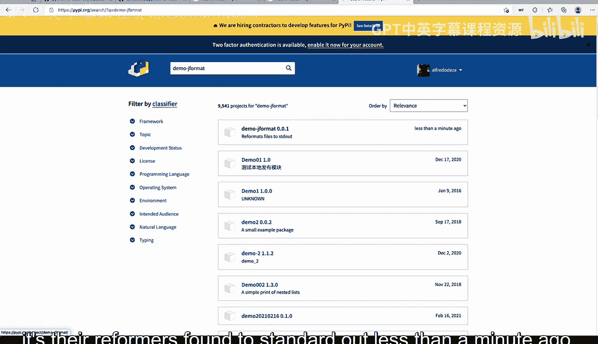
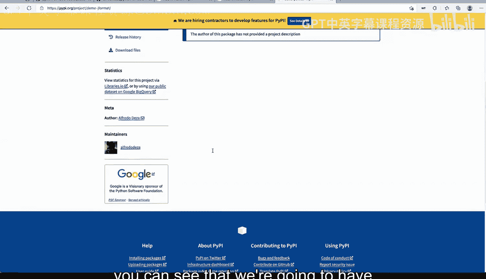
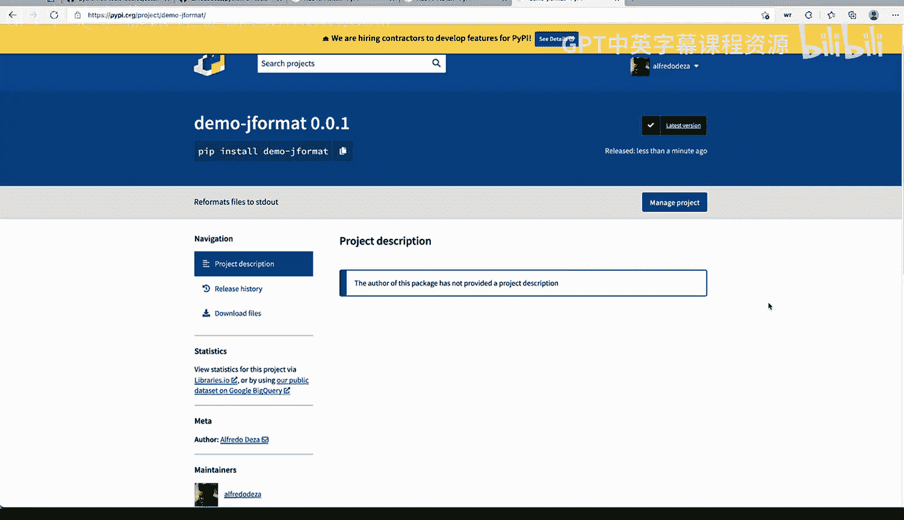
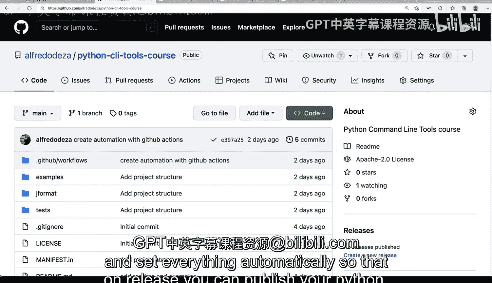

# 杜克大学｜Python、Bash和SQL数据工程基础2-4Python Bash and SQL Essentials for Data Engineering p175 41_04_05_Python项目自动化发布.zh_en -BV1XS421X7tw_p175-

Now we're finally ready to start publishing our project。 We're going to do some automation。

 this is probably going to take or involve both several steps。

 this is the main repository for this course where we have everything ready。

 we have our Github automation with Github actions and where we have all of our things including a little little tool here called J format。

 Now before you do that you have to youll have to go to the Python package index。

 make sure you log in， you register in this case I already have an account I have many different projects and you're going to create a token you're going to go to account settings。

And the token is going to allow you to set some automation。

So were we're going to do tokens all the way here at API token。

 you're going to give it a name So in this like you can give anything meaningful， So say。

 for example， GiHub project automation。And then youre going you're going to select the scope。

 What is the scope， Well， the scope is like if it's specific to a particular project。

So you can if you've never uploaded the project like see there's a catch 22 here or kind of like a problem here with the scope is that if you've never uploaded the project before this is the first time you have to use entire account which is kind of you know you have to proceed with caution that's all fine but if you have published the project before then you can select like a specific one so I have various different ones so say for example setlo and I can say just for setlo that gives permissions just for that one project in this case you can select entire account add the token and it will something like these will will appear now I've already created that and then you're going to use that for the next step you are going to add this as a secret in your in your account in your repository so let's go back to our repos。

ory over here and we are going to。Add a add a secret。 I'm going to click on settings。

 and I'm going to scroll here。 I'm going to do secrets。And I'm going to select actions。

And then action secret means there's a secret that an action a GitHub action will use and you can see here that already have added a P API token so what you need to do is create a new repository secret put P API token and then paste paste the value here and then add secret and then that's it then you would have you would have these P API token which again came from your account with a proper scope for your whole account so next we are going to go to actions and we're going to add a specific action we're going like we're you already have one that tests that does some things here we're going to click a new workflow。

And we're going to。We're going to do， we're going to use this one。 P Python package。

 Plish a Python package to Ppi on release。 Great。 I'm gonna click on there。

 And the wonderful thing about this is that it comes everything ready and preconfigured。 Now。

 it's only going to happen on a release。 So that's great。 So whenever there's a release。

 I set a release on Gitthub and we'll do that in a second。😊。

This action will manage to publish our package to the Python package index with using the API token。

 and you will see here if I'm scrolling all the way down。You will see。That。

That you will use the Python package in the index API token that's the password it's not really a password it's a token。

 but that's where that comes into play so now that you've saved that and that's available it's all good and you can you can make that happen so this is great and now you're going to start a commit and you're gonna say create publishing action you don't even need to go on the command line tool to release although you may choose to so now we have a Python publish now this one run unless there's a release so you can see here that our workflows are running and the one workflow that is running is the one that is doing the tests so if we click here you will see that Python 38 and 39 are running tests and they're verifying everything's good。

we haven' changed it。 we haven't changed anything with Python yet。 So now next。

 let's create a release。 So how do you create a release。Well。

 what we need to do is go to the main website for here， and then we're going to click on tags。

And then we're going to click on releases and when I create a new release。

 create a new release over here， and I don't have any tags。

 so I'm going to create one for the release so create new tag on publish that's perfect Excel This tag will be created from the target when you publish a release This is going to be release0 that0 that one version this is a an initial an initial release of the demo J format project perfect So now。

So now we're going to publish the release。And the release is done。 So if I go to actions。

We can see now that the upload Python package is running， I'm going to click that。

And this action is already running， it's doing the build process。

And collecting all of the dependencies， packaging everything。

 And it's going to try and you know go through the whole process of packaging the process and publishing that all the way to the Python package index in this case。

 now it's actually doing the build， then it will publish and then post set up to Python。

 there you go， you can see demoj format 0 that' 0 that1。 and that that's going very well。

 it will keep scrolling and the output like the output itself quite a lot。

 But now it will post it to the Python package index and there there we have it successfully done in 45 seconds。

 So if we head over if we head over to here like I didn't show you the name that we've used here and set of the pi。

 we have。

We've used demo J format as the package name I use demo because you know this is an actual demo and I've used version 0 that 0 that1 and the important thing is that I've used my the author email is the one that matches my account on Python package index。

 So if I go to the Python package index。 So if I do Ppi。org and we search for demoj format。

Demo J format that 0 that 001。 It's there Reance filess standard out less than a minute ago。

 if we click there， you can see that we're going to have some information with my account。

 everything is associated with me and there you have it that's how you are going to be able to publish。

 set some automation， get a Github action， create a token on a Python package index and set everything automatically so that on release you can publish your Python。

