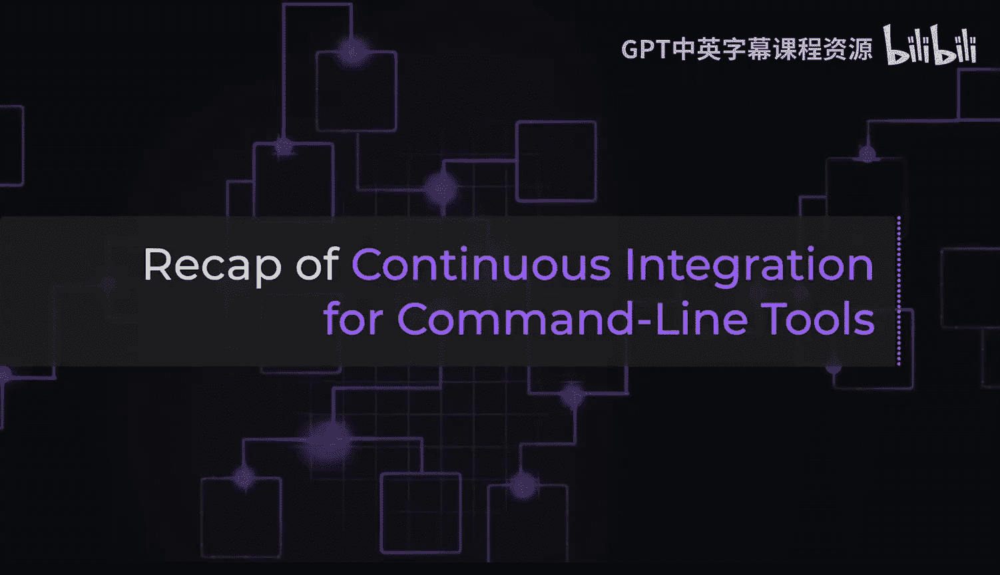

# 杜克大学｜Python、Bash和SQL数据工程基础2-4Python Bash and SQL Essentials for Data Engineering p176 42_04_06_命令行工具持续集成要点回顾.zh_en -BV1XS421X7tw_p176-

In this lesson， we cover different ways that you can automate the continuous integration process and from the release to the LinkedIn to the testing different Python versions。

All of these aspects will help you create a very robust command line tool。

 but actually any other Python software project or in fact any software project at all。

 as long as you have automation as a foundation for your development practices。

 you should feel confident and secure at the time of making changes or even releasing a new version。

