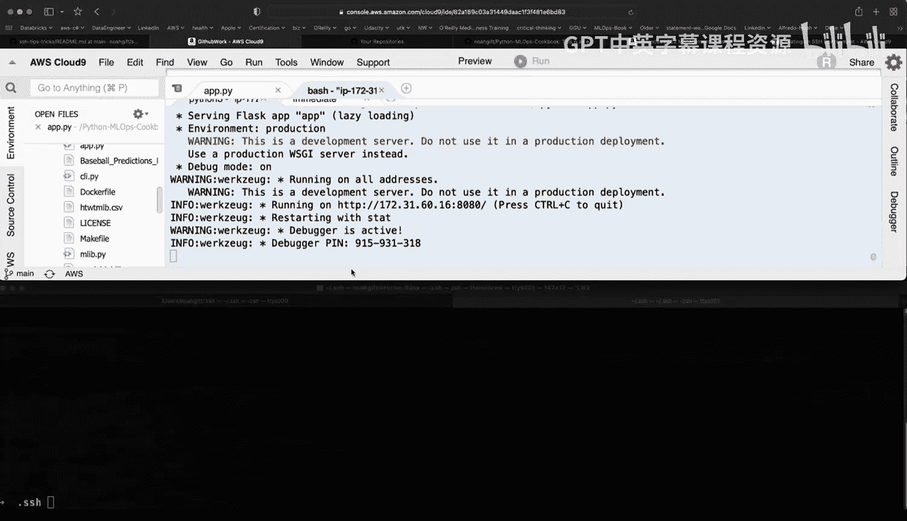
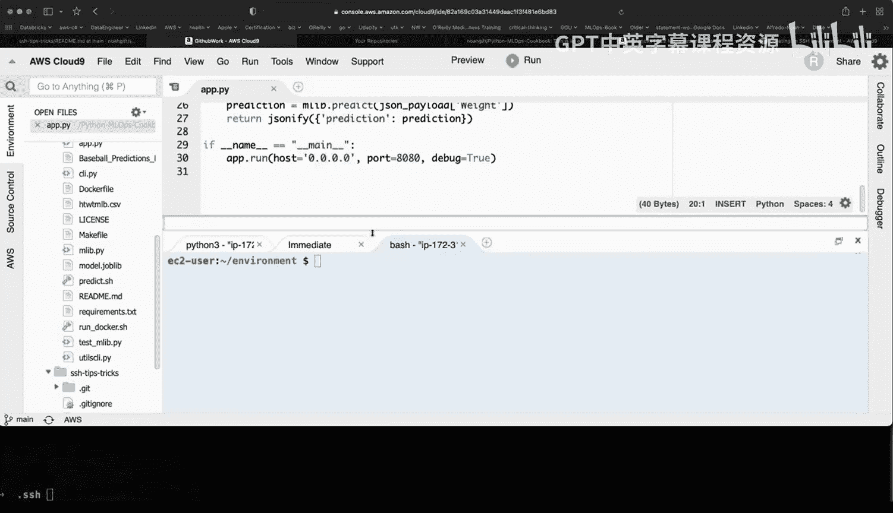
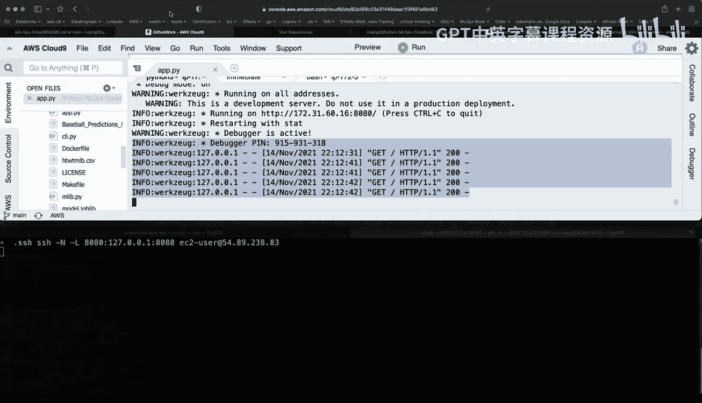
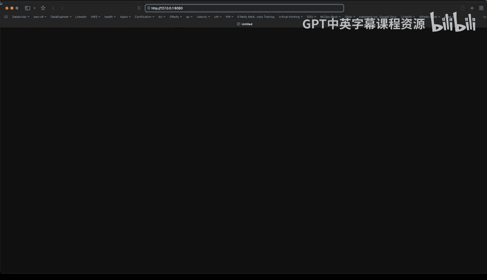
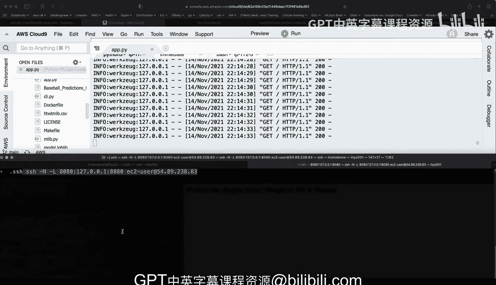

# 杜克大学｜Python、Bash和SQL数据工程基础2-4Python Bash and SQL Essentials for Data Engineering p18 18_01_08_SSH隧道示例演练.zh_en -BV1XS421X7tw_p18-

Let's take a look at this repo Python EmOs cookbook。

 this is a recipe that I have for a book I wrote for O'reilly about operationalizing machine learning models and if you scroll down here。

 one of the things you'll see is that I have a flask web application and I can run it anywhere but when I'm developing it most likely I'd want a way to communicate it with it remotely and so let's go ahead and check that out into our environment here and you can see I've done this。

I have this app running right here and if I scroll down here it's a fairly straightforward application that has a default route that shows you just some information and then later this other route can do machine learning predictions and if we scroll down to the bottom you can see that it runs on port 8080 so if we want to go ahead and take a look at this thing and move it up a little bit I can actually run this in foreground mode by typing Python app。

And once I've got this thing running， if I wanted to test it out。

 I could open up another terminal on this environment and then inside of here。

We should have a couple different shell environments and I could go through here and actually potentially curl that code。

 or if this might be a better place for that terminal here。

 let's close this one up and if I scroll up here and move this up。

 what we can do is I can curl the 127。0。0。1 8080。

There we go， you can see that this is running and I could toggle between these two environments。

 you can see there we go that's the request and if I go back again。

I I can do this over and over again and I'm able to get those requests on this environment now this is a remote server and I don't have access to it because it's only running on port 8080。

So what could I do to remotely access it One of the ways you can remotely access this is use using something called port 4ing and let's go ahead and take a look at what that would look like here's an example of what that would look like notice the command here I say SSH create a connection using these two flags in and L it could be slightly different depending on your operating system and I say listen on my local machine which is 127。

0。0。1 I want to connect this remote port 8080 to my port 8080 and then right here you put in your SSH connection information Now once I do this something very fascinating happens。

If we go through here and we connect this， I can go to a local web browser here。

And let's go ahead and do that。 let's go ahead and open up a web browser and in fact。

 maybe I'll make it a little bit bigger。

And I'll scroll this down here like this and notice what happens。

Is that I'm able to remotely talk to that server so this could be a full copy of a production website for example。

 if you had you know a social network or an e-merce site or a sports site or something like this and you can actually use that remote site for debugging now I'm going through and I'm refreshing this over and over again now let's take a look at what's happening while I do that if I go back here look。

We can see that this is invoking that remote location and this is what's so awesome about using port forwarding is that if I had a bunch of security set up in this environment and I had databases I was communicating with and all kinds of other remote things I can actually remotely develop by using this port forwarding technique so really an extremely powerful technique you could do port forwarding for databases。

 you could do port forwarding for the web services。

 you can do really anything that you can think of that you want to forward to your local port and this is why if you have a mastery of SSH。

 it allows you to do a lot of advanced techniques like running code remotely on a new location。

