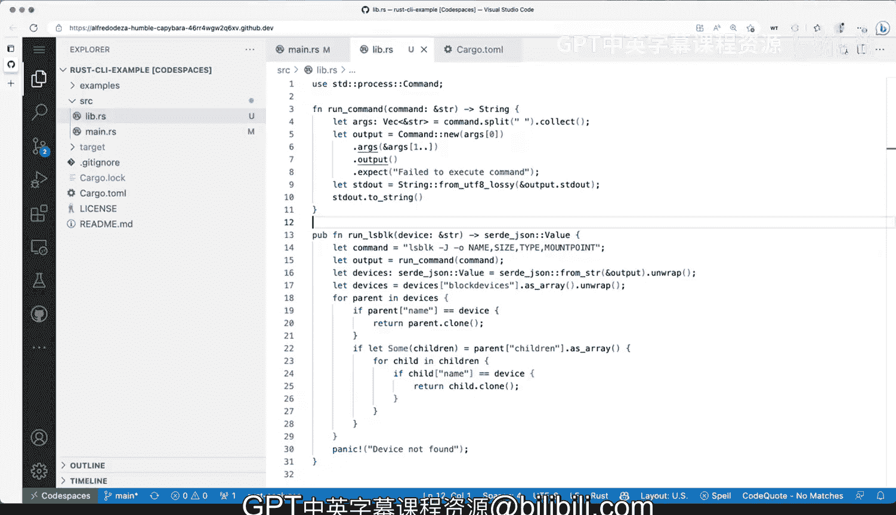

# 杜克大学｜Python、Bash和SQL数据工程基础2-4Python Bash and SQL Essentials for Data Engineering p181 47_04_08_通过模块与库扩展工具功能.zh_en -BV1XS421X7tw_p181-

So far in our tool with that it's going to use rust and going to do LS block。

 it's going to do the implementation of LS block in rust。

 we haven't used any modules we've only been using this main that Rs file that comes by the fold when you do the cargo in it command。

Now this is all fine， this is all good， it works， everything's fine。

 but very much like in our Python application when we're trying to build everything in a single file。

It is okay to have everything in a single file until you start looking to organize things a little bit better and that's what we're going to try to do right now。

 we're going to make these more modular and we're going to start with something that is fairly common in breast applications which is going to add more things to SRC and the first thing we're going to do is add a Lib that R S usually。

Youll have at least mainRS and Libs。 You can have many more and even subdirecties with more modules and more files。

 depending on the organization that you will want。 But we we'll explore a little bit on how modular Ri would look like for what we're trying to do here。

 There's plenty of different options， but we're going to start with the simplest。

 which is just adding a lip that Rs file right here。 So I'm going to go back to mainRS。

 explore what we have， which is let's see run command。

 We have run underscore Alice block and then we have the main function。

 I'm going to leave the main function as is， and I'm going not going touch anything there。

 and I'm going to select everything all the way up and gonna。Cut those contents。

 Now you're going to see that the rest analyzer is going to complain。

 This is problematic because I don' I no longer have access to run underscore Ls block。

 I'm going to go to Lib R S。 I'm going to paste all of the things that I had there。

 and I'm going to save that。I still have these underlines and the reason why I have those underlines is because these are not used。

 Let's see if the L actually tells me something， yes。

 function run command is never used so we we do have the rest analyzer working well for us Okay so let's go back to main that RRS and see what are some of the L things I' going to get for first is coming back here。

 we cannot find run L block in this scope。Okay， so I know I have run L block。

 it is in a different module， so how do I make that work Well。

 if you remember the name of our application， if I go and open the cargo that T file。

 I'm going to move this over here。If I open cargo that。

 you'll see that our package is called block Rs。 So that is what we're gonna use right here。

 and we're going to use block Rs calling double calling there and save it。 Now that's fine。

 but we're still getting these curly underlined。 So why is that Well。

 function run El block is private。 Of course it's private because when when I was using everything in the single file main that Rs。

 the function was not made publicly available。 So let's quickly change that by going to live that Rs find our run L block function and make it public how we make it public。

 Well， we're gonna prefix this with。Pub for sure for public。And when we do that。

 if we go to main that R， we no longer get the curly underline。 and this seems to be good enough。

 So now let's toggle the terminal。And do cargo run， how about SDP1？

And which is our blog device that is not really a blog device and that totally works。 It's fine。

 you know， it took a little bit longer to compile everything and run our application because we made some changes。

 That's fine if I run it again， of course that's going to run pretty fast because everything' is already compiled and behind the scenes rust understands that I don't need to compile anything again。

 so now we're in a good spot we have two modules and here you can keep you can keep modularizing and keep making these things slightly better。

 but in more organized as you grow。 but so far this is good enough and will give us the ability of keep expanding。

 Now these minimal way of modularizing is a good starting point and later in our lessons we'll see how we can。

This a step further but for now you saw how we can actually use block R。

 the package name right there， straight to to use run LS block we could actually also define run LS block at the very top and make that work the way we would do that is by going to the very top here which is also something that you might want to try to do especially if you want to make clear what are some of the things that you're coming you're using that are coming from another module so you can say use block arrest double colon and then run LS block so I'm going to do that add the semicolon there and then when I come here I'm going to use the function directly so I'm going to remove that block R and double column。

And then that way these line stays the same and I'm explicit about what am I using here。

 I could also do the same thing with clap and actually let's go ahead and do that so so that we can provide more clarity as to what are the things that we're doing。

 I actually prefer to use or define what I'm using externally versus what I'm using internally before before the first external then the internal one so this is just a perform preference。

 but it helps keep things organized， we can say clap and we can say。Let's use app。

And then here we can just do this and perfect。 So that is a little bit more organized。

 We're a little bit more explicit as to what is it that we're using here at the very top and things are stain unchanged on our output call there and our things are a slightly more organized because we have a Lib that are as module。

 So that is a very straightforward very introductory way on how we can organize things in a rust command line tool that will be using more it's a very good step in stone to try to build more complexity at more files later on。

