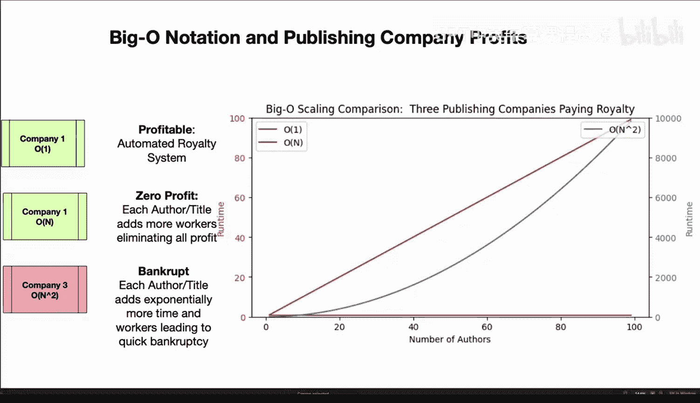
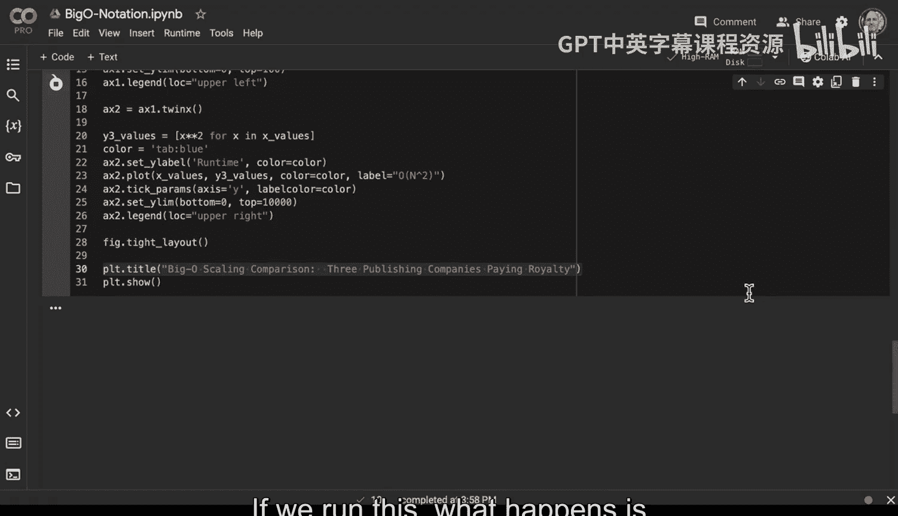
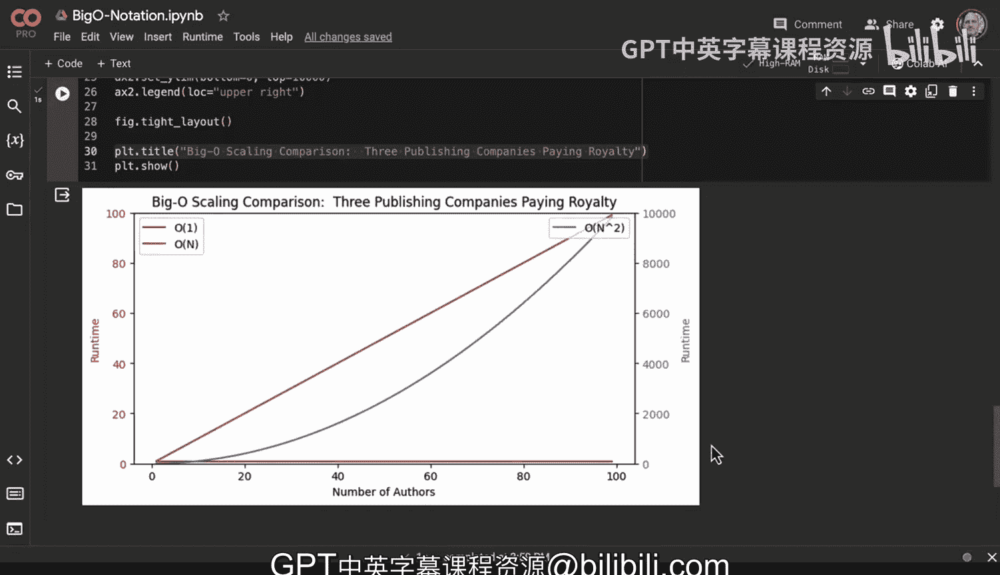

# 杜克大学｜Python、Bash和SQL数据工程基础2-4Python Bash and SQL Essentials for Data Engineering p184 50_04_02_大O表示法最终挑战详解.zh_en -BV1XS421X7tw_p184-

Yeah。This is a big O notation simulation that I'm going to talk about about a publishing company and the profits that are generated。

 depending on how efficient the company is。 It's really common to hear from someone new to programming that big O notation isn't that big of a deal and I don't understand why people are so obsessed with it。

 I wanted to demonstrate why it is a big deal。 And in fact。

 it could either have a big effect like a bankruptcy or in the effect of over to the one。

 it could cause a company to be profitable。 So it's really important to know these concepts。

 I'm going to talk about this scenario here that I'm going to show the code。 So first up here。

 we have this company one here， which is owe to the one。

 it means that they have an automated royalty system。

 So no matter how many authors come onto their system， whether it's 100 or 1000 or 10000。

 It's still the same fixed amount of time because they have a process that's essentially completely automated。

 and it's a SQL query or it's some。Automated system where it doesn't matter how many authors are in the system。

 We have a second system which has zero profit。 This company。

 One of the problems is every time they add a new author or they make a new book or some kind of video course。

 they have to add more workers and eventually what happens is even though they're adding more authors and more titles they're adding more workers。

 So all the profit actually goes to the work。 So they have an inefficient system。

 Finally in company3 every time they add an author or title， it adds exponentially more work。

 So maybe two workers per author or two workers per title。

 and basically the more work they get the quicker they go bankrupt。

 And so you can see this on this graph here where there's two different access on the left here。

 we have the number of authors here at the very bottom O to the one。

 you can see it doesn't matter you can have 100 authors or one author。

 you're always gonna process automatically through let's say a SQ query or some kind of automated system In the case of the linear system here。

 to the。You can see that basically it gets longer and longer and longer every time you add more work。

 and so the system is not very efficient。 And then in the case of this other access。

 you can see it's an exponential relationship。 And so it causes a huge problem in this particular company and basically they instantly go bankrupt because of how inefficient their process is so big O notation is important。

 let's go ahead and dive into some code here。

Now， here's some Python code where I demonstrate what happens here。 First up。

 we have some randomness。 We have some time。 And so let's imagine this is company number one number of authors。

 And notice that it's always paying the same。 There's a fixed amount of time。

 So we can see here this is a great simulation to represent that。 Now。

 with this particular simulation。 we're going to do a for loop， which means， again。

Every time we add a new author， thingss going to add a little bit more work。

 eventually you know there's a linear relationship。 And then the third one。

 which things get very you know computationally expensive， is the in squared here。

 exponential relationship and things get longer and longer。 So it's also nice to see it yourself。

 So first up， we have this fixed time here。 So we first run this simulation here。

 So let's let's instantiate the code。 run this。 And you can see pain royalty。

 it's always going be the same。 no matter how many authors， in fact， we could do 100 authors。

 it's going to be the same， it doesn't matter， it's always going to be one second。 Now。

 in the other scenario here with a linear relationship。

 it's going get longer and longer we're sleeping。 We're doing some work right So this is not in a very efficient process。

 And then the one that's really terrible is the exponential relationship。 In this case， again。

 imagine your sound publishing company and the more work you get the worst things get an exponentially grows eventually。

With only a few additional authors or a few different properties you're going to go out of work very quickly。

 you're going to go into bankruptcy And so that's why it's so important to be aware of big O notation Now in terms of the plotting here。

 let's take a look here we have map plototlib and we go through here and we do a little simulation where what we say is we have the number of authors here and then what we do is we run each of these again。

 So we have in this case the exponential relationship right here， we also have the linear。

 we have the fixed big O notation at a title here that says big O scaling comparison3 publishing companies paying royalty So if we run this what happens is it goes through here and it shows the different relationship So again we have the fixed relationship where it doesn't matter how many authors they have a SQL query instantly they pay net 30 plus one etc a linear relationship right there's a very inefficient system。

 the more authors， a more titles the longer it is。

For them to get paid and then in the case of the Doomsday scenario。

 you have extremely inefficient system that adds multiple workers per new author or title that you bring on board。

 so even though it can be tempting to say， you know math doesn't matter。

 exponential relationships don't matter， it does matter and in fact it could be the difference between a company going out of business or being profitable in the future。

 so please pay attention to big out notation。

