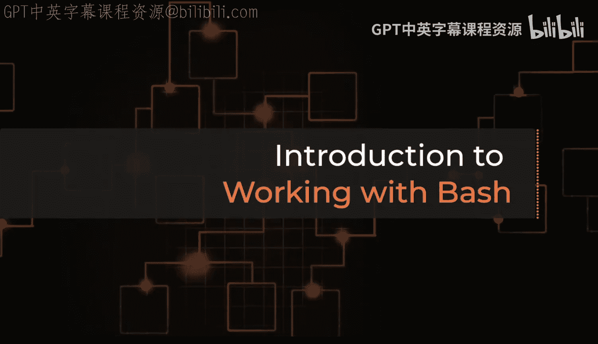

# 杜克大学｜Python、Bash和SQL数据工程基础2-4Python Bash and SQL Essentials for Data Engineering p19 19_02_02_Bash操作入门.zh_en -BV1XS421X7tw_p19-

This week， you'll learn to configure Ba scripts to enhance and control your Linux development environment。

 as well as production systems。 You'll also learn about shell variables and how to effectively use standard in and standard out。

😊，Let's go over the week 2 learning objectives。 You'll be able to configure the shell environment。

You'll also be able to utilize shell variables to solve common Linux workflow problems。

 You learn how to explain the use of both standard in and standard out and use those to stream effectively with data。

