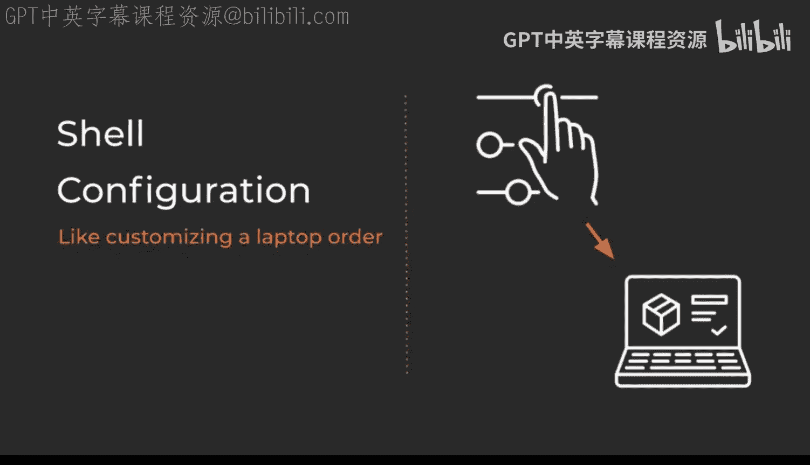
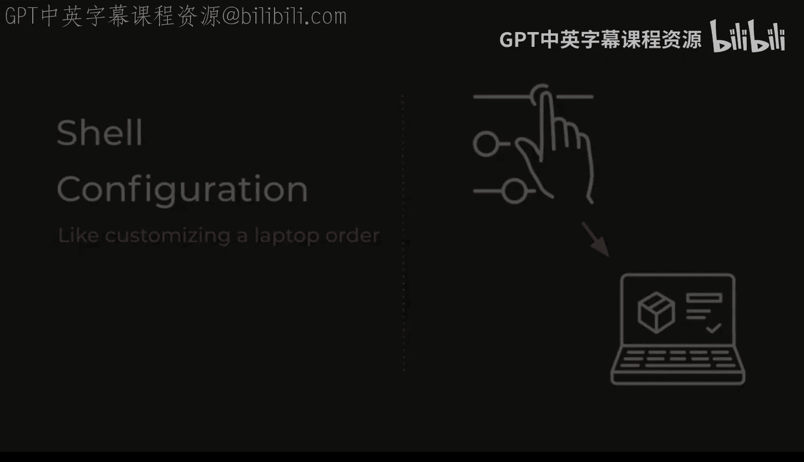

# 杜克大学｜Python、Bash和SQL数据工程基础2-4Python Bash and SQL Essentials for Data Engineering p20 20_02_03_Bash Shell环境配置简介.zh_en -BV1XS421X7tw_p20-

Today we're going to talk about how to configure your shell environment。

 turns out that what is old is new again， and we're really in a resurgence of being able to use Linux to build microservices。

 built containers and being able to configure your environment， your Bsh RRC file。

 maybe your ZSHRC file are critical to being really an expert in data engineering and expert in MLOs。

 an expert in cloud computing， so let's go ahead and get started and make sure you're an expert in configuring your BS environment。

First we're going to talk about how to configure the shell environment in lesson one。

 let's cover the key learning objectives for this lesson。

We're going to talk through why shell config files are important and what they are and some of the things you can do with them。

 like configure your shell environment so that every time you open up a terminal。

 it does the correct thing。We'll also talk about BashRC。

 which is really the most common file that you'll change when you're editing your environment。

 it's available on pretty much every system that you would log into in the cloud and also in potentially a Docker environment or a virtual machine。

Finally we'll talk about some of the really evolving technologies like dot ZsHRC files used through third party libraries like OMI ZSH。

 this is really an emerging trend for developers who want to fully customize their workflow and enhance it in a way that really suits their needs。

So let's talk through this a little bit about you know why would you care about shell configuration really it's a lot like customizing a laptop order。

 let's say you want to order the latest laptop a lot of times you'll pick the amount of RA maybe the kind of GPU you want to use the size of the screen。

 it's very similar when you're configuring your shell environment and that you want to build something that fits your needs so that you can be the most productive person when you're developing a project。

 so that's really the analogy that I would recommend thinking about your shell configuration so let's go ahead and get started。

