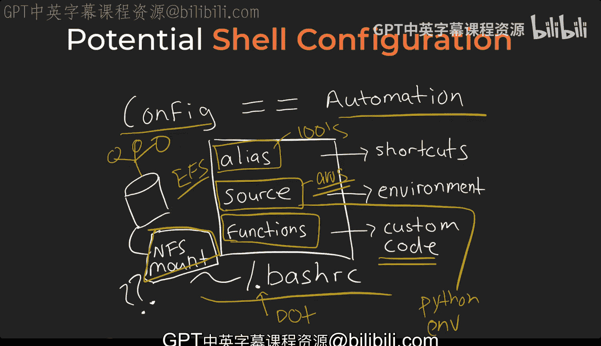

# 杜克大学｜Python、Bash和SQL数据工程基础2-4Python Bash and SQL Essentials for Data Engineering p21 21_02_04_Shell配置文件解析.zh_en -BV1XS421X7tw_p21-

Let's dive in a little bit into this concept of a shell configuration file。

ItIn a way seems more simple than it really is when I was working in film for decades。

 one of the things that was critical to everybody in the film。

 whether it was Disney or Sony or wherever I worked where we had a large centralized file system was that everybody had similar configuration files so that they could mount their home directory and that they also could work on common commands and common shortcuts so really you could say that film production can't exist without some form of shell configuration file it really is almost impossible。

 likewise we're moving into a new era where with big data。

 the concept of a distributed file system is really back in vogue and you can see this with Amazon it has elastic file system is a really good example Google has also a distributed file system you can mount and what's beautiful about this is that that mountpoint you can put a configuration file so that every time you log into a。

On the cluster or another person needs to maybe log into another location。

 you have access to everything。 And this is really like almost like bookmarks with a browser where you don't have to actually go back and look up everything again。

 So really a shell configuration file is a massive form of automation。

 So let's dive a little bit into a notepad here where I'm going to walk you through some of the key aspects of a shell configuration file。

Let's take a look at this potential configuration file here in Tilde slash dotbshRC。

 so that Tilda stands for the home directory of the user and the slash means that it's going to be inside this directory and there's an invisible file called dot BshRC。

 The reason this is invisible is because it has a dot in front of it。

 So that's one way you can do this in any kind of a shell environment you put a dot in front of it and by default it won't show up if you're typing the LS command or if you open up maybe some kind of a guI tool that will edit the file system。

Now let's look at really in a nutshell， what are we talking about when we talking about a config file。

 a config file is automation。 That's the simplest way to explain it without config files。

 there's all these steps you have to do that can be almost incomprehensible when you're dealing with Linux So the first thing you'll see in a configuration file is this concept of an alias Now an alias is very similar to know maybe a bookmark in your web browser and what it does is it allows you to type in a shortcut and then that shortcut will lead you to some path or to a command or to some other resource and if you're an expert in the shell what you'll find yourself doing is potentially developing maybe hundreds of custom aliases throughout your duration of time at a certain company or in your own personal projects and this is just a form of automation。

And what's really handy is if you use a centralized mountpoint like I've talked about earlier。

 Amazon has something called elasticastic file system， Google has a network file system。

 every cloud platform at some point has some access to a centralized file system in pure Linux environments they have centralized file systems the concept here is that any machine you log into in the network。

 so really at a cluster level， all of those machines will all have the exact same user experience and this is really handy because it means that you don't have to set everything up again and again and again and there's so many things that need to be done to a shell-based environment that really a centralized mountpoint is one of the ways that you can automate things completely Now another thing you may see in a lot of environments and we'll take a look at this a little bit later。

Is that when you source a BshRC file on login， it itself will source other files。

 and so this could be in a cloud-based environment， for example， on AWS。

 they may source a ton of custom commands， and they may have a bunch of custom things that are embedded inside of your environment and all those things are really built there for you and they're automated into your BRC file。

So this is really， really common， this also works the same way with things like the Python virtual environment。

 which you'll see。When you're developing with Python is that they themselves will source a bash file and that will actually set everything up so that there's a certain library path where you'll install all your packages so really this is an important concept as well with configuration files finally as you get more advanced potentially after you take this course you'll find yourself building little bash functions and that custom code can be invaluable it could do things like maybe mount a file system and do some things to that file system it could perform deep learning。

 it could do maybe some kind of data cleaning operation。

 know really the sky is the limit in terms of the custom code and you can actually source that custom code inside of your bash RRC file so really again to summarize here a configuration file is the basis of automation in a shell environment and it allows you to do very advanced things and it really all develop。

ers that use data， they use machine learning should have some level of competency with configuring your BacheRC。

