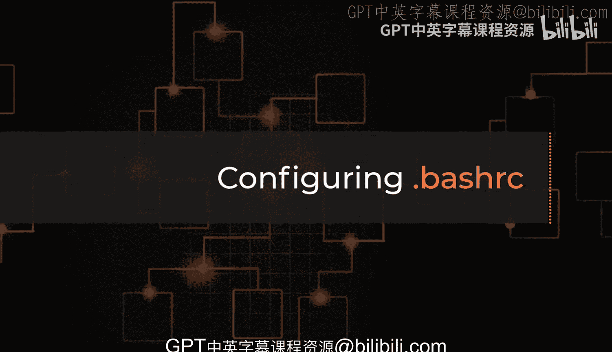
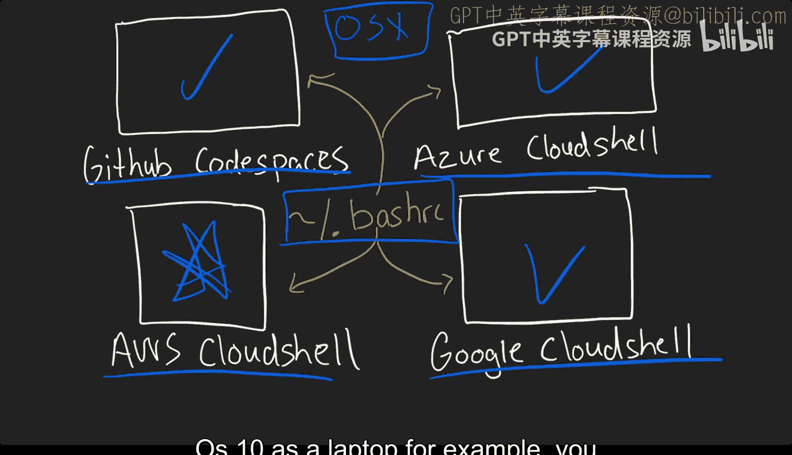
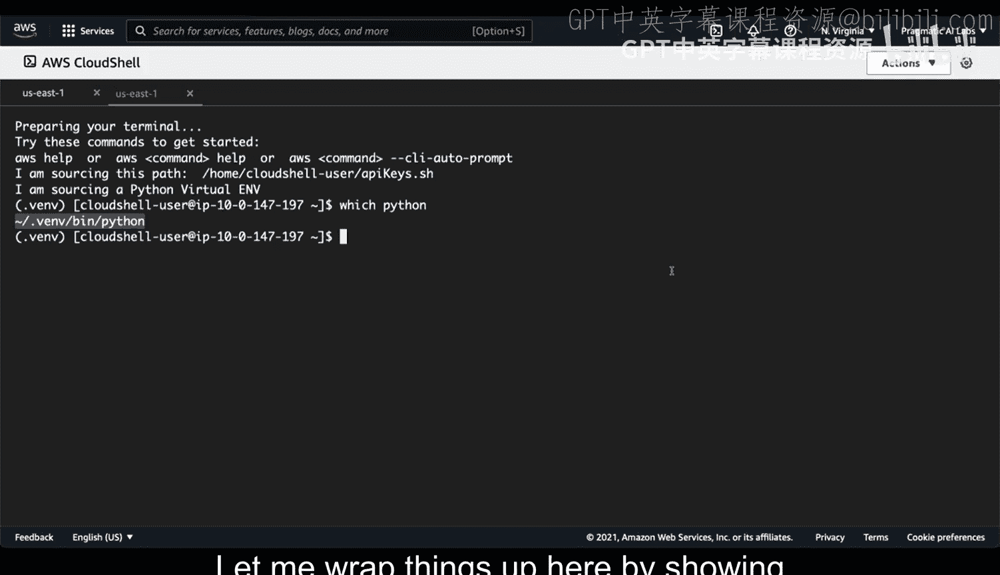
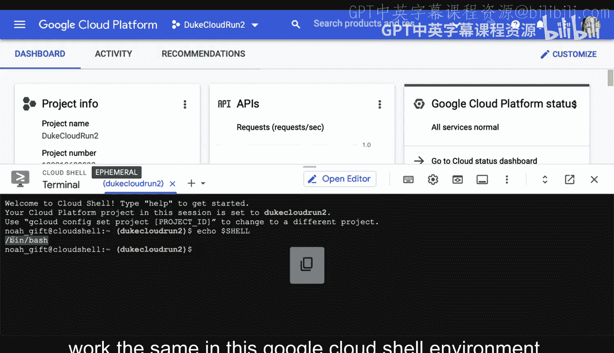
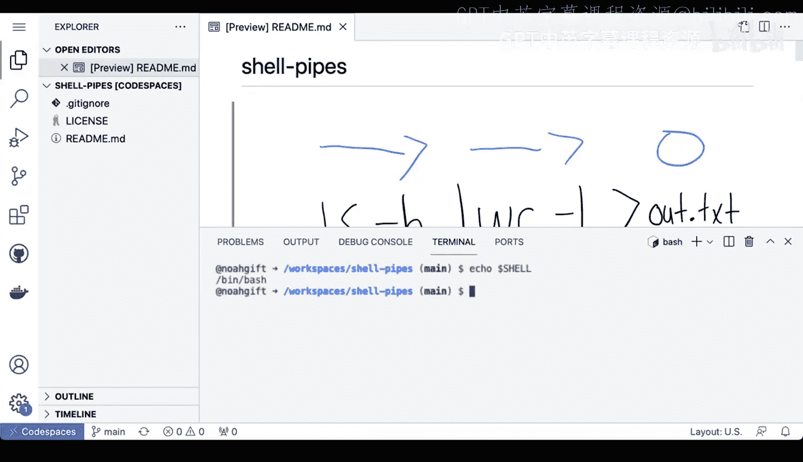
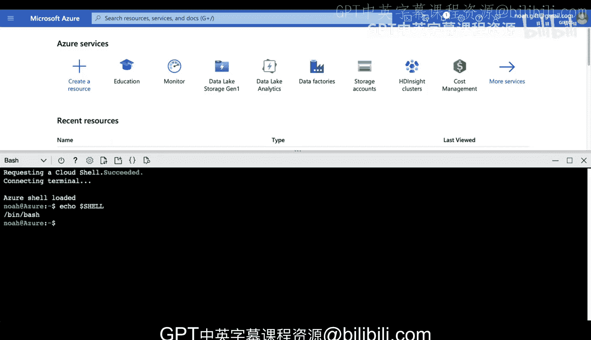

# 杜克大学｜Python、Bash和SQL数据工程基础2-4Python Bash and SQL Essentials for Data Engineering p22 22_02_05_配置Bashrc.zh_en -BV1XS421X7tw_p22-

Let's take a look at this BshRC file concept and see it's really about the fruit from the same tree In this case。

 the Bsh RRC is the tree and you notice that in this environment here AWs Cloudhell in this environment Gitthub codespaces in this environment。

 Azure Cloudhell also Google Cloudhell every single one of them uses the BRC file to configure the environment and also each of them has a little bit of a secret sauce that does something special to that unique environment So we're going to primarily focus on this environment here AW Cloud shellll。

 but I'll also show a little bit of Github codespaces。

 a little bit of Azure Cloud shellll and a little bit of Google Cloud shellll just to show you how once you understand the single BshRC file you can really use it for everything and also what's great to know about BshRC is that if you're using OS10 as a laptop for example。

 you can also use those same techniques。

Let's go and get started。Here we are in the AWS Cloud Shell。

 it's in my AWS account and I went over to this icon here and I selected and it opened up a new Cloud Shell What's something that I would recommend doing when you first open any Cloud shellll environment is type in echocho。

Dollar sign shell like this。 And this will tell us that we're using the ba shell。

 And once we know that we're using the bash shell， I would type in LS dash L tilde slash。

 and this will let us see what's inside of。LSla tilda/ and this will show us what's inside of the home directory and you notice here that there's a bash history file。

 there's a bash logout， a bash profile， these are all things that you could edit if you needed to。

 but most people will edit the BRC because it's a centralized spot to store things that you're going to use in your interactive shell。

Now， what I'll do here is actually open up using the Vm file that file。 and we'll type in BshRC。

 and notice here we've got our ability to edit custom things。

 You can see the AWs itself right here has user local bin AWS Compr。

 They have all kinds of userspec alias and functions here that they've created for us in the cloud channel environment。

 but we're gonna actually go to customize us even further and we're going add in our own aliases。

 So let's let's do one here， which is let's add in alias and these are just shortcuts。

 So we can type in alias and we'll call this。How about source？Code like that。

 It looks like a good alias And then this will be anything that's in this source directory。

 this will actually get us right to there。 And if I type in C into that there we go。

 This looks like a great shortcut。 So I'll go ahead and close that and now if I want to source it all I need to do is open up a new tab here。

 which will spawn a new interactive shell and it'll read that config file in。There we go。

 and now if I type in alias。Notice that there's a new alias called source code right here。

 and then if I just type in SRC code。Oh it says that that directory doesn't exist。

 So if I do a command， it doesn't exist， I'm going to have to fix that。

 So all I have to do is just type in maketer tilda SRC there we go。

 And now if I type in source code there we go and we type in PwD you can see that I'm automatically changing to that directory so you can see how this can be really handy to add aliases to your environment so that you don't have to type as much Now one other thing that's really important to call out here。

Is that it's very common to need to configure API keys and this happens all the time when I'm working with students or I'm working with my own projects。

 and so what I'm going to do here is I'm going to create an empty file here called API。Keys。sh。

And so what we can do is actually inside of this file。

I'll just edit it real quick and just put a couple of just you know pretend variables so I'm going to type in export you know secret one like this and this will just be1。

2，3 these are kind of pretend API keys and we can call this secret2 this could be anything from Slackbot API key to AWS API keys and we'll call this ABC there we go and then what we can do and if I wanted to you just build this up with more and more stuff is every time I want to launch into this environment what I could do is I could essentially put this path in this API keys file。

All within my my batchsh R C file so that it would always be loaded for any kind of work that I needed to do。

 So how would we do this pretty simple， I would just go through here and and basically create this path so we can actually test this out from the terminal We could do this。

 We could type in export。You know， the path。To API。Keys or something like this。And we could do this。

 We could just say。U。Home users。And then we could type in API keys like that， that looks good。

 and then if I type in path to API keys。We could do that to。A PI。Let's say echocho path2。APpiI keys。

There we go and we see that that path has actually been been set up and it's。And it's good to go。

If I put a dollar sign， there we go， so the dollar sign is the key here because the dollar sign allows us。

To actually echo out what that variable is。We could do something very。

 very similar inside of our Bsh RRC file， so let's go ahead and do that。

 let's go ahead and go Vim Tilda。baash RRC。There we go。And then we'll add a variable here。

 so let's just add a。Let's add a path actually would be a good way to do it。

 and then we could add a new command， which is source API keys。Pretty simple to do。

 We just type in the command source。 and in fact， we could even put a little command in here that says echo。

 I am sourcing。This path。And we could do this。Doar sign。Spaceed door signed。Path。Two API keys。

 So this just gives us a little bit of context So we remember it， and then I just source it。

 and I just source path。Dollar sign path to API keys， Do sign。

 we could just copy this to make it simpler， there we go。

Perfect now all I need to do is just reload this file。

 although let's just be lazy and actually just open up a new tab so that it'll source it。

And there you go， it says I'm sourcing this path and now what does that mean exactly， well。

 if we type in echo。Secret dollar sign。Secret。Secret 1。There we go。

 It's automatically in our environment so I can start using it if I start writing Python code or if I write a bash file that needs to actually use that API key so this is a really clever way to actually inject secrets into your BshRC file now let me show you one last trick here which is what something I do a lot is if we want to use Python which is very common for data engineering and I type in Python Python3 M V E and V Tilde V E and V like this。

 this will actually create a virtual environments， here we go， and then if I source it。

And I put in this virtual environment notice it's the same style， right。

 I'm sourcing literally a shell script in fact。For fun。

 let's actually look at that file let's actually look and see what's inside of there how you can see you can source other environments now what this does is really is just remembering paths so that we can automatically load packages in Python into a particular directory so I'm going go through here and I'm going to I'm going to put this command right here into my Bsh RRC file and this is a neat little trick because now I don't have to source it every time I load my Python environment so let's go ahead and do that let's go to Vim again go to BshRC file here。

And we'll go to the very bottom of our file， and we'll go here and we'll say， you know， sourcing。

Python， virtual environment。And we can do the same thing。 We can add a little command here that says。

 you know， I am sourcing。A Python virtual environment。There we go。

And we could add the path or whatever we wanted to。

 but we're just going to keep it simple and just add that inside。There we go。

 And now what's great about this is again， I can be lazy and I can just basically close all the shells if I wanted to and just open up a new one and notice it says I'm sourcing those secrets and I'm also sourcing my Python virtual environment and look how do we know because it changed our shell prompt here which is this is the shell prompt So what I can do to verify this is type in which Python great now we've got Python here So in a nutshell mastering bash RRC is a huge win for any data engineer and it's something that you can do really within 10 minutes you just need to know a few things like aliass you need to know variables and you need to know how to source things once you got that down you're really good to go Now let me wrap things up here by showing you other cloud environment。

 So I'm going to go here and look at Google Cloud and look at this if we want to really verify what we're doing here look same thing。

Shell。There we go。 So we know everything we did is going to work the same in this Google Cloud shell environment。

 Now let's go over to Github code spaces。 Let's take a look at this and we'll also do the same thing。

 We'll type in echo。

Dollar sign shell。Ben Bsh， we know everything is going to work the same here。 Likewise。

 we can go to Azure Cloud Shell。 We can also take a look。 we can take an echo Do sign shell。

 the exact same thing。 So really， even though these are vastly different environments that you have a common execution environment here with Bsh that really it will let you easily run different commands And once you' got the hang of this。

 really it's a great way to feel very comfortable in a brand new environment。😊。

