# 杜克大学｜Python、Bash和SQL数据工程基础2-4Python Bash and SQL Essentials for Data Engineering p23 23_02_06_配置Zshrc与第三方工具Oh My Zsh.zh_en -BV1XS421X7tw_p23-

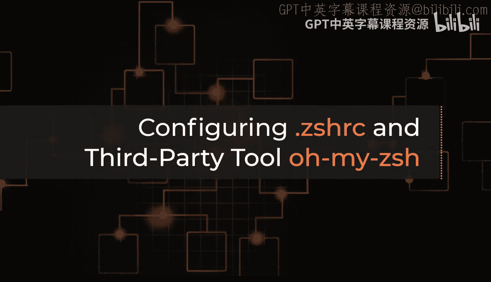

Let's take a look at what you can do on your local machine as well。

 This is really common as a OS10 developer to go and configure your environment so that it's a little more fancy and it can do more things and in particular a very common thirdpart tool is O my ZSH and let's just take a look at some of the things you can do with it so the main thing that you can do is that there are a bunch of plugins and also themes here that really help you do things quickly by using the Z shellll and in particular if we scroll down here all you need to do to get started is to run this command so let's go ahead and do this I'm going to go behind here and take our terminal out and here we go here's like a typical bash shell and if I go through here and I run this command you can see that in my case I've already got it installed and so I don't need to install it again but you could actually go through and do the installation。

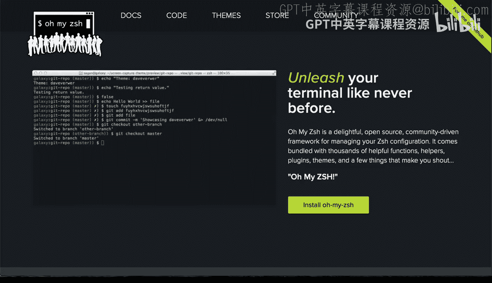

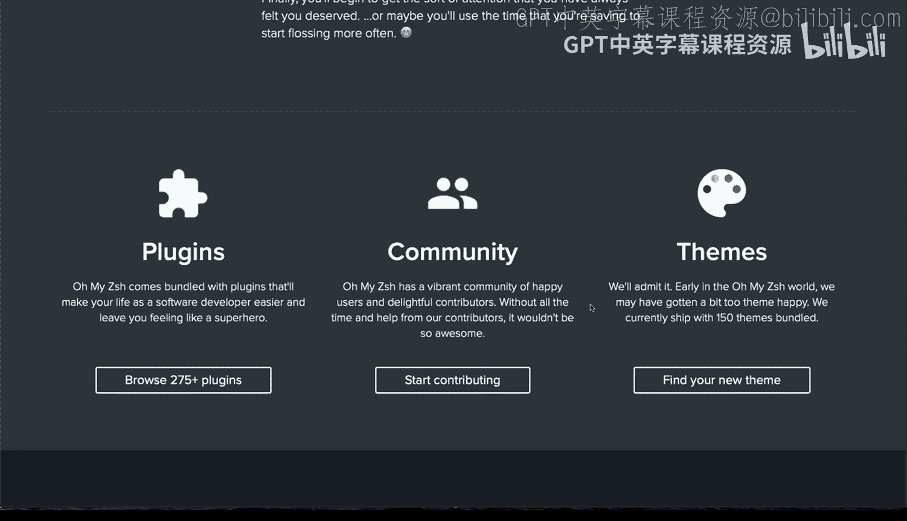

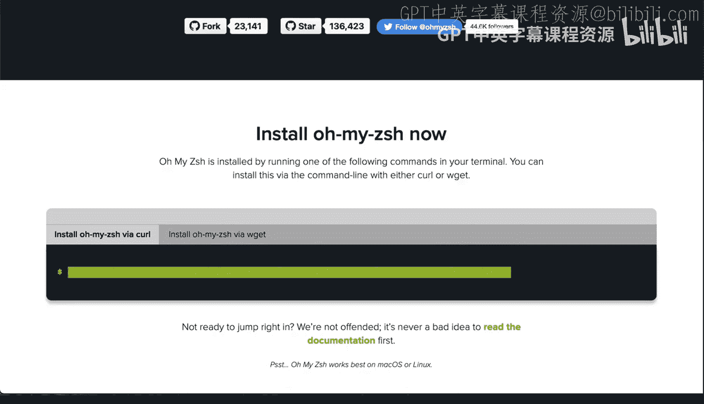

Yourself， if it's not installed and notice what it'll say is that once you've got this configured then you can go through and edit basically this file right here so let's go ahead and switch gears here and take a look at that so if we go through there and we type in echo dollar sign shell here you can see that yes in fact that is true and if I want to go through here and look at this file here we can actually go go in and take a look at it so let's go ahead and do an LS let's just change into that directory and if I do LS LA you can see that there's a bunch of stuff inside of this O myzshH directory and in fact if we go into plugins you can see there's a bunch of plugins as well so there's tons and tons of things you can do that will enhance your development environment。

The big thing， though， that I want to start with is that the default changes of the ZSH environment using O my ZsH allows you to do things like this。

 So if I type in a print working directory， notice that I can just type in a path and it'll change without me needing to type in the C command。

 So this is really handy because just saves you a lot of typing so。

If want to go to the root directory there we go go to the root。 I want to type in Cd。

 it goes back to the home directory。 if I go to bash though and and we look at a typical bashtion environment if I just type in temp。

 it says nope sorry you know it's a directory you can't do that So there's some automation here that's really。

 really handy that you get automatically the other thing that you can do is we can actually look inside of the history as well so let's go ahead and take a look at history and notice here that wow we've got 10000 lines of history because I use some of the fancy defaults here with oh my Zsh if I go to a normal bash shell。

 we only got a little bit of history so basically there's a bunch of default options here that are that are really slick and if we want to edit this further we could go to vimtilda zRC and this file will contain all of the different things that I would need to do to tweak my environment Now let's take a look at some of the things that this thing can do So first。

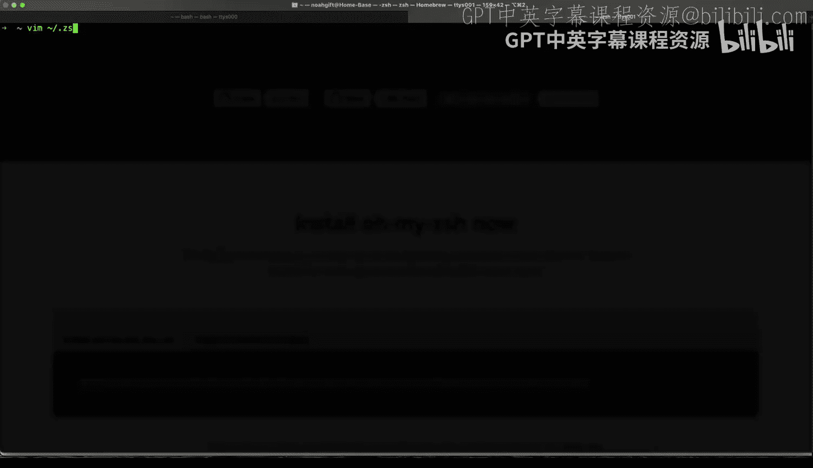

We have this。 This allows us to use O my ZH。 This is a theme。

 So if I wanted to change colors or something else， the prompt。 And then notice here。

 these are the plugins。 So I'm using the Git plugin。 I'm using the Pip plugin。 I'm using Python。

 and I'm using Docker。 And what's awesome about this is it will do a bunch of auto completion for me。

 so。😊。

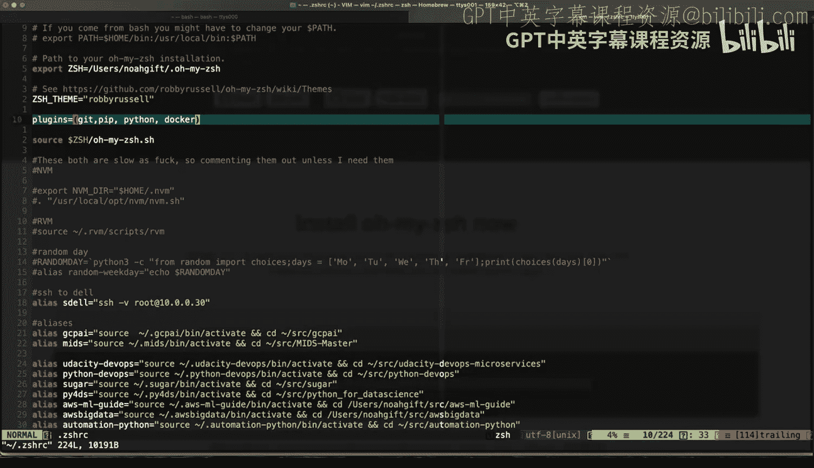

For example， if I go into， let's go into a source directory here and let's just pick a project。

 let's go to how about a Social power MBA。And and notice here that automatically it's able to detect that I'm in a again environment and gives me these fancy gi commands here。

 So that's kind of the power of using these plugins is this really cool automation and。😊。

In cool theming behind things。 Now， the other thing I can do。

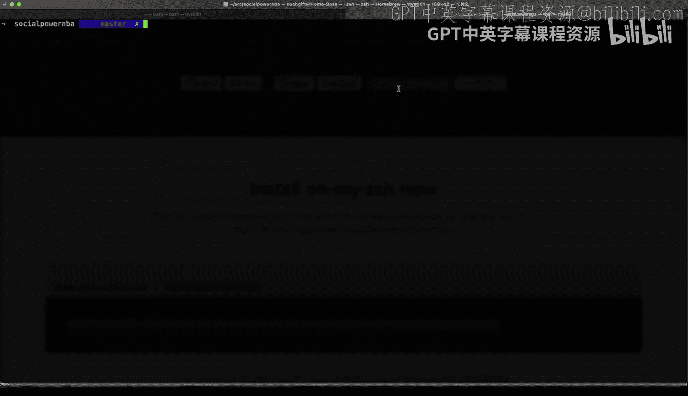

If I go back to this file here is I can also add other plugins so let's go ahead and try that out so lets let's take a look at what plugins are available via O my ZSH here and we'll go back up here we'll bring this up and see let's see what plugins here we go see all the plugins and notice here that we've got tons and tons and tons of plugins that are available The one that I think would be a cool one is AWS I use AWS a lot let's go ahead and take a look at this there we go all I need to do to add completion for the AWS commandlan tool and a few other utilities is to add this in at AWS so let's go and try that out so I'm gonna go back here。

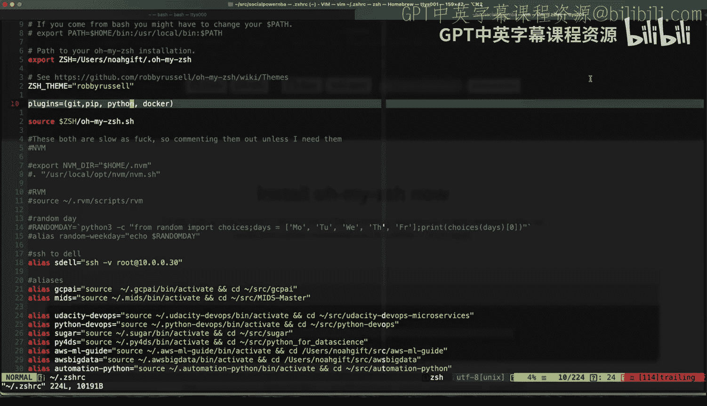

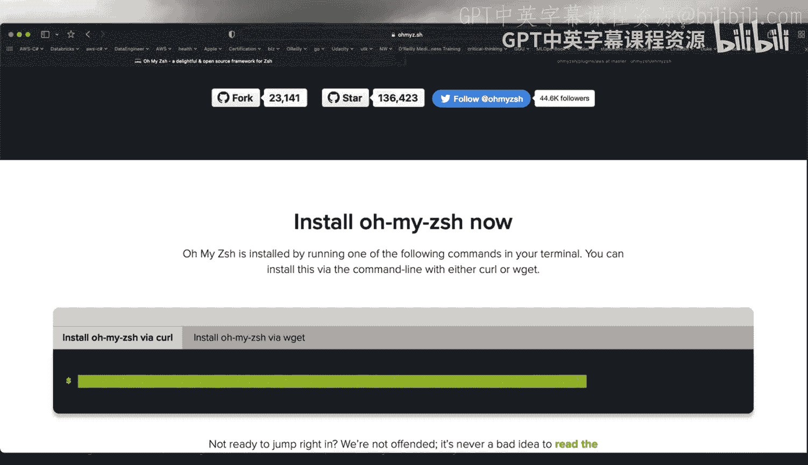

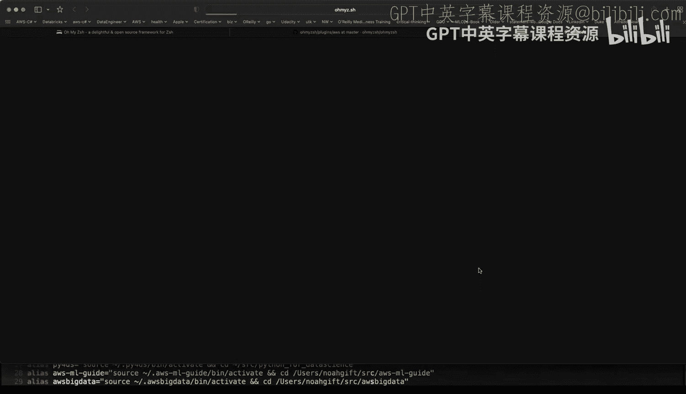

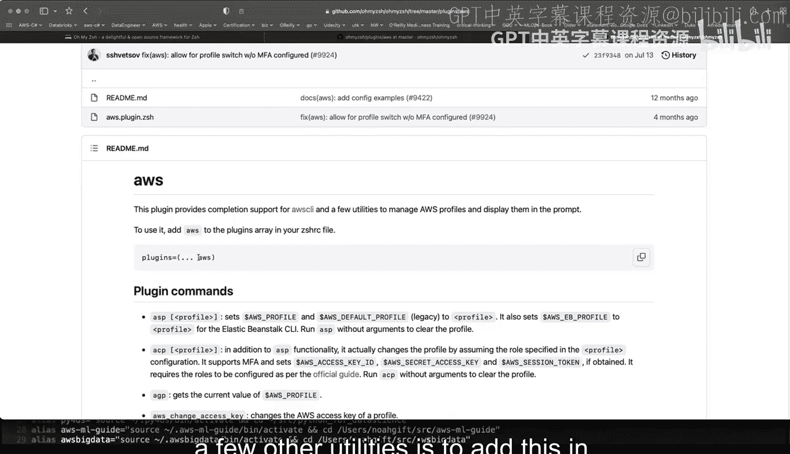

I'm going to bring this up here and I'm going to add in the AWS plug in here。

 so let's go ahead and take a look at here。

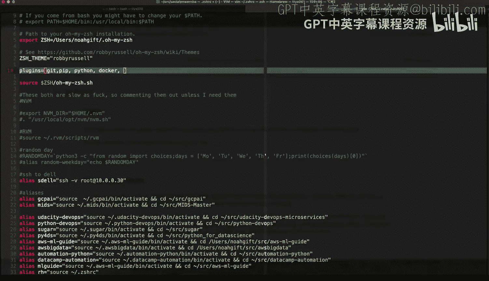

And type in AWS， and now to source this， all I need to do is I need just need to type in source tilde/。

cshhRC。And then now I should have access to a bunch of extra AWS commands。 so if I type in AWS。

 look at this， there's all these extra AWS commands here， and if I wanted to type in S3， for example。

 like it would basically give me the ability to automatically do tab completion here。

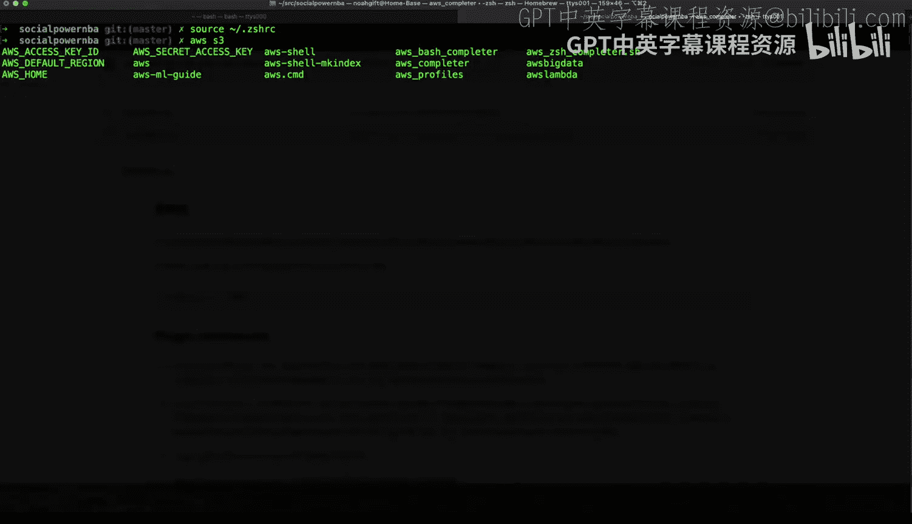

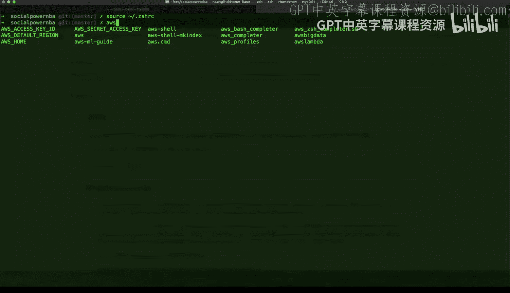

Which again is awesome because I don't have to actually remember all those commands。

 it all automatically does this for me so it's a really useful tool to be able to configure the Zocag environment let's take a look at a few other things as well so the other thing that you can do here if you go through here and start to edit this is I add a lot of aliases notice here I'll even add shortcuts to you know shell into machines I'll add shortcuts here to source different virtual environments you can see gets's very。

 very large here， we've got tons and tons of aliases throughout you know the last several years of me working on things but in a nutshell。

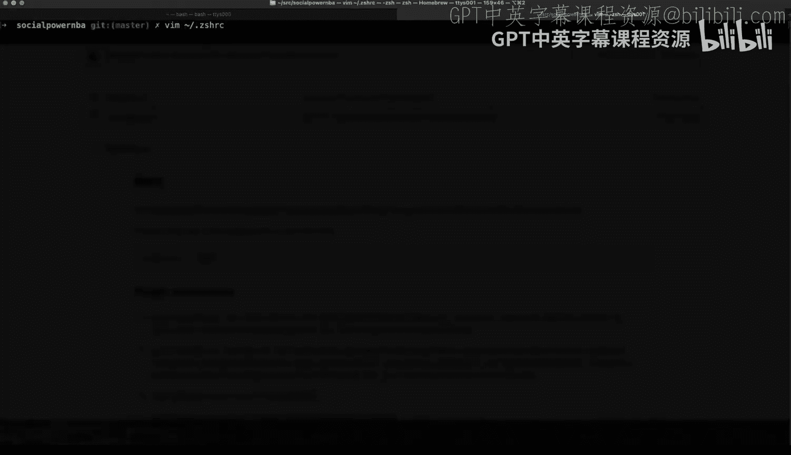

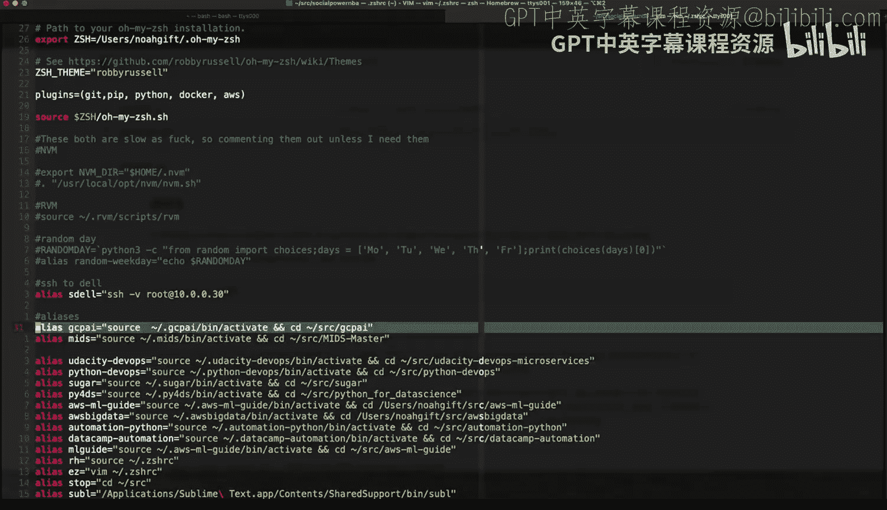

And if I go to the bottom here， it's a very， very powerful way to really enhance your environment is by using something like O my ZSH。

 adding plugins so you get this really fancy auto completion。

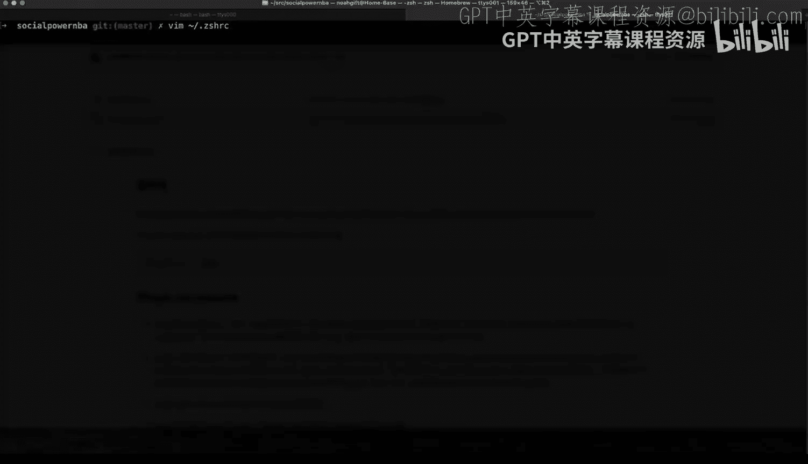

Okay， let's take a look at a couple of other stealth things here。If you remember here。

 if I type in echocho dollar sign shell， it shows me that the default shell is bin ZsH。

 Well how do we actually find that Well what we can do is we can actually go over to right behind here I've got another window here and this is actually the systems preference icon。

On OS10， I can actually go through and change my logggage shell by going to my user account。

 and I'll go ahead and change this real quick。

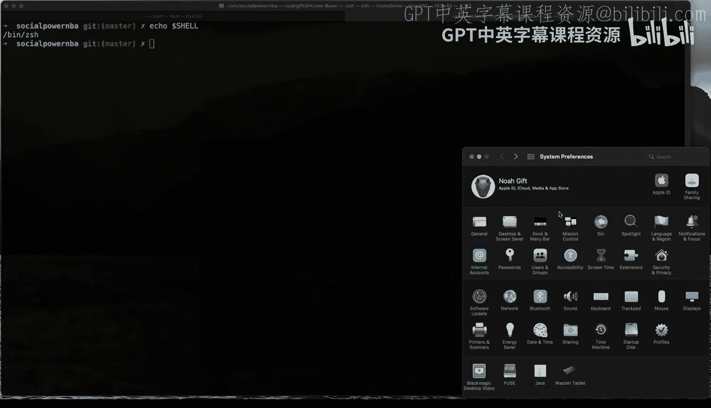

And if I right click， it says advanced options， notice here that I can change settings。

 I can change my user ID， the group I'm in， but look I can also change the login shell and look at all the options。

 you could go through here and you can change bash Thell。

 S CSH and cornshell K you actually can change to a different shell you can also choose a different home directory let's say I want to have a network home directory So this would be how you would change it on OS10 if you wanted to your default login shell to be something different Now the newer versions of OS10。

 they actually give you the default Zhell option And the main reason here is that Zhell has a lot more features than regular bash but still backwards compatible Now the other thing that I'll mention here as well if I go ahead and close this is if I want to go to the preferences in the terminal notice that I also could go through here and double check and look the default login shell it tells me that I'm using what I've selected in my user profile。

From OS10， but I also could go through here and I could actually change it as well。

 so there's a couple different ways you could change your profile as well。

 And so that's one of the really cool things about an environment like OS 10 is you've got this ability to do things like configure ZsH install O my ZsH shellll and also you have the ability to run special commands that are only available on the OS10 environment and in particular I'll show you a couple really cool commands that one of them that's called MDfin and if I type in MD find I can actually just type in you know text and it will find every single text file instantaneously if I did a word count you could see 433 files here that it could find that all have something like TxD and the reason for this if we do MD find help is that this is a tool that's built into let's actually do。

Imdeine Dsha show。This is built into OS 10 and it actually uses the spotlight index and so it's actually customized specifically for querying realtime results without needing to walk the file system Another command that I like to use is disquiil This has been around for a long time and you can see here there's a huge list of things you can do anyone you can list the partitions on OS10。

 you can mount drives you can actually repair drives you can set up bras。

 there's all kinds of very advanced things so really having the ability to work with the interactive prompt not only on Linux but on your native OS10 environment and understanding a little bit about Zhell or bash and understanding the differences and how you can enhance them really will make you a more productive data engineer。

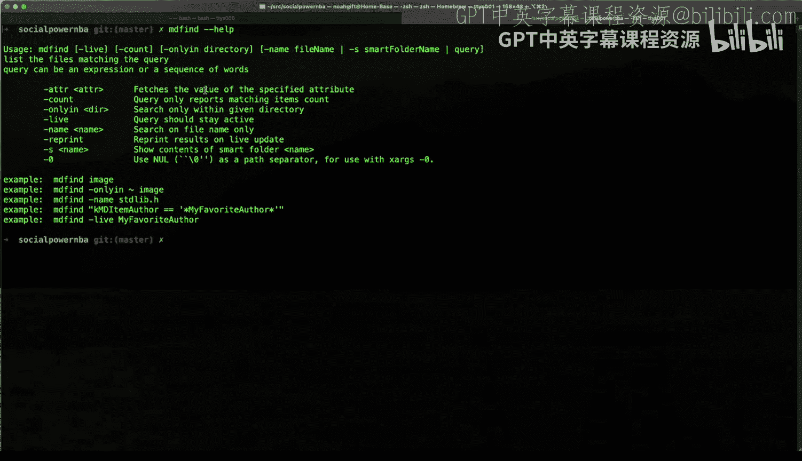

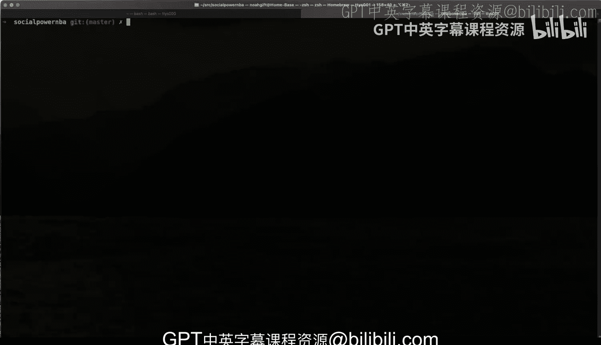