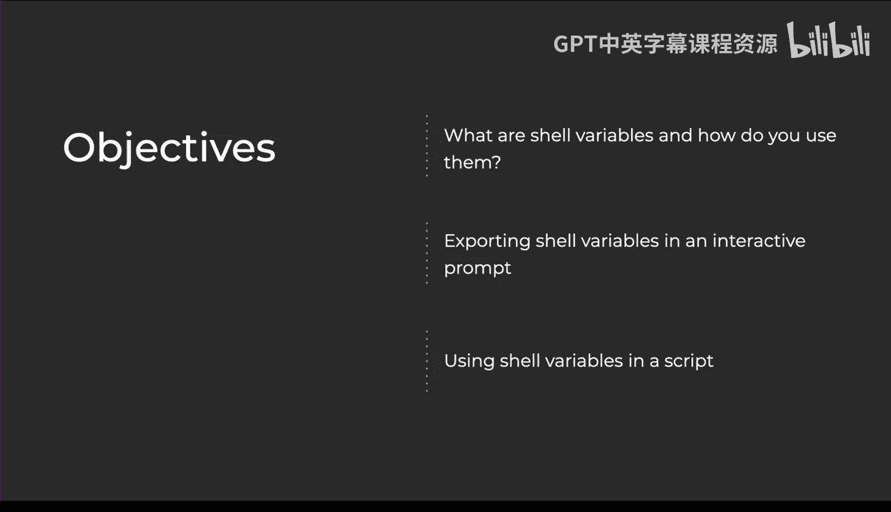

# 杜克大学｜Python、Bash和SQL数据工程基础2-4Python Bash and SQL Essentials for Data Engineering p24 24_02_02_Shell变量操作入门.zh_en -BV1XS421X7tw_p24-

In this lesson we cover working with She variables。

 this is another automation technique you can use to enhance the delivery of scripts to work with API keys to make sure you handle secrets in a way where they don't accidentally get checked into a GitHub repo and your account gets there's all kinds of really strong advantages to working with She variables and let's go ahead and cover the objectives。

So first we're going to talk about what they are like what is a shell variable。

 how do you use them and then after that we'll get into exporting the shell variables in an interactive prompt so we'll actually play around with shell variables make sure that you understand how to use them in a bash terminal and then finally we'll talk about how to actually use those shell variables in a script this is very real world an example that comes to mind is you have an API key for Twitter API key for a Slack you want to pull some stuff down into a script what do you do you put these in an external file you don't check in that file into your source code repository but you use it locally while you're developing so again these are the three objectives that we'll cover for this course so let's going ahead to get started。

