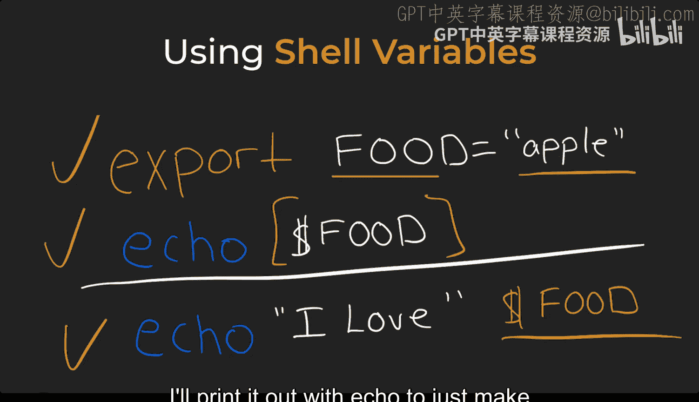
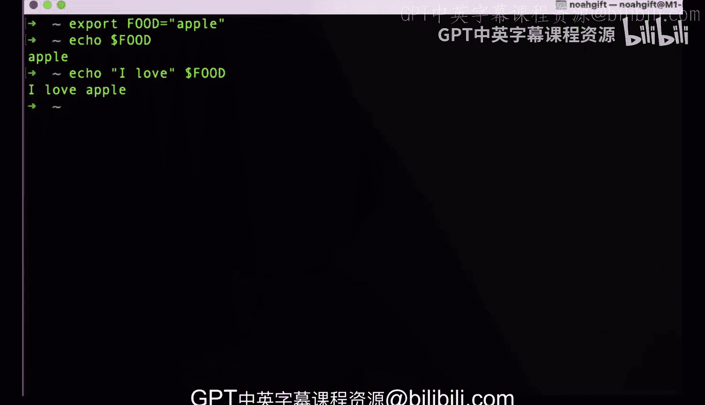

# 杜克大学｜Python、Bash和SQL数据工程基础2-4Python Bash and SQL Essentials for Data Engineering p25 25_02_03_什么是Shell变量.zh_en -BV1XS421X7tw_p25-

All right， let's talk through what shell variables are。

 Really it's a way of storing data that you use in another script or another process。

 They come up a lot when you're building things with APIs and the key reason here is that you want to store those special keys somewhere where they won't accidentally be checked into your repository So a lot of times what you'll do is you'll use a gitign file which tells your source control system to ignore certain files and inside potentially you'll say I want you to ignore a file called dot Ev inside that file you'll have API keys for the cloud provider thirdparty services you're using maybe authentication credentials for your database and all that gets stored inside these files that are local just to your machine So then when you work with a developer that's on your team you just tell them you need to create your own env file and put the things that you need inside that Ev file and then you source。

That EV file when you work on that particular project and you could even go further and actually put that in as part of your let's say dotBashRC file so that every time you change into a certain directory it'll source the environment variables just for that particular project so there's a lot of automation that can occur just by using shell variables so let's go ahead and take a look at a few different examples of how this works。

Let's take a look here at really the theory behind a shell variable。 There's not a lot of theory。

 but let's go into the theory we have。 First， what you would do is you would create a export command inside of bash。

Now what's nice about this export command is that you can see that food is in fact。

 the variable and the value of the variable is Apple。Next， if you want to use this。

All you need to do is go into the echo command after you've run the first command and say dollar sign food。

 so that's really the key aspect of building things with shell variables is you must access that variable by referring to it with a dollar sign in front and this means that the shell knows how to interpret that this is actually a variable。

Now if you want to use something slightly more complex and this is really not much more complex。

 you could put it into a statement and we see here in this example， you would say echo。

 put a string here that says I love and then at the very end here you refer to the variable dollar sign food so this is really really common when you're doing some kind of debugging I do it all the time maybe I'll have a really long path or I have the database credentials or I have a UI for some service I'm using。

 I'll put into a variable， I'll print it out with echo to just make sure I understand what's happening。

Okay， let's take a look here at this same example， but let's do it。 So here we go， I have export。

 I have food here， I assign it a value by using Apple。Now。

 how would I access this value is type in Echo dollar sign food and what's neat about this is notice what I did here if I just partially complete it。

And I use the tab key， you know complete the rest that's a great pro tip that I would recommend is use Tab to discover。

 it's almost like an automated search that you would do in Google and it allows you to discover the correct value without typing as much so it's not only saving you time but it's actually allowing you to be more efficient when you're actually building things so that you don't make errors。

Now there here we go， I have that value and let's go ahead and put this into a sentence I can say I love。

And then， Do sign。So this is really essentially the hello world of writing variables in the bash prompt。

 it's identical when you do this with the Z shellll and it's easy to get started with writing shell variables。

