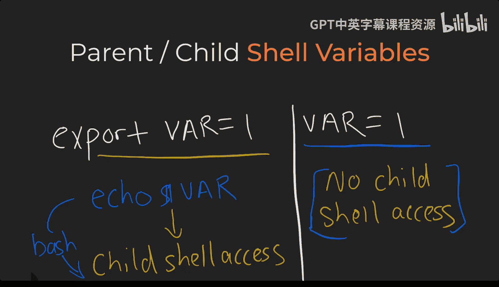
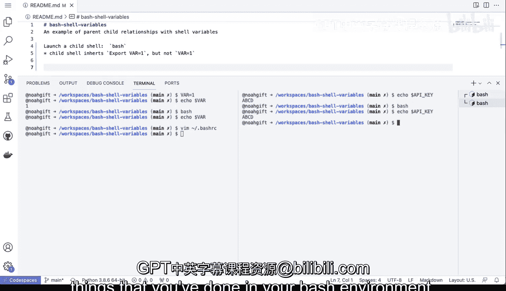

# 杜克大学｜Python、Bash和SQL数据工程基础2-4Python Bash and SQL Essentials for Data Engineering p26 26_02_04_交互式提示符中导出Shell变量.zh_en -BV1XS421X7tw_p26-

Okay， let's take a look here at parent childil relationships in shell variables。

 and this is something that's a little bit subtle， but let's go through here and debunk it。

 So if we look at an export statement where I put a variable together， this var equals one。

 if I echo this in my shell it obviously works， but what happens if I launch a new shell。

By typing the word bash， which we'll do in a second。

 what will happen is that that variable will still exist。

 and this is something that allows you to persist a variable through child shells。

 and this is very handy for launching subprosses that get forked in the background or whatever it is you need to do is if you use the export variable。

 the value will follow you down into the child process。 Now there's another scenario。

Where if you defined variables in this way where you don't use export， you just say var equals1。

 It becomes an environmental variable。 And what this means is that there is no child access。

 So it makes that your environment is throw away right， it won't be persisted to the new environment。

 if you open up a。Essentially a bash shell， it won't have access to this variable。

 So depending on what it is you're trying to do， it's important to know the scoping of the variable so that your child processes may or may not have access to the variable you set again。

 depending on how you do it。 So let's go ahead and take a look at how this works。

I've launched a new Github code space。 What's great about this environment is that if I want to。

 I can launch any number of shells。 You can see here there's a couple。 Let's get rid of this one。

 And let's actually start with this main one here。 And what I'll do instead of having two like that。

 I'm going to have a split terminal。 This is a good option for experimenting with things。

 And here we have one on the left one the right。 Now， this first one。

 I'm going to show how you can use a local variable， and it won't be accessible in a child shell。

 So first， I'll go through here and I'll export var。😊，I'm sorry， I will set var equals one。Like this。

And if I want to access this verbal， I would type in echo Do sign var。

And we we can see that that variable set now if I want to launch a child shell to do that。

 you type in the word bash。There we go， and this opens up a second shell that's underneath this。

 and if I want to go through here and echo the dollar sign var here， notice it's not set。

And this is really the issue with setting a variable that's a local environmental variable is that you are intentionally trying to make sure that it doesn't go to a child shell So again。

 depending on what you're doing this may be what you want。

 I think more likely many people would like it to go to the child's shell because it's very common to launch a process and you give it a bunch of variables so here's an example of a parent childil relationship on the right where we do let it have access to that variable。

 So if I type an export this is really key。 the export command will say listen。

 it's okay and let's call this one Var2 to differentiate it and we say too。

If I type in echocho Do sign Var2。You'll see that that's set now what if I go through and I open up another shell in bash？

What happens here， we can see that in fact， echo dollar sign。Var 2。

Is set so really the main takeaway here is when you're looking through about how to build things。

 it's important to know the difference between export base variables and the regular var- based variables and in particular one of the places where this really comes into play。

 if we just get rid of one of these shells here where this really comes into play is in your bash RRC。

 so if we go into bash RRC here，And we go into Tilda。bashrc。

This is where you could make a big mistake right， because if you go through here and notice these are variables where you know maybe you don't care that in subtermins you know what's happening。

 but in general， what you want to do is you want to use the word export so that。

The child shells that you launch have access to these variables and so look at this we can see export that's why they're using this Also here's export what's happening is that because the parent shell when it sources the ba orRC file it has these export commands we can be assured that the variables that are going to be set in the child shell will be able to inherit this so really the takeaway would be if you were going to customize your ba terminal here we just say like you know my custom variables what you should do is do this do the export command and say you know let's say API key or whatever it is your setting。

And then you could do， you know。ABCD。And then what's nice about this is if we can test this out real quick is if I want to launch a new shell and we can do that by doing the split terminal again。

That it source that。 And if I type in basically。Echo。Dollar sign， API key。

We're able to actually access this if I want to open up a child chill。

We can again echo the dollar sign API key。And we have access to。This variable。There we go。

 so it's a very important distinction to know about and especially when you're editing the Bsh RRC is to make sure that you are using the export command so that your child' shells will inherit all those great shortcuts and different automation things that you've done in your bash environment。

