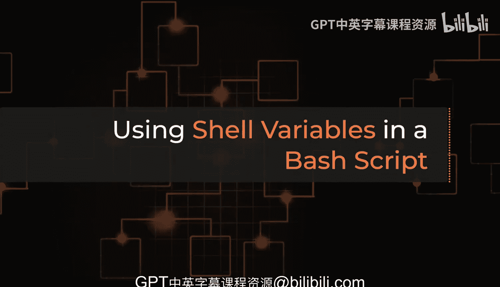
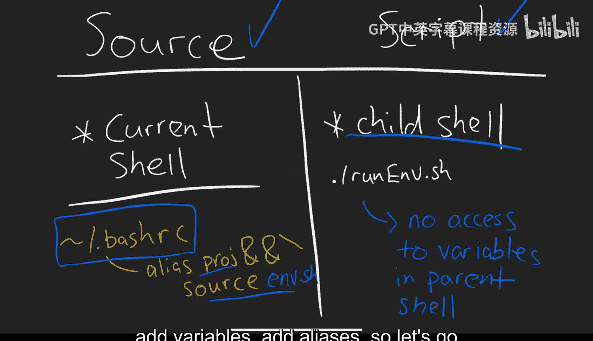
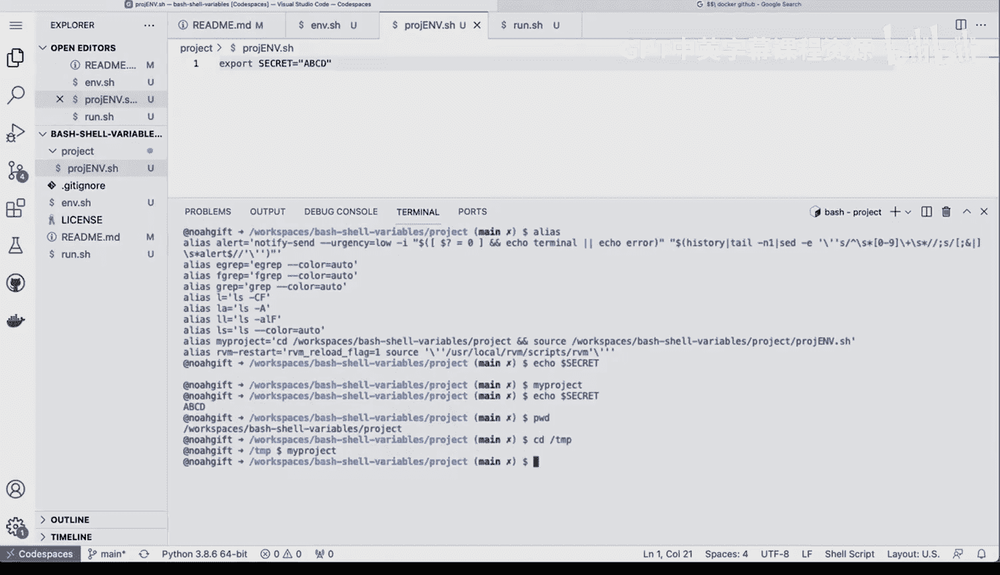

# 杜克大学｜Python、Bash和SQL数据工程基础2-4Python Bash and SQL Essentials for Data Engineering p27 27_02_05_Bash脚本中的Shell变量使用.zh_en -BV1XS421X7tw_p27-

Let's take a look at two different ways to execute code in a bash environment。

 The first one here is source。 And what's fascinating about source is that it's able to really in your current shell。

 take up the variables and put them into that environment。

 And that's why you see people source a bash R C file after they make a change because they want those changes in the configuration file to show back up。

 And so what I typically do is I will create aliases inside of bash R C。 let's say in this case。

 I could create one called project。 And then I can also source some set of variables that would be specific to that project。

 And what's nice about this is that if I had a lot of variables for a project。

 they wouldn't necessarily be in my shell all the time。 They'd only be there。

When I needed to work on the project and I could actually just basically call that alias and it would actually go into the right directory and source those particular environmental variables So I think that's a really good distinction to know about and we'll go into this in a second The second option is a script and you know this from running bass scripts is it's typically done with dot slash and you run the script Now the issue with this kind of scenario is it's not really suitable for you going through and then grabbing a bunch of you aliases and variables because they're only available to the child shell And so what this means is it's great to run the script。

 but it has nothing to do with your parent environment here。

 So a script is really meant to run it and forget it。

 a source is meant to improve your current environment and add context， add variables， add aliases。

 So let's go ahead and。

Try both of these ideas out。Okay， let's take this concept of sourcing versus scripts to the next level here and in particular what we can do is take a look at this concept of a script file here so I'm going to go ahead and I'm going to go to terminal just open up a new terminal so we have a fresh one here and notice I have a run。

sh and I have an EV。sh so if I go through here and I run this script we can make it executable first and go to runsh there we go and if I run this that's great we exported an animal but now how do I access it in this parent shell well if I type an echo Doll signign animal。

It's actually not available， so it basically ran this silently somewhere else， and in fact。

 we could further take a look at this if we said。Echo， let's say this is my favorites。Animal。

And then I could actually do a dollar sign。Here。That's great and now if I run it again。

 what'll happen？It will will definitely execute that variable， but again。

 if I echo that that variable it doesn't show up right so you can see how it's only running this in the context of the child shell。

 the parent shell has nothing to do with it now if I want to use variables in my current environment。

I would actually go through here and run the source command so if I go through here and run source this particular environment。

 what happens， I can actually go through here and I can say echo dollar sign food。

And now it shows up。 So that's really the key difference here。 Now。

 why would you want to do something like this， So one of the things that I like to do。

I I like to use this style of sourcing for going into projects that I work on frequently。

 so let's go ahead and take a look at how we could do this and so I will go ahead and make a project and just call this。

Project right， and then essentially inside of this project。

 we can create a new environmental variable and we can call this Proage E and V like this。

And now if I go into here， we can create some kind of inverable， we can go and we can say like。

I don't know， secret or something like this。Export it and we can say secret is equal to ABCD。

All right， that looks good and now what I can do is I can type in PWD。

And I can actually take this path and I can go into my Bsh or C file。

 and I can make a context of where switch。 And so what we can do is go through here and say alias's。

And exports something like this。And I can say my project。And we'll call this an alias。Is equal to。

And then I will create a command here that will CDd。Into that project。呃。En。

This will actually say if I was successful。Then run the next part of this command。

 which would be source。And then we would go through here and we would say projects。Project Ev。

sh and so what's great about this is none of this happens。Untiltel I actually access this alias。

 so I don't have to have a bunch of variables over the plays polluting my main shell。

 so let's go ahead and take a look at how this would work， so I would just say source you know tilda。

baRC。And then now if I go through here and I type in aliases。

You can see that that's actually now an alias great so let's go ahead and use it and in fact。

 before we even use it， let me just double check to make sure if I type in echo dollar sign。Secret。

This will not be available。It's not available， but if I type in my project， it'll seed in there。

And now the secrets available。 So this is a nice little trick you can do where you can actually set the context for your project where every time you want to work on a project。

 you just type in the name of your project， it Cds you into this path and then at that point again we can look where we're at right we're right in this location If I went to the temp directory and I did the same thing it would CDd right into this directory。

 let's go ahead and do it again。So it's a nice context aware shortcut that combines the power of many of the things that we've talked about。

 the CD command aliases， also context available environmental variables using source。

