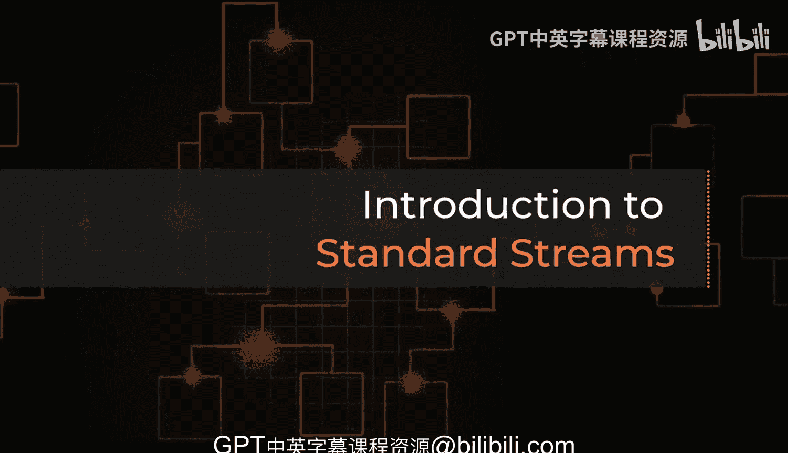
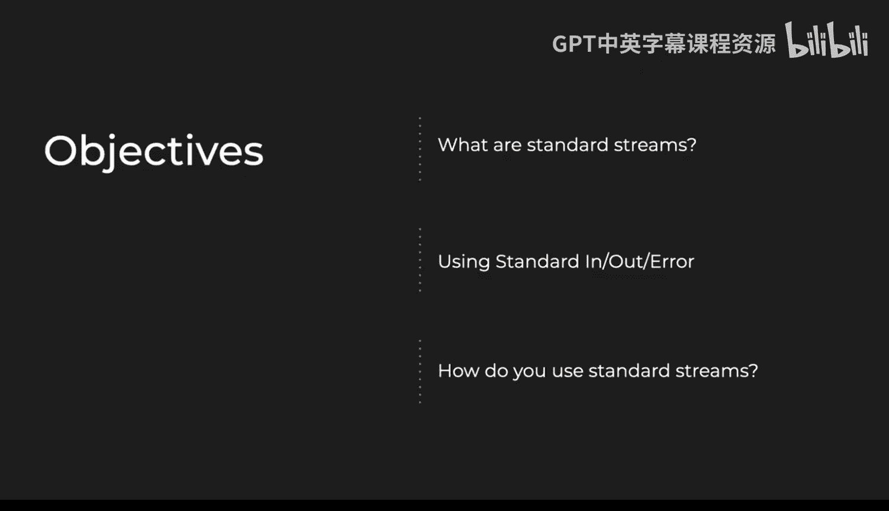

# 杜克大学｜Python、Bash和SQL数据工程基础2-4Python Bash and SQL Essentials for Data Engineering p28 28_02_02_标准流入门.zh_en -BV1XS421X7tw_p28-

In this lesson we cover standard streams， using standard in， using standard out。

 using standard error， how to actually reason about these from a baS perspective that each serve a different goal in the case of standard in。

 typically you'll be putting things inside of some kind of a script， piping it in。

 standard out you could be looking at， let's say the output of a log file。

 standard error could be some kind of error that you ran from a utility。

 maybe you put a path that doesn't exist in and you have to decide where to send these components。

In terms of the objectives here， we're going to start with what are standard streams and dive into the details there Next we'll cover using standard in out in error how to reason about each one of these different outputs in terms of a bash terminal and then finally how do you use standard streams What are the key components of standard streams and how can you use them to be more successful as a bash programmer Okay。

 let's go ahead and get started。

