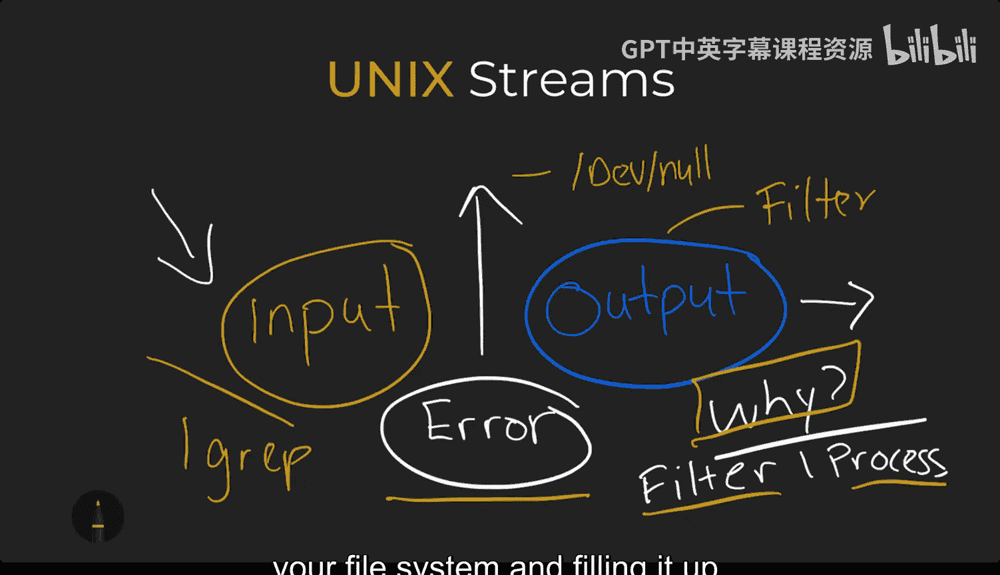

# 杜克大学｜Python、Bash和SQL数据工程基础2-4Python Bash and SQL Essentials for Data Engineering p29 29_02_03_什么是标准流.zh_en -BV1XS421X7tw_p29-

So what are Uni streams Uni streams are a way of capturing data into an input and filtering it for example。

 this is really common in data science， you'll filter something via SQL query or you'll use pandas and you'll go through and take some subset of the data so that you can process it later down the stream Similarlyly when you have output you'll take that data and maybe you'll pipe it to some other location so really what Uni streams are are you can think of them a lot like water in a pipe if you have a house and you put water into your house。

 you'll process all of those things and do things with it like have sewage systems。

 you'll have dishwasher， you have all of the different appliances in your house。

 very similar concept with UniX there's lots of ways to process data filter data stream data and we'll go ahead and take a look at some of those methods in the next section。

Let's take a look here at this UniX Streams diagram and you can see here on the input side this is where you're going to pass things into a UniX utility there's lots of examples of this for example if you wanted to pipe something into G you could go and you could search through some keyword to find a pattern in a log file likewise a lot of times you'll pipe something out to maybe a file and before you pipe it out。

 you may do some kind of processing you may truncate the data or shuffle it do some kind of a filtering operation as well this is a very common thing to do so really when you think about what is it I'm doing when I'm using Uni streamreams the why the why is you're going to filter data and you're going to process data those are really the most common operations and if you're dealing with data the command line is one of the more powerful ways and really one of the most efficient ways to do this。

We have error here and a lot of times you'll either capture the error and put into a file or you'll move that error down to a location where you can throw it away in some cases you don't want those error messages polluting your file system and filling it up。

 you'll pipe that into something like devnoll。

