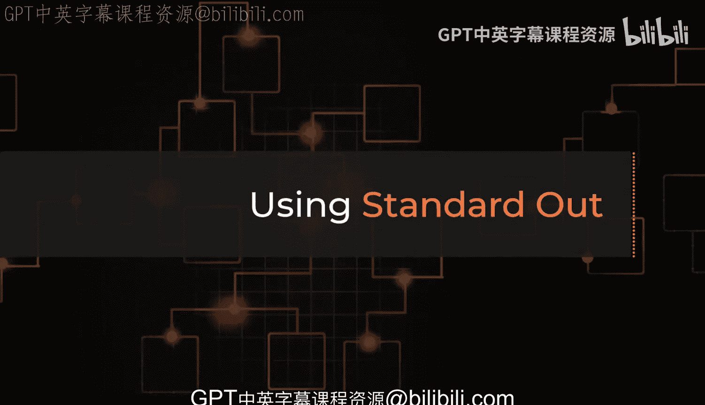
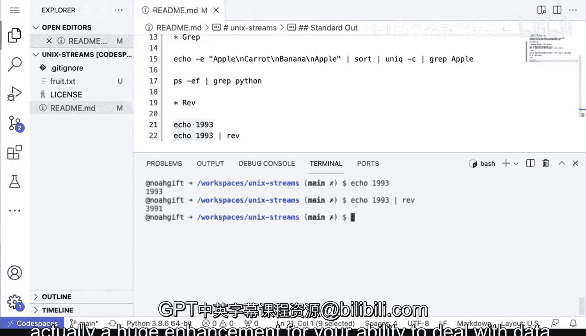

# 杜克大学｜Python、Bash和SQL数据工程基础2-4Python Bash and SQL Essentials for Data Engineering p30 30_02_04_标准输出使用.zh_en -BV1XS421X7tw_p30-

All right， let's take a look at some standard out examples here here's one in particular that's a good one to start with is this echo command and you can see from echo what it does it literally just echoes out statements and we're going to add line bricks and that's what this s in here is and if you see this there'll be three lines apple carrot banana I could even pipe that out to a file if I wanted to and this is the nice thing about standard out as I could say you know fruitru。

txt and then if I look at this if I run less for example we can see there's three things in the file I could also read it with cat I could say cat fruit。

And so this again is a great way to play around with standard out as echo or know put it into another file。

 but what I'm going to do next year is I'm going to not just pipe it to a file。

 but I'm going pipe it to a command called sort So we know again that the order here is Apple carrot banana but what if I want to change it to be an alphabetical error order here so if I go to do that now notice how it changed。

 we have Apple we have banana and we have carrot Now one of the things I can do that's kind of nifty。

Is because I've been able to pipeline this and filter the data， I could actually do this command。

 which is the greater than command。 and I could go back to the fruit。 Now。

 because I'm using the greater than operator。 This will overwrite what was in the file before。

 if you remember it was in Apple cart banana order。 let's go ahead and take a look at this now。

 And let's see that it's actually been overwritten and it's in the correct order。

 So there's a lot of really cool things I can do with standard out and a lot of it is chaining and filtering。

 Now， another thing I can do thiss pretty cool。 is if I go through here。😊。

And I want to see both methods， what I could do is I could take out this sort command and replace it and I could actually add an append。

 and this will actually append new data to this file。Now， if I again go ahead and I cat this。

 you can see this is the first series of things I wrote and this is the second series of things unfiltered right so there's a ton of great things you can do with piping and actually sorting。

 Now let's actually take a neat look here at something called unique So notice now I have three different things。

 I've got chain together。 I have echo command which prints out line by line。

 I have the sort which will change the order and then this unique command what it does if I use dash C is it'll count every unique occurrence inside and notice I'm actually adding another word apple here。

 So there's gonna be two occurrences of Apple。 if I print this out。

 look it's able to actually capture that there's two occurrences of Apple so this could be invaluable if you are going to build up something for a data science project and you wanted to pipe a whole stream of data somewhere and you wanted to keep some counts of maybe unique items。

That you're actually you know capturing this is a great command to know about Now let's move on to another command here called GE and here's a similar scenario here you know I just go through here and I print things out Okay great but what happens if I want to you know you know basically change things up a little bit here and actually do a rep for something how would I do this well I could I could really change together everything I just did before I could do a sort which will change the sort order I could do a unique count。

Which will give us the ability to。Let's do a tab here。

Give us the ability to keep track of how many occurrences there are and then I can pipe into Gr and I can look for the word apple。

 So basically I want you to process the text sort it， give me the unique values。

 but then only give me the unique count for Apple， how do I do that There we go。

 now we see that just that one line has been piped out。

 and I could again chain it to some other action。 So there's a ton of really cool stuff you can do with pipelining multiple steps。

 Now very similarly， if I go through here and I type in PS Ef here。

 This is a command that shows me all of the processes on my machine notice that there's just a ton of different things going on on my machine here。

 but let's say there's too many to look at， but I just want to look at some python scripts that I wrote maybe I have a flashask gap running。

 I want to see where it is。 well you can do that very simply by using again our friend Gr here。

And grab Python if I do a return Here we go。 you can see in fact。

 these are the versions of Python that are running and I could actually get access to the process I if I wanted to kill it。

 for example， So the output being able to pipeline it and filter it is a fundamental aspect of using the bash terminal let's look at one final example here。

 if I go through here and I look at echo。1993 right that's a nice year there but what if I wanted to reverse it well how would I do this I could again pipe this out and the number gets transposed and now we have 3991 so really one of the best ways to learn standard out is to do these kind of operations playing around with it and you'll notice in no time that it's actually a huge enhancement for your ability to deal with data。

