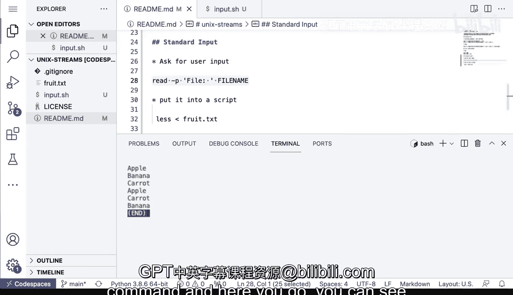

# 杜克大学｜Python、Bash和SQL数据工程基础2-4Python Bash and SQL Essentials for Data Engineering p31 31_02_05_标准输入使用.zh_en -BV1XS421X7tw_p31-

All right， let's take a look at standard input here。

 this is a really common pattern that you need to master for bash and let's look at this particular command readP file file name now what does this do？

This asks for user input and this comes up very handy in a script， for example。

 if you wanted a user to give you some kind of value notice here that I do P for prompt so this will prompt the user and then this file name here will be the variable that will be filled out There we go we can see here it says file now what file do I want to process will type in fruit TxT here。

And then you can see if I want to echo this later and I just type in file name。There we go。

 we've got this file name。 Now how could actually use this。 Well， if we go to input here。

 notice I'm creating a script here user bin bash has the sang line there that tells the script that it can run as bash and I also can make it executable so I can say chma plus X input。

 and then once I do this， it'll first run the line that prompts the user for input then I run a command called readlink F which will find the full path to the file。

 and I assign it to a variable called Fpath。 Finally I go through here and I say echo full path。

 let's go ahead and take a look at this there we go input I'm gonna ask for a file here。

 I'm going type in Txt。 there we go。 I've actually got the ability to see the whole path to that file So I wrote a nice handy little script here that I can use in the future maybe I can process a whole series of a full path here。

 So there's a lot of things that you can do that are very powerful by using。The the standard input。

 Now， another thing we can take a look at that will really hammer this home is notice that again。

 we have this file here fruit。Now if I wanted to process it in a slightly different way。

 I can also use the less command and I can actually tell the less command to accept the input from this file so you don't have to go one way or the other you can go multiple directions in this case I'm telling the less command to accept the input of the fruit command and here you go you can see I'm able to actually process that command。

