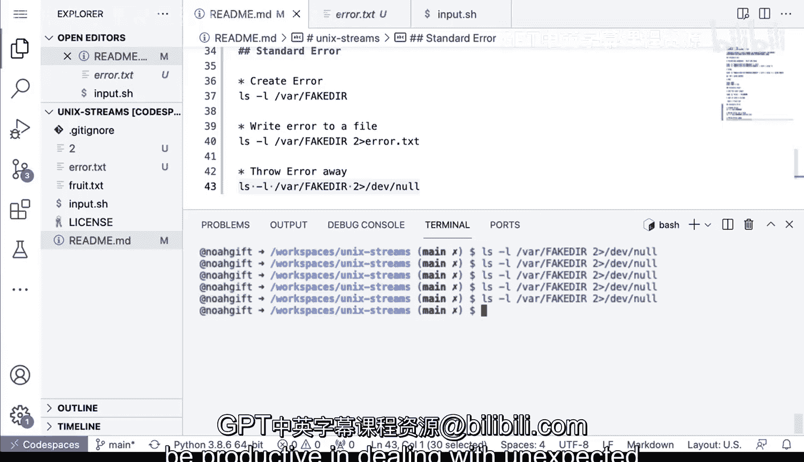

# 杜克大学｜Python、Bash和SQL数据工程基础2-4Python Bash and SQL Essentials for Data Engineering p32 32_02_06_标准错误使用.zh_en -BV1XS421X7tw_p32-

Let's take a look at standard error。 A really good way to take a look at what happens with standard error is by running a fake command or a command that will be guaranteed to fail so this LSl command I give it a path where it just doesn't exist notice what happens it says hey。

 I can't find this there's no such file or directory if you're running a script that is going to output a lot of different paths here and some of them won't work and some of them will you may not want to have all this in your output and so what you can do here is you can actually redirect that standard error to another location so let's take a look at how you would do that in order to do that。

What I do is I say two， well， this will refer to the standard error。

And then I can actually pipe it to a file like TXT notice that error just goes away and now if I go and I'll take a look at this file。

You can see that it's actually put inside of this file。 and in fact。

 if I wanted to append to that file， what I could do is I could actually put one more here and every time I run this notice it just fills it up with all the errors。

 So if I was going to write a script that looked for real pass and fake pass maybe determined if there were still valid directories this might be a good way to do it is go through and keep app pending the errors to a file so that I can later look at the results of my script and then debug things so it's very important to know how to deal with standard error when you're writing scripts Now another thing you can do that happens a lot if let's say you're dealing with a server or you're dealing with something where you don't want the errors to show up for a multitude of reasons like overfilling the disk what you could do is you could pipe this to devnoll and this is a very common pattern here or essentially you just say look I don't care about the errors。

runun all this code and throw the output away if there's any kind of an error。

 so let's go ahead and take a look at how I would do that。There we go。

 I just run devol I know it just goes away right and so this is really one of the other ways that you can deal with standard error so there's just a few things to really be careful of with standard error。

 one of them is you know like to capture the output and put it to a file another one is to throw it away and if you know these very simple techniques with standard error。

 you can immediately be productive in dealing with unexpected things that happen with your script。

