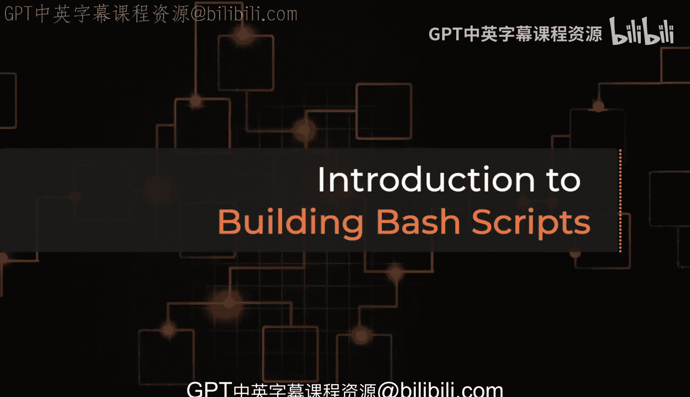

# 杜克大学｜Python、Bash和SQL数据工程基础2-4Python Bash and SQL Essentials for Data Engineering p33 33_03_02_Bash脚本构建入门.zh_en -BV1XS421X7tw_p33-

This week， you'll learn to build Ba scripts to solve common problems in data engineering。

You'll also learn about shell logic。Dealing with data in the shell and how to build command land tools using bash。

 You'll apply this knowledge to create command land tools in bash。

Let's go over the week three learning objectives。You'll be able to do the following actions。

Use shell logic and control， flow， write statements to manipulate data with the shell and also construct bass scripts and command line tools。

