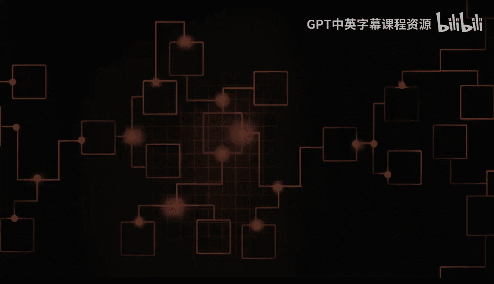
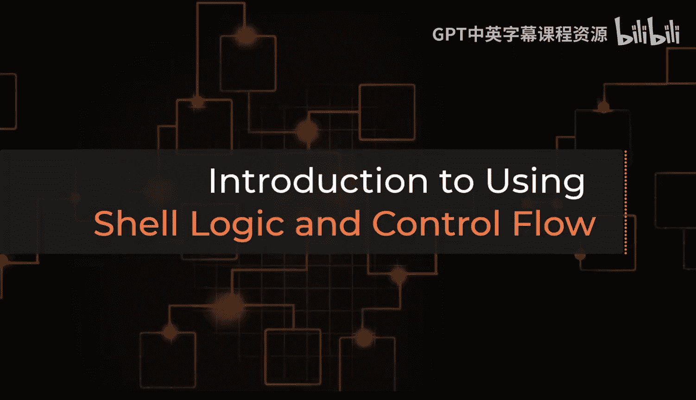
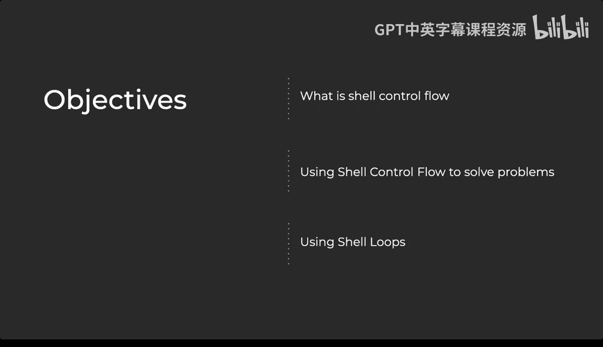

# 杜克大学｜Python、Bash和SQL数据工程基础2-4Python Bash and SQL Essentials for Data Engineering p34 34_03_03_Shell逻辑与控制流简介.zh_en -BV1XS421X7tw_p34-

In this lesson we use shell logic and control flow what we're going to cover first is the ability to understand how to use that control flow to loop through different problems and solve them with the bash terminal。

Let's talk through the objectives。First， we're going to talk through what is shell control flow。

 describe it， go through the operations that you use when you're creatinging things like loops。

 and then make sure that you understand how to implement them in your scripts Next we'll talk about using shell control flow to solve problems So the whole point of using these techniques is to be able to solve a real world problem Next well use shell loops。

Okay， let's go ahead and get started。