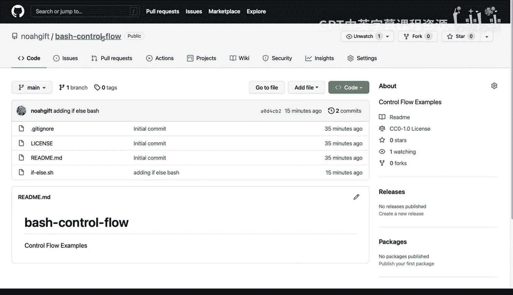

# 杜克大学｜Python、Bash和SQL数据工程基础2-4Python Bash and SQL Essentials for Data Engineering p36 36_03_05_使用Shell控制流解决Bash问题.zh_en -BV1XS421X7tw_p36-

Let's take a look here at if LF else in action with Bash one of the best ways to test out these conditional statements is by asking a command line tool like in this situation to take an input in and then do something with it so first let's walk through the code and then'll run it so I have an echo line here that prints out what food do you choose and then I read in the input that I ask from the user and this will store the input into a food variable Now here's where the conditionals come in。

This bracket right here is where I can do a string match and what I want to say is if the food is equal to the string apple then I'm going to put this conditional statement right here which is eatat yogurt with your apple if I pass in the wordmi and it matches that then basically I'll say echo eat cereal with your milk if the word that I pass in is neither apple nor milk and it'll pass in echo down to this last line the food and then it'll go into a complete statement that says eat your whatever the food is you put in there by itself and then this is the important part as well is to remember that you have to put Fi at the end to close out the conditional statement so let's go ahead and run this notice again that I have the shebang line here which allows me to make it run as a script and then it's also made executable。

By using Chma+ X。And so once I do this， I can run the script and we'll go ahead and run the first condition。

 so I'll go ahead and put an Apple。And it has to exactly match。Eat yogurt with your apple。

 There we go。 It looks like that part works。 The next thing I'll do is I'll type in milk。

Eat cereally with your milk great now the final thing I need to do is put some third food and let's go ahead and put steak。

Eat your steak by itself so really the conditional statements in bash are fairly straightforward and this is a great example for you to play around with this is in GiHub and if you want to take a look at that GiHub link itself I can go through here and go right to this repository it is GiHub Bsh control flow and you'll have an opportunity to play with this on your own。

