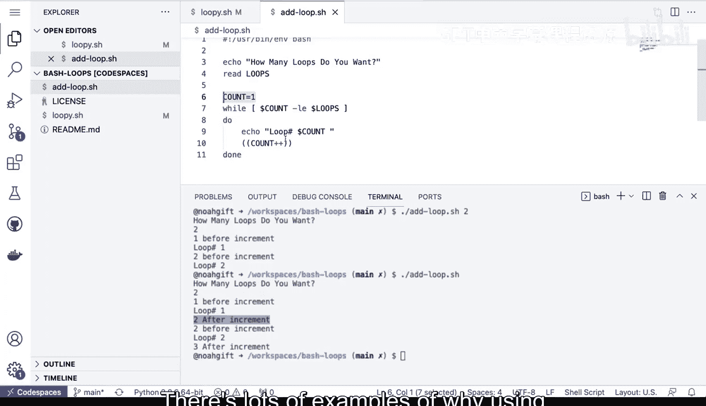

# 杜克大学｜Python、Bash和SQL数据工程基础2-4Python Bash and SQL Essentials for Data Engineering p37 37_03_06_Bash中的Shell循环使用.zh_en -BV1XS421X7tw_p37-

Let's take a look at this repo here that has a couple different kinds of loops in bash。

 One of the ways I like to think about a loop is very similar to me going to the grocery store and picking up a basket。

 putting some stuff in the basket and then when I get to the end and I want to check it out I got to pull things out of the basket that's really what a loop is you're pulling things out of a basket。

 So let's take a look at this piece of code here， This is the sang line this tells the script that it should run in bash and then I declare an array。

 This statement right here says declare dash a array and this is the name of my array and then I put inside of the array three items there's an apple there's pair and there's cherry Now here I need to do something with it So again just like where the grocery store I want to pull stuff out of the basket。

 I need a loop and this is where the four loop comes in What happens is I say for every item and this is a loop variable。

Really a temporary variable I say inside of that array and this is the syntax to pull it out of the array what I do is I echo what is pulled out in this case it'll say the whatever loop I'm on if I'm on the first loop it'll be Apple if I'm on the second loop it'll be pair if I'm on the third loop it'll be cherry so let's take a look at this if I go through here and I run this and I type in loopy。

Like this。We should see this is apple。 This apple is delicious， This pear is delicious。

 This cherry is delicious， and we can actually extend it as well。 just like at the grocery store。

 you can put more things in your cart， you can put more things in an array so we can go here and let's let's pick a strawberry。

😊，There we go and now we've got a fourth fruit here I run it again。

 they'll be for loops this apple is delicious， this pear is delicious， this cherry is delicious。

 the strawberry is delicious， so very straightforward in bash to use arrays to store things and then loop through them these could be for example。

 you files that you want to process or directories you want to search really a sky's limit。

 but this is a good example for you to play around with to get familiar with basic for loops。

Now there's another style of loop that I wanted to cover as well。

 and this is a while loop with a counter and the idea here is that a lot of times you want to count what loop you're on in order to do something it could be print a line number or show how many things you found like for example。

 if you were searching for duplicate files in your file system you may want to do account of how many times you found that same file on your file system that could be you know a good way to to figure out how you're going to do your cleanup So here's an example I put a smang line here again。

 user bin in Vbsh I do an echo how many loops do you want I then read in from the input from the user。

 the variable loops。 And here's where the loop and account all goes together First I have to initialize a variable。

 This is count initialization where I say I want this to equal one。

And what happens here is I say wall the count variable is essentially less than the loop。

 go ahead and continue to do this statement underneath here and this is really the logic。

 and so again， just like we did in the other example this count variable will change every time there's a loop and then what happens here is we increment the count。

 So this prints out in the first case one and then the second time we go through what will happen is because it got to this statement and it incremented it up one this will go back to the top here and change this variable and then this will increment。

 So every single time we go through here it'll increment。

 so let's take a look at how this works if I go through and let's type an add loop。

How many loops do you want， Okay， let's go ahead and do four。Loop1， loop 2， loop 3， loop 4。

 and so this again is a great way to take a look at what's happening in a script。

 let's go ahead and maybe run 10， there we go。Because we have 10 loops now if you want to see the action of what happens before and after。

 we could even do an echo and we could say。啊。Counts。Before increment。

And so let's just make it very small this time and let's clear this out and let's just add two。

Two loops。How many loops you want， we say2，1 before increment， loop 1，2 before increment。

Loop 2 right so you can see here that basically the count variable before we get to the bottom it's still at one and once we've gone through and it prints out this this loop statement here it's now been incremented and that's why it goes through and shows the next loop。

 we could also do this and we could say echo。And we could say， count after increment。

And we could actually see what happens here。And we can do count after increment。

And then you can see it in action so this is always a good way to play around with things is to you know go through。

 tweak the code a little bit and then see what happens so in this case we say one before right which is this this line。

 then we loop， that's this line， then once we do the counter。

Then you see two after increment there we go， so after it incremented this next line gets run。

 you can see really the order of operations when you're doing things。This is really。

 I think a good thing to master is to master how while loopop works and also how to work with count Icration。

 because this comes up all the time again， how many files did I match how many times do I want this process to run or try before timess out。

 there's lots of examples of why using encounters to keep track of what you're doing in the loop are really good ideas。

