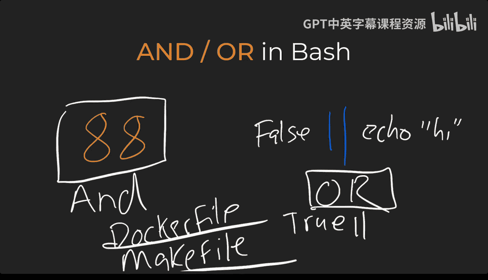
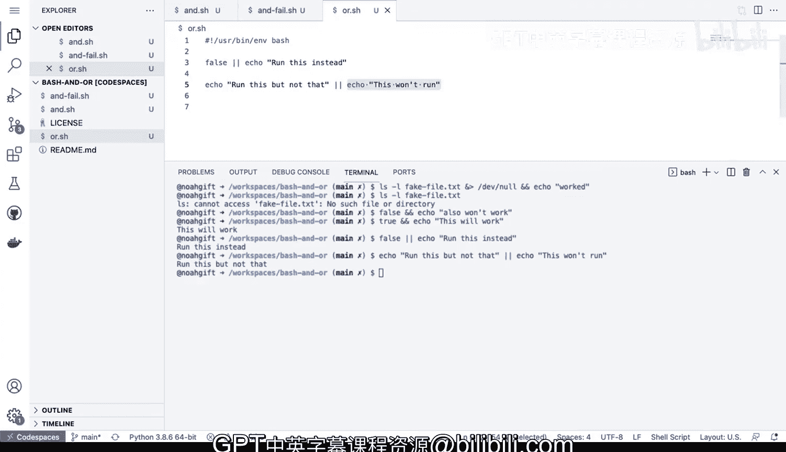

# 杜克大学｜Python、Bash和SQL数据工程基础2-4Python Bash and SQL Essentials for Data Engineering p38 38_03_07_Bash中的条件判断.zh_en -BV1XS421X7tw_p38-

Here we have bash and。And or operators。 And if we take a look at here。

 really the the key idea here is that when you have this double ampersand， it refers to and。

 So you'll see this a lot when you're using。Both the Docker file format。

 and also you'll see this with make files。 And so what's nice about this is that you'll be able to chain things together。

 And really that's the idea when you have this double ampersand is you want to run multiple commands。

 but only if the first command worked。 Likewise， there's also the or operator where if this is the first condition false。

 then this second condition will run， maybe echo high。 But if this first condition was true。

 it actually won't run。The second condition reallys。

One of them it's either or essentially when you have this or operator。

 so we'll take a look at both of these in action and they really come in handy when you're using the Docker file format and the make file format。

 which are essential tools really for someone that is mastering bash。

Let's take a look at Docker H。 This is a great place to learn about bash and or conditions。

 And I'm at the Python official image。 And if I scroll down here and I just take the first tag I see we can see this is a complete Docker file and we'll see many examples of the and operator here。

 So notice this， we have a slash， then we have an and and and and and so basically what's happening under this run statement as。

😊，None of this will continue to work unless the command before it was successful。

 and so this is a great way to learn how to use these commands together and potentially get some ideas for for other things but you'll see here this is a critical component of it is that every subsequent command must work for the full thing to work。

 which again makes quite a bit of sense and you see how they do this style here where they do a slash and then they do the and and and then they run the next command。

So similarly， if we go to this repo here called bash and or I've got a codespace setup and we have a shang line here and notice I did something similar and in fact if we wanted to copy that style here。

 we could do that looks like that's like the cool thing to do。

 we could go here and then put this right in front。

 we can just say double ampers hand and then the same thing we can just move this down and this would look a little bit more like the new style that people are doing when they're building out multiple。

Ls inside of a Docker file， so we'll do this as well。

 we'll do another and then again we can just put this one。Like this and so if I look at this。

 what's going to happen is it'll first create the first file。

 then it'll create the second file and then it'll create the third file and then it'll go through here and do a LS command that counts the amount of files created and put print it out so if we go through here and we run this we can say and dosh。

3， right， and look， those three files were actually created。

 So it's a very clever way to use this and operator。

 especially when you're doing a sequence of commands。 Now let's see how it would fail。

 this is a really good example of how it would fail。 Notice that this file doesn't exist right。

 we don't see it and our directory here。 In fact， I'll even just do remove command to get rid of all the text files。

 but notice if I run this， what'll happen is that the second part it worked won't actually print out。

 And the reason why it doesn't print out is because this is a command that doesn't work right And so this is an error condition and so the ampersand。

 the double ampersand won't work right and that's really the point of using the double ampersand likewise if I do this。

This also won't print this out， but if I do true， right， which is a an operator that I can use。

 we can see that， yes， it does work。 So now that we know how the and and works。

 let's go ahead and go to the ore。 And if we go over here， we can see that in this case。

 the opposite thing happens。 if I run false。It basically runs the other one instead。

 but if I run something where the first statement is true。

This second part won't run because this was able to be successful。So if I say run this， but not that。

There we go run this but not that this one did not actually run so they're both great operators to use and a great way to learn them is by looking through DockerHub and really once you get the hang of it。

 you'll be able to build your own Docker files in no time。

