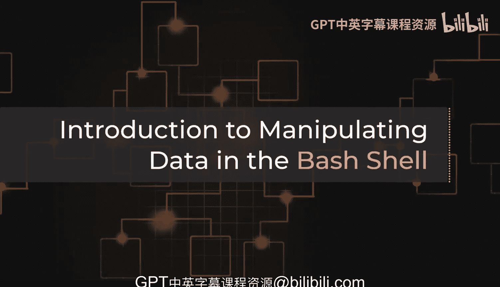
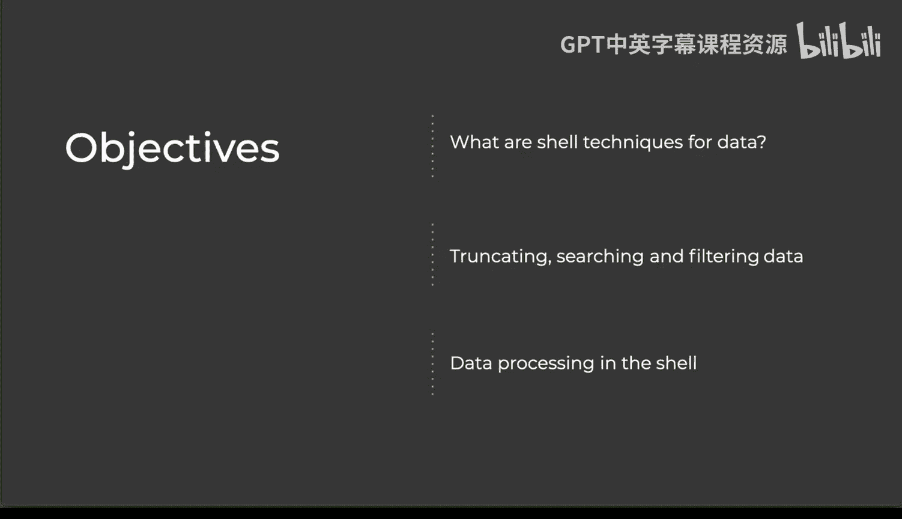

# 杜克大学｜Python、Bash和SQL数据工程基础2-4Python Bash and SQL Essentials for Data Engineering p39 39_03_02_Bash Shell数据操作入门.zh_en -BV1XS421X7tw_p39-

In this lesson we manipulate data with the shell。 There are a lot of things that are really friendly when you start manipulating data in the bash environment。

 many of the tools are developed over a huge period of time and it's very convenient to actually do lots of operations on data using bash so let's get into some of the things that we can cover in this lesson First。

 we're going to talk about what are shell techniques for data So basically what are the things that you can do immediately to start solving problems Also how do you truncate data。

 search data and filter data in the batchsh terminal really once you start to master these three things it's easy to create more sophisticated data processing pipelines。

Finally， we'll get into data processing itself in the shell， so how to use BS to go through。

 create data pipelines and solve real world problems。

Okay， let's get started。