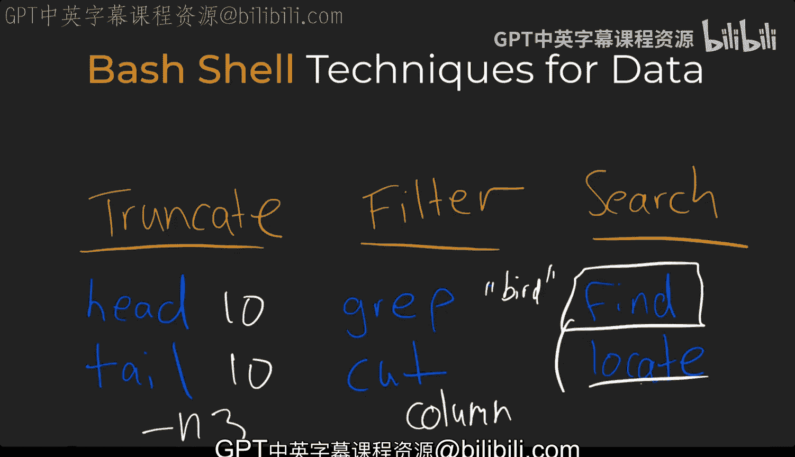

# 杜克大学｜Python、Bash和SQL数据工程基础2-4Python Bash and SQL Essentials for Data Engineering p40 40_03_03_Bash Shell数据处理技巧.zh_en -BV1XS421X7tw_p40-

In this lesson we cover shell processing techniques。

 what are some of the things that you can use to make your life easier as a data engineer and in particular I would compare this to working around the house when you're at home you have maybe a drill。

 you have a hammer， you have a screwdriver and some of these things are a replaceable like potentially a screwdriver and a drill。

 you might be able to replace those things sometimes they don't fit like a hammer and a drill those don't really have an overlap it's very similar with shell processing tools like truncation shuffling data going through and grpping data there's lots of combinations of tools that will allow you to make things much easier。

 there's some tools that don't work well together as you get more familiarity with a shell tools you'll notice that you have favorites that you really combine together to create sophisticated solutions so that's what we're going cover in this lesson and let's go ahead and get started。

Let's take a look at these shell data techniques that are really common first we have truncate this is probably one of your best friends if you're going to deal with files is head or tail and in both cases they'll grab either the top 10 or the bottom 10 of a file if you want to pass in the specific number like the first three you would just do dash n3 and we'll take some examples of that in just a second。

There's also filter and this' is another one that's really great to use is if you want to look for a pattern like。

 for example， you want to find the word bird in a file。

 you just literally put in the word bird and it'll go through and it'll find it out cut allows you to grab a specific column and this is handy if you have let's say lots and lots of columns in a file and you want to just operate on one you could use the cut command to pull it out。

 it does a lot of other things as well。 but commonly that's how I use it。

 then we have search and probably the one that most people will find themselves using a lot is the fine command you can search the file system in real time。

 and there's a lot of useful things you can do with it。

 the other one that's can have an interesting one is locate。

 which will have some examples of where it actually has a index of everything that's already on the file system and it has a very fast lookup as a result So I like both commands and there's even on OS 10。

 something called Mlocate。I'm sorry， M defined。Whi allows you to also search the metadata。

 so there's really the real time and the metadata based searches and they all can be very helpful in building complex solutions。

