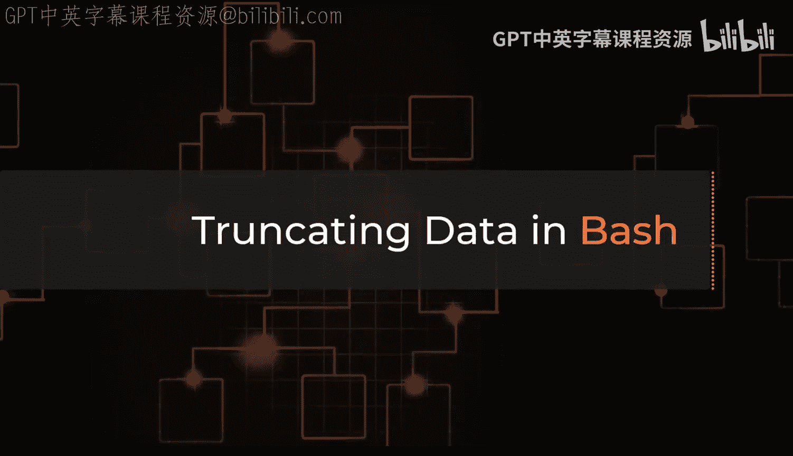
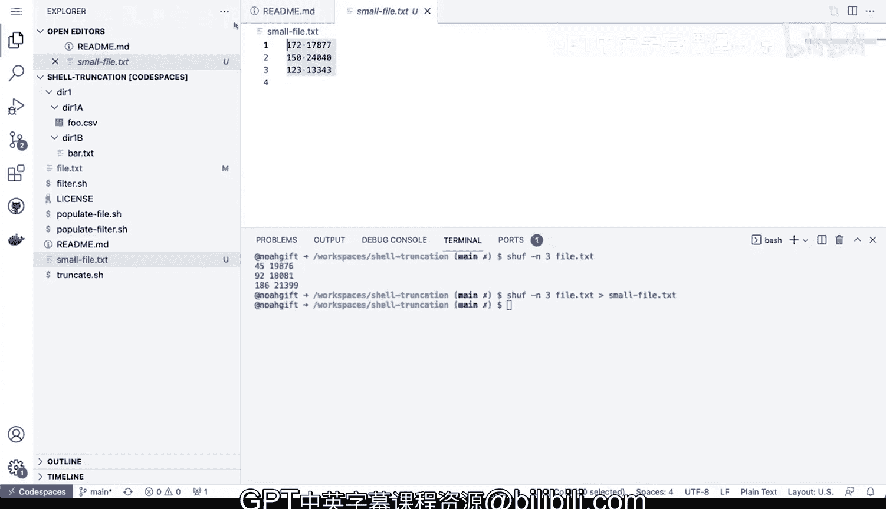

# 杜克大学｜Python、Bash和SQL数据工程基础2-4Python Bash and SQL Essentials for Data Engineering p41 41_03_04_Bash数据截断.zh_en -BV1XS421X7tw_p41-

Let's take a look at truncation， which is an important concept when dealing with big data files。

 here's a script I have called populate file and in this particular script what I'm going to do is generate a bunch of files so that I can manipulate how to get the top of the file and the bottom of the file and also select random lines in the file so to first start I'll go through here。

And run this script here， which will ask me how many lines I want to create。

 Let's go ahead and run this and let's create a 200 line file。

 And then if I do the word count dash L command， we can see that this file。It has。

 in fact 200 lines in it。 And now how would I go ahead and start looking at this file。

 especially if it's a really big file， if I， if I just run cat， for example。

Notice that it really I can't see everything on the screen right so we see that basically there's so much output that I'm going to need to truncate it in some way So what we can do is we can type in the head operation and what this does is it allows us to just grab the first 10 lines of the file here here we see that these random numbers here I can see the first first 10 lines the other thing we could do is if I only want to see a couple。

I could do this right I could just do the dash in here and this allows us to select just a small amount of the file at the very top Now likewise。

 if you run the tail command here，If we go through here and we see tail， check this out。

 we've got these last 10 rows here。And again， it automatically picks 10， but we could actually say。

 well， I want to see the last row， for example， only the last one。

 if I do dash in that allows me to select that so the tail command is really your friend when you want to go through and find the very end of a file。

Now in this particular example， I want to show another one that's pretty neat here。

 which is the shuffle command， and this really is inviuable when you're dealing with really large data sets like for example。

 you a terabyte of data and you don't have room to process it with a certain tool or you need to figure out how to make it smaller well you can use the shuffle command and what's nice about the shuffle command is in this case you can see that we're able to actually select just a few of the items but randomly select them and so this allows me to potentially pull that into a machine learning training data and this could be one of the things that I'm doing to know maybe first get the pipeline working So if you do have the ability to use the shuffle command on your system。

 this is a great way to sample a really large data and in this example。If I go in and write it out。

 I could say small file like this。And now if we take a look at this， I can just double check。

 there we go。 we've got a small file， so a very， very neat technique here as well。

 so we've got shuffle， we've got head and we've got tail。

