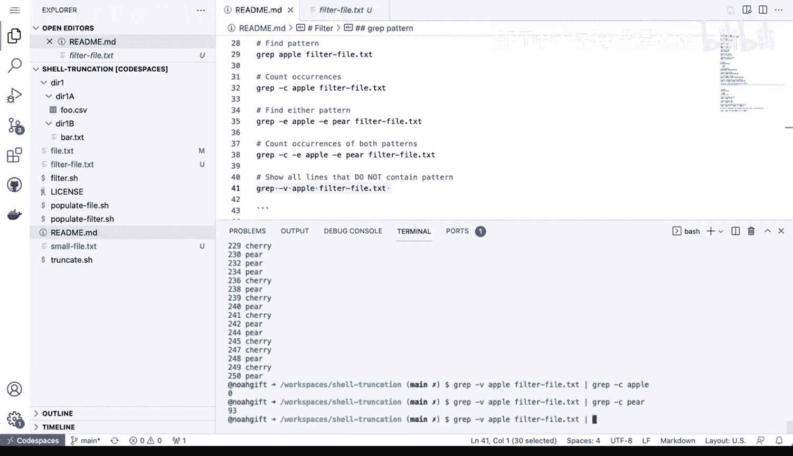

# 杜克大学｜Python、Bash和SQL数据工程基础2-4Python Bash and SQL Essentials for Data Engineering p42 42_03_05_Bash数据过滤.zh_en -BV1XS421X7tw_p42-

Let's take a look at filtering data， I have a script here that is able to generate a bunch of different strings inside of a line I'm going to declare an array that has either an apple peart or cherry。

 and I randomly put one of those in to a line and so if we go ahead and run this。

I go through here and I say populate filter。How many lines do we want， How about 250。

And that creates a file called filter file。 you can see take a look at this。

 it has the line number and then it has some string。

 right either one of those three apple cherry or pe they randomly selected。

And what's neat about this is that I can actually then start to filter this out。

 and this is again really common with a data science problem。

 you have a huge file and you want to maybe figure out a little bit more about what's going on in the file。

We could do this， this is a great way to get a start。I if I go here and I say Grep Apple。

 this will show me all the occurrences inside this file。

 and you can see there's a lot of occurrences of Apple， and it shows me。

 in fact the line number itself where that was。 What if I want to count the number of occurrences because there's quite a few。

 I don't know off the top of my head， how many there are。 Let's go ahead and count that。

We can see there's 76 occurrences of the string Apple in this file。

 So this could really be helpful if I was looking at medical records， for example。

 and I wanted to find all of you know maybe the cases of some kind of cancer and it was in a huge CSV file I could go through and run this really quick and get get a ballpark Now another thing is pretty handy that you can do is you can say what if I want to find not just that apple pattern。

 but I want to find another pattern。 Well if you add the dash E here。

 we can find a couple different patterns in this case you can see we have Gr for Apple and GrP for pair either one will count look there we go。

 I can see all the occurrences of Apple and pear remember there's 250 items in this file so how many of them would actually be included So if we go through here and we do a GrP with a dash C now we combine all that together I can count how many occurrences of both Apple or pair。

We can see 169 out of the 250 lines in the file have the word apple word so this really gives us a lot of really really cool things that we can we can play around with but let's take it look at the opposite let's say I want to look for things other than some pattern。

 this happens a lot because you may have a really noisy log file for example。

 and you don't want to look at this one message that keeps popping up you want to look for things other than that。

 well how would you do this we can do the dash V which allows us to say。

 listen if this string appears don't show it。There we go。

 and we can see in this case exactly all of their curs that don't have the word apple in it and you could go further as well right so you could combine Grs together and we could actually say Gr D C apple right？

And we can see， look， there is no occurrences of Apple because we filtered out， what about pair。

 how many occurrences of pair， you can actually go through here and do many different kinds of operations by using GrP and also chain together GP and so this is a great way to filter out huge files and get a little bit of meaning just with one command。

