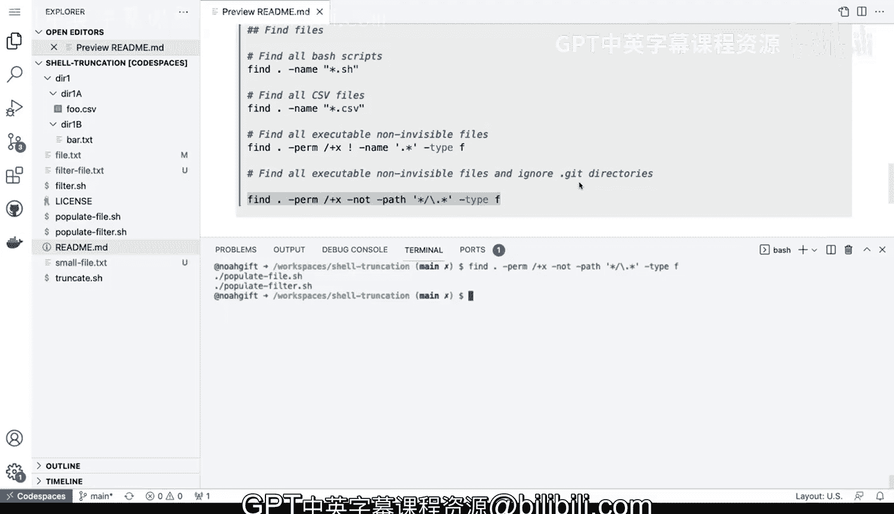

# 杜克大学｜Python、Bash和SQL数据工程基础2-4Python Bash and SQL Essentials for Data Engineering p43 43_03_06_Bash数据搜索.zh_en -BV1XS421X7tw_p43-

Let's take a look at searching the file system this is really common when you're dealing with a huge tree of data from maybe a machine learning project or a data engineering project is how do I find where anything is well fortunately on the B terminal there's a command called find that makes things very easy and if we take a look at this command let's break down what it's doing first we have the command find and what I say is look in this current working directory and find all files that have the word dots unit so that file extension。

When I run that we can see here that there's a truncate script， there's a filter script。

 there's a populate file script and there's a pop filter script so it was able to find these four files so this is a really good pattern to use is just the find the location。

 the name and that would be the file extension now what if I wanted to find all of the CSV files notice it's very similar I say find dot dash name and what will happen is it will recursively look from where I'm at。

Down below。 And look， you can see that these directories are below me and by saying dot。

 it was able to keep searching until it finally found a file that had the word CSP in it。

 and and here's my result。 So this is also a great way to recursively look through the file system is just put in a pattern using the name here。

 and then it'll find the pattern that you look for。Another thing that does come up quite a bit。

 especially if you start writing scripts is what if you want to specifically look for a certain thing like an executable file。

 And here's a good example of this is if I go through here and I run this fine command。

 notice what happens is I say， look again， starting at this current working directory。

 but I want you to find everything that has。A execution flag set on it so that's what the plus exit is here and then I want to say as long as it's not an invisible file。

 show me what it is and also don't show me directories just show me files right so there's a few different things here we have the location the search criteria in exclusion and then we have what kind of file in this case only look for files don't look for directories if we look here it gives us a somewhat surprising results first we're able to find these two files here which is great these are both set to be executable and that's nice to know but what about all these other files well these are hidden directories and they actually are part of the get version control system and so on one hand it's nice that we now know that these hooks here we could actually change these if we wanted to but the main thing to be aware。

With with this is that probably we want to get rid of this noise because we only cared about these two so how would we do this Well we can slightly tweak it。

By adding another type of exclusion， so if I go here and I paste this in。

 what's going to happen is that I again look in this current working directory。

 I again look for the executable flag but what I do this time is I say don't look in the path which is essentially this directory that has all the hidden files in it so the get location and if I go through and I run this。

 we can see that now it excluded those hidden directories and I can have just the two results that I care about so really the find is is a very important command to know about and it really can be useful in dealing with data injury projects。

