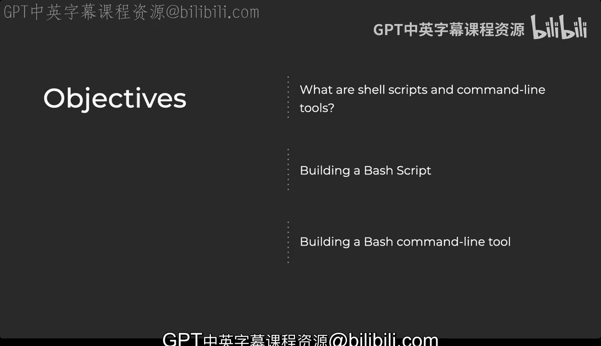

# 杜克大学｜Python、Bash和SQL数据工程基础2-4Python Bash and SQL Essentials for Data Engineering p44 44_03_02_Bash脚本与命令行工具编写入门.zh_en -BV1XS421X7tw_p44-

In this lesson， we talk through ba scripts and command land tools and dive a little bit deeper into how to build them。

The objectives are what are scripts and command line tools we'll talk about how to define both。

Also how to build out a Bsh script and finally how to build a bash Kamean tool and use it to solve useful problems Okay。

 let's go ahead and get started。

