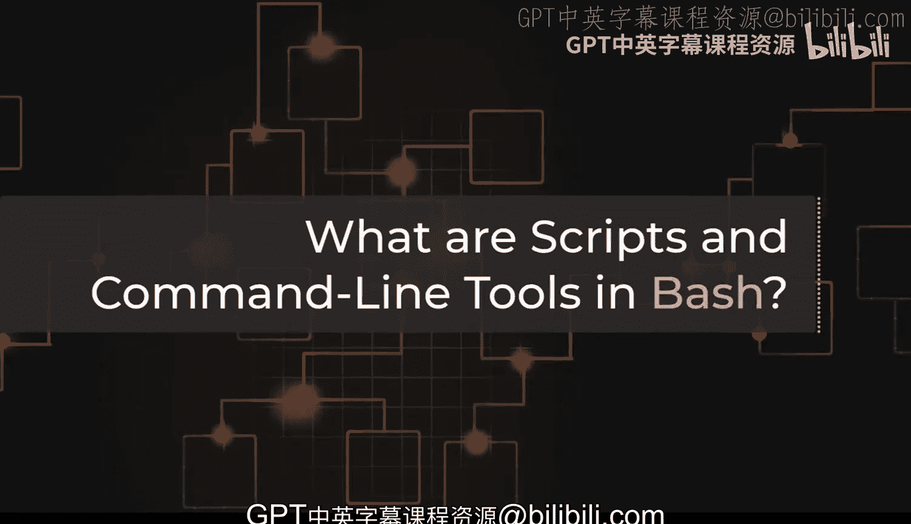
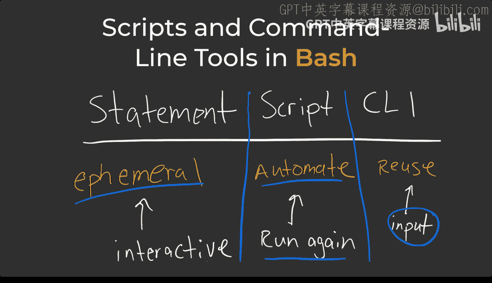

# 杜克大学｜Python、Bash和SQL数据工程基础2-4Python Bash and SQL Essentials for Data Engineering p45 45_03_03_脚本与命令行工具解析.zh_en -BV1XS421X7tw_p45-

In this lesson we talk through what is a statement。

 what is a script and what's a command line tool they solve different problems in particular a statement is something you do quite frequently in bash'll let's say grab a file and in that case you want to interactively try something out and then you throw that away you really don't care again about running that command。

 maybe you store it into history or something like this and recall it。

 but in general you're not gonna to do anything with it。

 a script is a more serious endeavor where you would take a bunch of commands or youd write a function and you build out something save it in a file add a shippingang line。

 make it executable and then this allows you to create automation workflows and then a third option is the command line tool in fact all of these Uni utilities like grab and CA and LS all of them take some kind of input have flags and really it's like the next。

Of automation because it allows you to customize how a script will actually behave so we're going to go through some of these examples throughout this lesson and then also make you familiar with how to do all these three operations。

Let's take a look at these three different kinds of styles in bash。

 You have a statement which is ephemeral。 It's meant to be done interactive。

 and this is really what the command line is all about in terms of the interactive bash prompt。

 a good example is you want to grab a file you grab a file then you get the results and then you don't care again。

 You may look at your history to rerun commands， but this is again。

 really designed for you to explore things。 A script is a little different because it really is more of a serious affair in that you want to take some code。

 put it together and actually run it again and again and a good example would be。

 let's say an archive or a backup script。 you want to run this every time you want to back up your machine。

 You don't want have to type all the stuff out and so really this is a great place for you to start to build up something and potentially check it into version control。

 The third option would be a command line interface and the key thing to know about here is that you want input。

So if you look at a lot of the UniX utilities， almost every UniX utility has some kind of commandlan interface and they'll accept things like a flag like hyphen H or hyphen L。

 they'll also expect some kind of user input as well and this is really the key thing here with commandlan tools。

 they're the ultimate form of automation because they can do all these things all at the same time。

 they're a combination of ephemeral and full automation。

And usually I tend to gear towards building things with chameleian interfaces because it gives me the most amount of flexibility。

