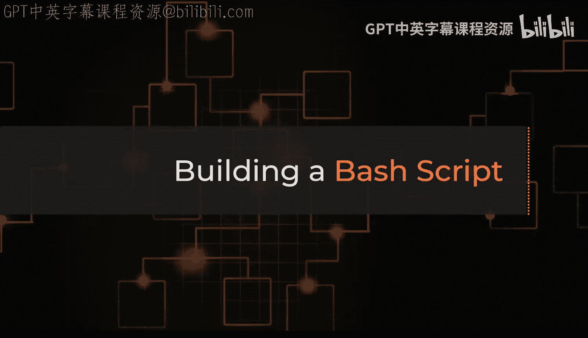
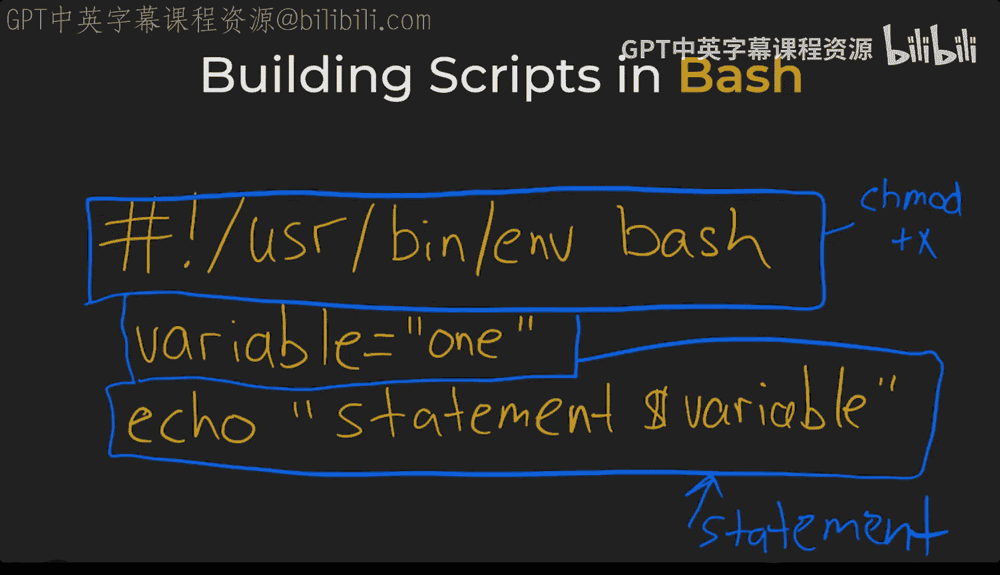
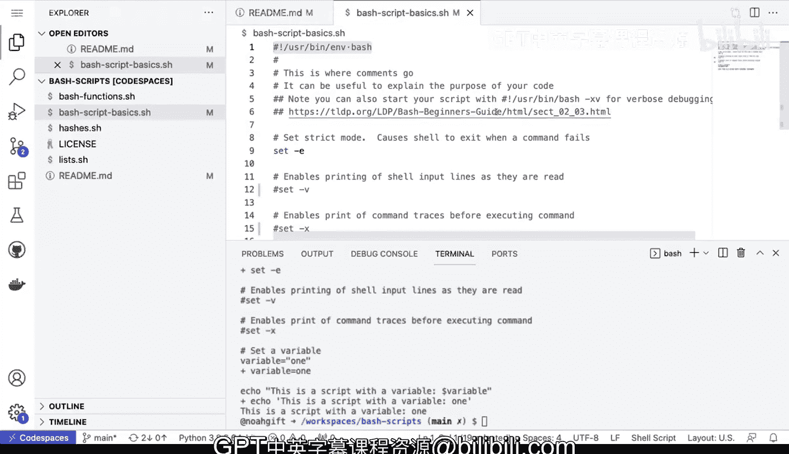

# 杜克大学｜Python、Bash和SQL数据工程基础2-4Python Bash and SQL Essentials for Data Engineering p46 46_03_04_构建Bash脚本.zh_en -BV1XS421X7tw_p46-

Let's dive into some of the key components of bash scripts。 Really， at the very beginning here。

 we have the shebang line。 And this sheang line。 What's important about it is it tells the script。

 what environment it should run in。 In this case， we say we want to execute bash。 It could be Python。

 It could be Z shellll。 It could be T shell It could be some other shell。

 So this is important because now I don't have to type in bash before I I put in the script。

Another thing to point out as well is that you would want to make this executable by running the chama command with a plus X and this says anybody could execute this script and I can use it again in in my automation now the next thing to point out here is a variable if I want to create a variable all I need to do is assign it via this equal statement and this is a string I'm setting and I say variable is equal to1 now I can use it again in in some part of my code Finally this is a statement in this section right here you can see that the whole idea here is that you chain together statement and this case I'm basically printing out the statement word plus the variable that I set earlier so really there are only a few things to know about to build your first batch script and once you get the hang of it really it's a form of automation and you can put a series of steps or almost。

A to do list and then those things sequentially run。

Here we are。 We have the basics of a ba script。 Really the core components are the shang line debug modes。

 statements and variables。 Really， if we get down to the minimalistic understanding of how to write a bash script。

 these are the three things that I would recommend。 And if we take a look at this script here。

 this bash scripts basic notice this is the sang line right And then a good thing to point out is that it's really a good idea to put comments at the beginning of your script and this is where you would go through and say what your code actually does so that another person 10 years in the future can look at your script and go。

 oh okay， this is what what's happening。 Now the next thing that's important is that it's often a good idea to set strict mode and you can do this by doing set hyphen E。

 And this causes the shell to exit when a command fails。

 And this can be really good because it makes your code more robust against potential errors。

 Another thing you can do。😊，Is you can enable printing of the shell input lines as they're red right and this is nice for debugging Another thing you can do is you can enable the printing of command traces before executing the command so this is nice because it'll tell you what it's about to do and then it'll go ahead and do it Finally really the core components are a variable right here here I create a variable and then I do a statement and you can see I use that variable in a statement so let's go ahead and run this if I type in Ba scripts basic notice it goes through and it does that debugging here now I can comment this out。

Right here and we can run it again， you can see how this is less for Bo now。

It just says this is a script with a variable one so oftentimes you can toggle back and forth these settings here and decide you know what level of verbosity you want in your code one other thing to point out that's a kind of a neat little feature of bash。

Is that you can also set a verbose debugging mode as it's executed。

If I go here and I change the shipping line to be user Bbaash Xv。

 let's take a look at what this does， we go through here。

Notice that it prints a lot of stuff to stand it out and in fact。

 what it's doing here is it's showing me everything about the execution of my code。

 including the environment that it's running through basically what's happening before and actually during the execution of my code and even prints out the entire script itself before it goes through and print it out so this would be really if you're super stuck in your code and you want to do verbose debugging that's a good option to be aware of。

