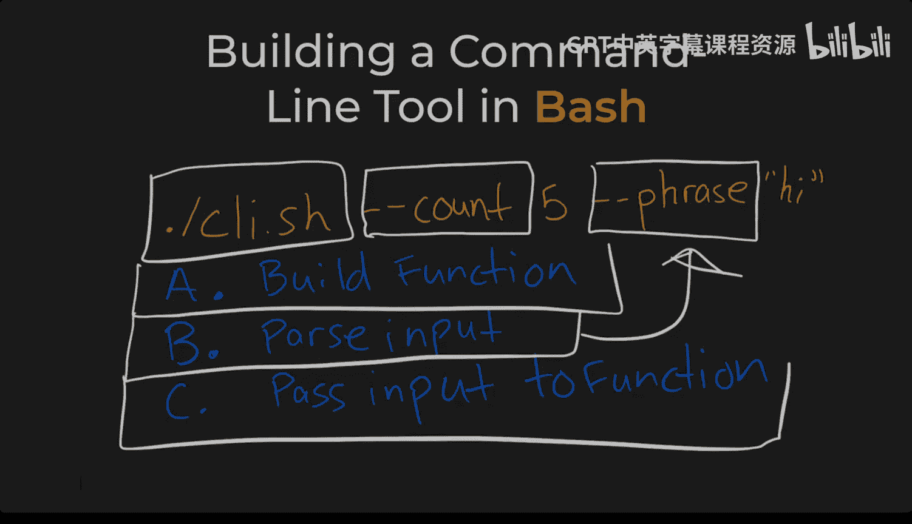
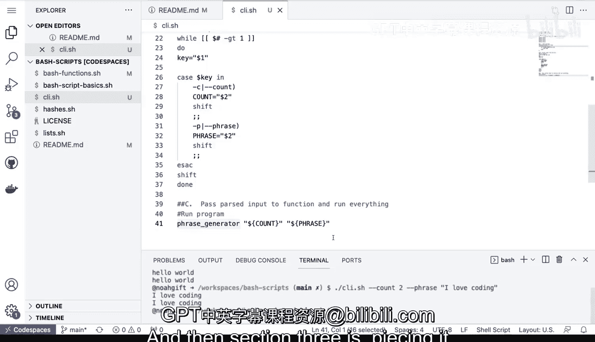

# 杜克大学｜Python、Bash和SQL数据工程基础2-4Python Bash and SQL Essentials for Data Engineering p48 48_03_06_构建Bash命令行工具.zh_en -BV1XS421X7tw_p48-

Let's take a look here at what a bash commandlan tool is all about。 There is the name of the script。

 This is the first part。 and then there's options that you pass into collect values。 In this case。

 we see this count option here would be dash count and there's a value associated with it。

 There's another one here， phrase again， dash phrase。

 So something in my code needs to be able to parse these options。

 So really there's a formula I've come up with。 and this is what you could apply to pretty much any bash command line tool。

 First you have to build out the functionality of the code and that could be an add function or a account function or whatever it is you're building。

 maybe a backup script。 you build it into a bash function。 Second。

 you need to have some code that will be able to parse the input again， this would be this。

You need to be able to parse the things that come in from the command line。

 Once you've got those two things。 you're ready to go。

 you just need to wrap it all together and pass that input you collected to the function。

 This formula is a great formula to build command line tools let's go ahead and watch it in action next。

 All right， let's take a look at the command line tool here that I was showing earlier and let's see the formula first we have again。

 the name of the script。 This is the Ci dosh。 I want some options to parse and then I also want the ability to run some piece of code。

 some kind of logic。 and so here's the first part part A here。

 which is this generates phrases multiple times。 So let's break down this step by step this is the name of the function This is the actual work which is a for loop where I count how many times somebody passes value in and then I echo it out。

Now in part B， this is where the option parsing will be set up and this can be something that's fairly formulaic。

 There's a case statement which allows me to toggle between different values and it's inside of a wall loop so I say wall basically if there's one or more parameters go through here and capture the output for the count capture the output for the phrase and then when you're done wrap up this whole loop Finally。

 now that I've got the input all I need to do is pass this into the function that I defined earlier and then in this case I just print out the count and I print out the phrase so how does this work well we can go ahead and run this from the command line here we go Ci that's the name of the script I have a option here。

 count5 and I have an option here phrase now we can change around and we can change the count here to a different value we'll say two and we'll do a different phrase here we can say。

嗯。I love coding。Right there we go and this should be able to give us two two more values here There we go。

 I love coding so really this is a great formula that I would recommend when you're building compelling tools think about section A。

 B and C， Section A is the work Section B is the parsing and then section3 is。😊。

Piecing it all together and running your code。