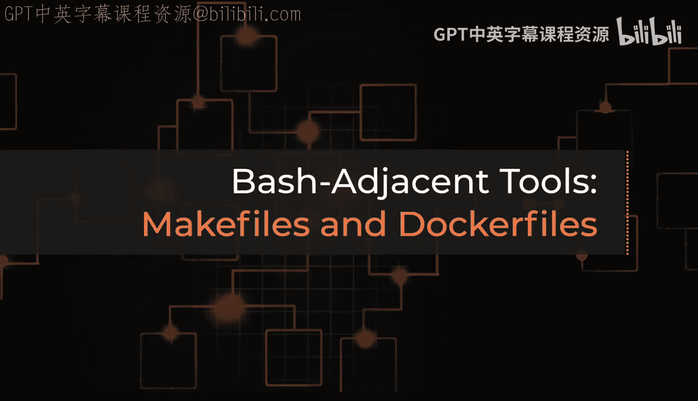
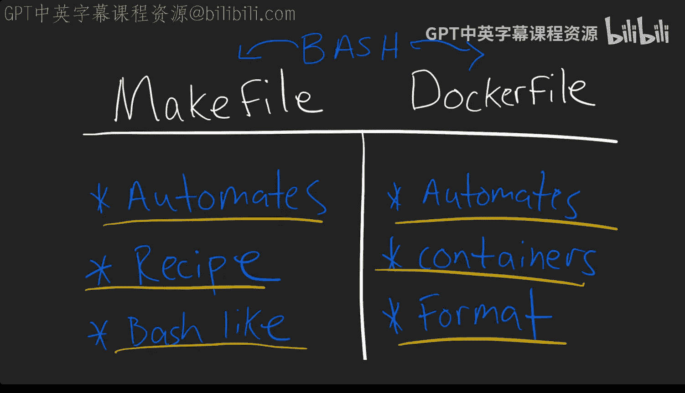
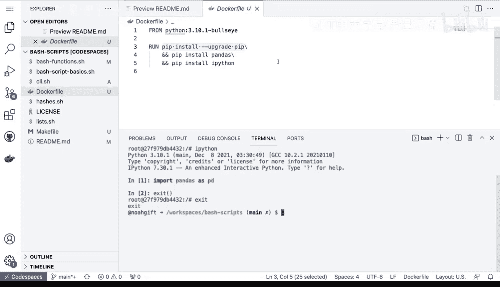

# 杜克大学｜Python、Bash和SQL数据工程基础2-4Python Bash and SQL Essentials for Data Engineering p49 49_03_07_Bash相关工具：Makefile与Dockerfile.zh_en -BV1XS421X7tw_p49-

Okay let's take a look here at the difference between a make fileile and a Docker file。

 one thing they have in common is really a heritage around bash。

 there's a lot of similarity in the case of a make file what it does is it automates things and in fact it's been used for decades and it's one of the older primitives that you can find around with Uniix and Linux and we'll take a look at a make file that is used by the Linux kernel。

Now there is another way to think about a make file。

 It's really a series of recipes and it's also bash like。

 So this means that it mostly looks like bash， but it has a little bit of a difference between some of the things that you do and it's always important to look at the documentation if you want to do something complex。

 Next， there's a Docker file Well what does it do well it also automates things。

 I use them a lot to build containers for machine learning applications。

 and that's really the idea here as it's a containerbased format and it's really something that you can do where you can inherit things from Linux or inherit things from bash or inherit things from maybe a bountu you can inherit all this really good logic and then encapsulate it and tie it together in a container and send that somewhere So really this is a heritage that has a commonality with bash And once you understand bash it's much simpler to get into make files and build them out。

 and it's also simpler to get into Docker files and build them out。

 Okay let's go ahead and take a look at。How these work in action。

Let's first take a look at make files here。 The basic formula is a target and a recipe and a good example I would say to start with would be this is the ultimate culmination of what you could do is you could open up a Linux make file here and we can see all the different things that you could do with the Linux kernel。

 So this is at the elite level this is the most complex possible make file potentially you could build and you somebody with decades and decades of experience building something like this you can see there's tons of documentation but essentially it looks like bash and that's really the main takeaway Now if we want to go ahead and look at a very。

 very simple make file here。 let's take a look at the recipe first so this is the name of the recipe in this case would be hello and all I do is a print out a statement or echo out a statement this is a recipe called ao I can build a second recipe and this recipe would say again。

 something something different。 Now it could be commands like Ls it could be installed。

like Pip install you can put really anything you want inside of here and this all will actually be something that can run multiple recipes at the same time so let's go ahead and take a look at how this will work in practice so if I bring this up here for a second。

What I could do is I can type in the word make and as long as you're in the directory where the make file exists。

 you just type in make and if you do a tab，Most operating systems will have the batchsh completion setup will tell you you have three different recipes you can run all of them。

 the goodbye or the hello， let's go ahead and run the hello first。

 you can see that it prints out the command and then it runs the command same with goodbye so if we go through here。

Goodbye， it prints out what it's going to run， then it runs it Now to run all of it。

 you can just say make and it will run everything that's in the all syntax so this is really a good formula for building testing for doing deployment I use them all the time in my Python projects as a data scientist。

 data engineer I think make files are one of the things that are really going to bring you to the next level and I would encourage you to use them。

Now let's move on here to Docker file next year now if we go to this readme。

 I can take a look here and take a look at a Docker file， really what is it。

 it builds a container you can read more documentation here let's go ahead and open this up real quick here's Docker file reference in a nutshell what a Docker file does is it allows you to containerize something and there's a series of commands here that get built by using the Docker build command and really there's only a few things to really be care about there's comments there's the run and now here's where the bash history comes into play is that this part is gonna be the bash part notice as well that you'll see this quite a bit is this return character and then potentially an ampersand which is something you see a lot so let's go ahead and and run our own Docker file here look at this what I do is I go to Python 3。

10。1。And I inherit from that version of Python so you can find these in Docker hubub you can go through and know basically find whatever Docker container you want and inherit from it so this installs this specific version of Python and here's where bash comes into play is that this run command literally runs bash command so again having a strong understanding of bash is helpful now let's walk through what this command does the first thing that happens as I do a Pip install of basically an upgrade and then I do the return character now notice here's the double ammppersand what does this mean this means as long as this first command was successful go ahead and run this next command in this case we sayPip install pandas so I install the pandas library I do another carriage return and then I do another install command I sayPip install i Python so what's neat about this is that this again allows me to very easily install things run things。

And that's really the point of a Docker container Now how do we actually run this thing， well。

 the first thing to do would be to do Docker build。

Dot and this will actually build a container locally。

 Let's go ahead and take a look at how this works。 Notice there we go。

 we're able to build this container very quickly。And what's nice is it's going to inherit from that version of Python right this is pulling it directly from Docker hubub itself if it was from a different container regitry。

 it would be a different command and then it also notices it's able to actually run this these install commands for me and I've were to run it before it's really quick because it's cached but it would actually go through here and install this once we've got this built in order to see it I would just type in Docker image LS。

And we can see the one that was created very recently。

 This one 17 minutes ago could be the one that I could use。 So let's go ahead and pick this one。

 And so I would say Docker run dash I， the name of the container。

 and then whatever terminal I want to start up。 And in this case， I'd like to start up in bash。

 Let's go ahead and try it。 Great， now I'm in the new container that I just built。 And in fact。

 if I type in Python， what happens There we go， Python 310。 What else can I do， Well。

 because I installed some libraries， I can try them out， So here we go， Here's that Python。

 and I can also try out pandas import pandas asBd。There we go。

 so really a Docker container in order to master it and we can go ahead and exit this。

 you have to know a little bit of bash and this is why it's so handy to have a background at it once you've got that then you can build out your Docker format so that you can package up your data engineering solutions。

