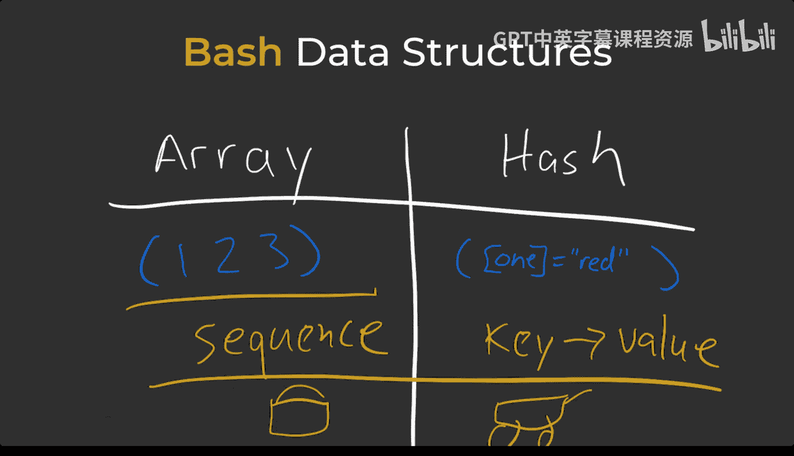
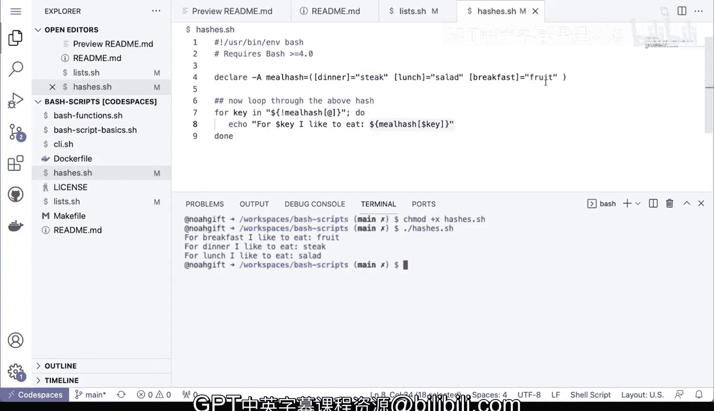

# 杜克大学｜Python、Bash和SQL数据工程基础2-4Python Bash and SQL Essentials for Data Engineering p50 50_03_08_Bash数据结构.zh_en -BV1XS421X7tw_p50-

Let's take a look at two data structures you'll use in bash to store information and other languages like Python an array is referred to as a list and a hash is referred to as a dictionary。

 In this case though in the array， really it's a sequence。

 So the idea would be you could pack a bunch of things into this array here and then as you want to process them。

 youd write a for loop and youd pull one off at a time and do something with them。

 So this is really common， for example， if you wanted to back up a bunch of different files or process a bunch of different files。

 an array could be a great technique to use to collect all those together。

 A hash is a little more complex， but also more powerful and that you have to refer to things via a key and then once you refer to the key you get the value。

 So I like to think of the difference between these two things the same as if in a grocery store。

 you have a basket， So why would you have a basket if you walk in， it's super simple。

 you just put stuff in， you go to the counter and you pull stuff off。

 A hash is a little bit more like a shopping。It's actually more complex to have the shopping cart。

 but it's more powerful because you can actually put more stuff in it。

 you can roll it around on wheels。 it's not as heavy so I think that's really the tradeoff is the simplicity versus the power and in an array with bash it's very very simple but a hash which is a newer form of a data structure in bash version 4。

0 is quite powerful so let's go ahead and take a look at examples of both of these coming up next here we go I have an example here of a loop this is something that is pretty straightforward to look at I declare an array and in that array I have an Apple I have a pair and have a cherry。

Very simple to process this in a for loop。 Really， it's just a few lines of code。

 I would say for I in array。 And this is the syntax to pull things out of here。 do something。

 In this case， I would iterate through in each of the loops。 will process something from this array。

 So it's really， again， like pulling one thing out of the basket at a time。

 if I go through here and I run this。 We can see， in fact， that。

This should be able to be made executable。Like this， and then I can run it。There we go。

 This apple is delicious， This pear is delicious， this cherry is delicious。

Now let's go to basically a hash here or an associative array or a dictionary。

 there's lots of different ways to refer to it， but basically this is a key valuebased lookup notice it's got to declare with an uppercase A and that's really the big difference between the regular array and this array it is going to require batch 4。

0 most cloudbased systems do have this， but look it's actually pretty intuitive I would create a hash right here。

 I call this the meal hash I have a variable called dinner and I assign to it steak for lunch I assign salad for breakfast I assign fruit Now what I do is I say I want to loop through the key value pairs of this so I say four key in and I go again to this hash here and I say do something in this case I want to pull the key out and then I want to pull the value of that key out so I must refer to that key again in the hash。

And that's really the way this trick works， so let's go ahead and run this one again。

run this one for the first time。 If I go through here and I saymodx hashes。

 let's go ahead and run this， What happens There we go for breakfast， I like to eat fruit for dinner。

 I like to eat steak for lunch， I like to eat salad。

 So what's neat about this is that it pull the key value key value。

 key value pair out each time I went through the loop so this could really be powerful for many things you're doing like for example。

 I want to pull every host on the network and I want to apply some action to it where I want to take this data from this certain data store and I want to apply some action to it So the key value pair is a really powerful way to program in bash and also it's really good for uniqueness where you can do a key lookup like does this key exist If it does then I want to do something if it doesn't I want to do another thing and there's a lot of power that you get by using this advanced feature in bash。

