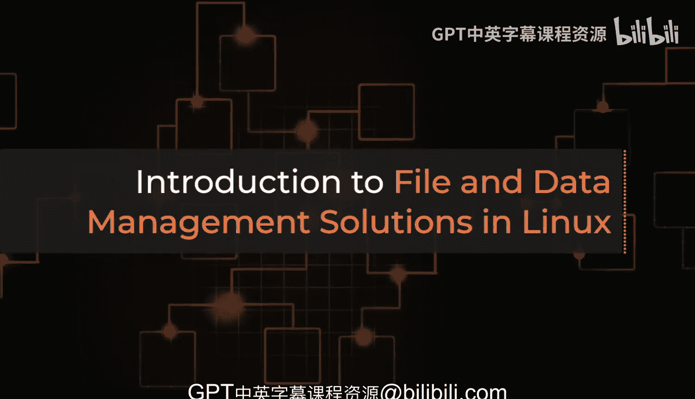

# 杜克大学｜Python、Bash和SQL数据工程基础2-4Python Bash and SQL Essentials for Data Engineering p51 51_04_02_Linux文件与数据管理方案构建入门.zh_en -BV1XS421X7tw_p51-

This week， you'll learn to use Linux to compose file and data management solutions。

 you'll also learn to search the file system， modify files， directories， and control permissions。

 you'll also learn to process text in bash and apply this knowledge to create a search solution in Bsh。

