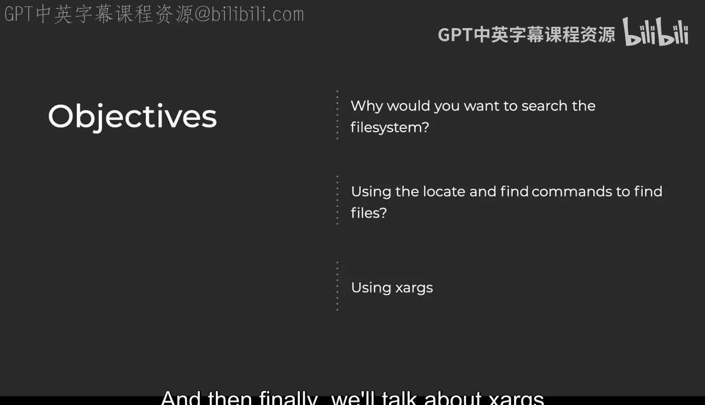
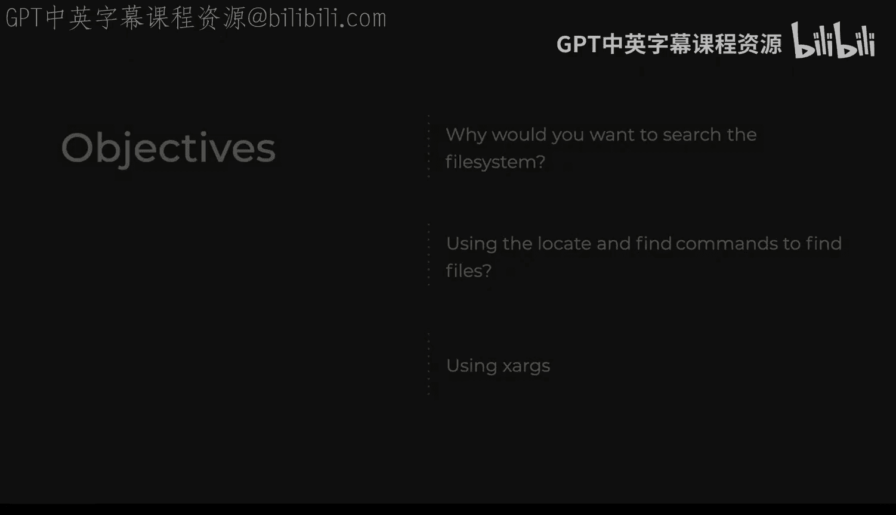

# 杜克大学｜Python、Bash和SQL数据工程基础2-4Python Bash and SQL Essentials for Data Engineering p52 52_04_03_Linux文件系统搜索简介.zh_en -BV1XS421X7tw_p52-

In this lesson， we work through searching the file system， talk about some best practices。

 and some common tools。The objectives for this lesson include the following why would you want to search the file system。

 really there are a lot of reasons you know searching for duplicate files archiving files。

 we'll go through some of those reasons。We'll also talk about the locate and find commands。

 two commands that you can use to locate files and search the file system。

 including using regular expressions， and then finally we'll talk about XAGs。

 which is a powerful way to enhance arguments on the command line。

