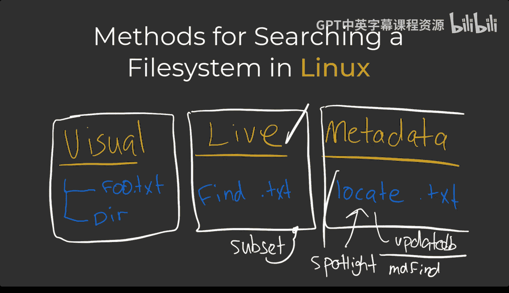

# 杜克大学｜Python、Bash和SQL数据工程基础2-4Python Bash and SQL Essentials for Data Engineering p53 53_04_04_Linux文件系统搜索方法.zh_en -BV1XS421X7tw_p53-

Why would you want to search a file system， Well you want to find something， really。

 it's a very simple reason to search a file system a lot of times when you're looking at maybe your desktop。

 you'll notice that it's easy to find things if there's a few files but hard to find things if there's hundreds of files Likewise once you start to get to enough data on your file system it's very difficult to know where something is and you could even categorize this into three different sections of search First there's visual search and it's beyond just the desktop。

 you could have a hierarchical structure on your file system where there's a tree of data and logically things go into a certain segment of the tree and this is something actually that is used quite a bit。

 it would be a conventionbased approach a second approach would be to actually look through and do a linear search through the file system where you look for a pattern and this is where we use tools like the find command and you can go through and it takes a little bit of time especially as。

The file system is large， but you will eventually find things。

I would say the third approach that's really an emerging technology is the metadatabased approach and that's what the locatecate command does on Linux is it creates a database of everything that's on the file system and then it's an instant lookup because you just look at the file that contains where all the metadata is on the file system on OS10 they have something similar called spotlight that also has the metadata approach where it's constantly going through and indexing the file system so I think it's important to know that all three of these methods are used very frequently and you will probably use all three of these methods yourself and it's important to know when to use which method for what problem you have at hand。

Let's take a look here at three of these different modes for searching the file system we first have this visual mode。

 which is really worth talking about because as I mentioned earlier。

 the hierarchical file system that's central is starting to make more and more of a comeback and so many organizations might create a structure that's logical。

 let's say a hierarchical structure where there's images in one directory or dates in another directory and you can visually look at it。

 I think this is important to be aware of and it is often the first place you would go to if you want to find something on a file system Now the live method of finding things is pretty interesting because。

As your data grows， obviously it' going to take longer and longer to search the file system。

 this is an O to the in problem is more data becomes available， your search takes longer。

 one of the ways that you can prevent this is by doing some types of restricted searches right so you could look at potentially a subset of the data and then you don't need to look at the entire big data data set。

 you could also look at a type of file and in addition have a subset of the data so the find command is extremely helpful and I would argue that all data engineers all data scientists should understand how to use it and we're going go into some more details on that and a little bit but it is important to know that it is live and that's the most important thing to know and it'll take time to do a search。

The final one I'll mention is this concept of metadaabase search My personal favorite is the metadata search and the reason for this is I don't have to even touch the file system all I do is I look into a file and this file contains every single thing that's on the file system and with the locate command。

 one of the things that you have to do is you have to run a command called updated DB and typically what people will do is they will actually run this in a Chonjob or nightly job where itll actually go through and look at the file system and look for updates。

 sometimes though this is not available and you have to manually look for it and other more sophisticated file systems。

Like the OS10 file system， they have something called spotlight and spotlight has a similar utility and they call that one MD。

 and I actually do like to use the MDfin command because it actually is able to look at the entire file system and give me results based on that search。

In a nutshell， there are three different ways to look at a file system as it's important to know how to use each of these three methods。

