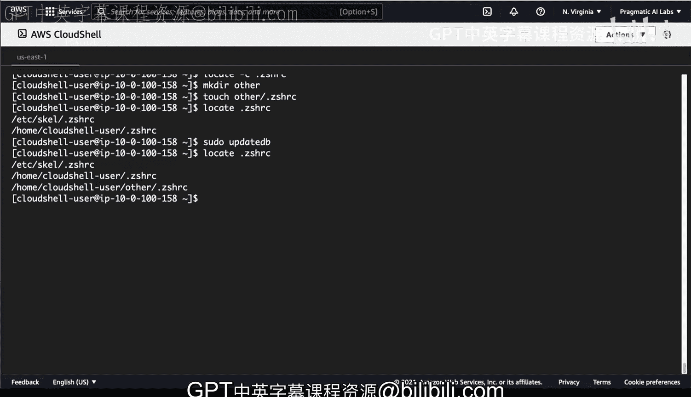

# 杜克大学｜Python、Bash和SQL数据工程基础2-4Python Bash and SQL Essentials for Data Engineering p54 54_04_05_使用locate命令查找Linux文件.zh_en -BV1XS421X7tw_p54-

Let's take a look at how to use the locate command really on any Linux system。

 the locatecate command should work just fine in this particular scenario what I'm going to do is take a look at the AWS Cloud shell and the first thing I would want to do is install it so we type in pseudo install and locate again this would be different based on a Deian system or some other versional Linux。

 but in this case I'll go ahead and'll install it once I've installed it。

 the next thing that I'll need to do is update the database because the locate command requires a database to index the file system you have to manually update it if you want to get the latest results so we can go ahead and do that I'll type in pseudo update DB and what this does is it finds the latest files and puts them into the locate database。

Once you got that going really it's pretty straightforward what you can do is type in locate and then tilda I'm sorry locate do zshRC here and this would find all of the locations for the Zhell configuration file here we go there's two locations which is pretty nice now what if I wanted to count how many times the do zshH file existed in this case is a small but there could be let's say maybe a movie files that would be thousands on my file system well all I would need to do is just type in C。

There we go too so we're able to find two instances of this particular file so really you can see it's very simplistic。

 very easy to use， but also very powerful and one of the things that we can do as well is I can also find case in sensitiveitive searches。

If I went through here and I typed in dot ZSHRC like this， what would happen？Nothing。

 because it case sensitive， if I do dash I。This will make the locate command case insensitive and now I'll be able to find everything on the file system。

Okay， so one of the things that's important to be aware of is that the locate command only knows about the last time the update of the database was run and so for example。

 if I make a directory here called other and then inside of that other I go ahead and I do a dot zshRC if I go through and I say locate do zshRC notice that its still only knows about these two commands and the only way it's going to know about the third do zshRC is if I do an update so I'll go ahead and do that I'll say update DB。

And now if I go through here and I do a locate command again。We have three different entries。

 so that's just one got to to be aware of， but in general。

 I would say the locate command is extremely powerful and I use it often when I'm searching the Linux file system。

