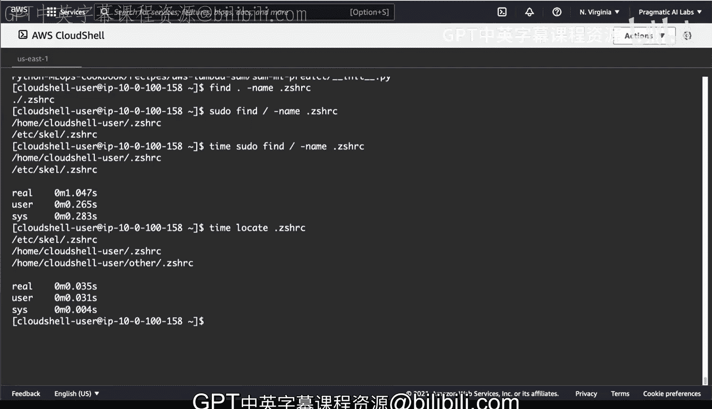

# 杜克大学｜Python、Bash和SQL数据工程基础2-4Python Bash and SQL Essentials for Data Engineering p55 55_04_06_使用find命令查找Linux文件.zh_en -BV1XS421X7tw_p55-

Let's take a look at the find command， the find command allows you to search the file system in real time。

 and as a result it becomes one of the most useful tools for someone needing to find a pattern or find something on the file system to start out with you can do this you can type in find。

The location you're looking for， for example， if I do dot。

 I want to look at this current working directory and below， and then I want to look for name。

And then dot ZSHRC in this case， it's going to find all of the dot zSH files that are at my directory or lower。

Here we go。 We can see that in fact found one Now there are more than just that one do zshhRC file on my file system though and so how would I find this Well。

 one of the things to be aware of is that you need to do a search of the entire file system and as a result I'll need to run the pseudo command because this allows me to have more power and look at all of the locations that my user may not have access to so in order to do that I would type in pseudo find and then at this point I want to look at the top of the file system and then again do name and then do dot zsRC。

Here we found a second dot Zs each file here， and so that's really the power of the find command is that it can find things in real time。

 Now this isn't free though because there are some problems with the find command and as a result。

 one of the things that I'll do is actually look at this and run the time command。

And if I do a time pseudo find slash。Dash name do zsHRC notice that it takes about a second to search the file system。

 so it's a pretty expensive command and if I go through and I run the locate command and I do dot ZsHRC and I put a time in front of it。

 what happens？It's literally over100 times faster here to run it this way。

 And so you can see that in this case， basically the 0。

03 seconds is significantly quicker and so because it has the ability to look at a database and go through and find things from the database it's much。

 much quicker so really you have to choose when you want to use one versus the other。

 So the fine command is something that I do recommend people use and just one thing to be aware of as the speed also be aware of the location that you're looking in other than that。

 it's an impressive tool that you should have in your toolkit。

