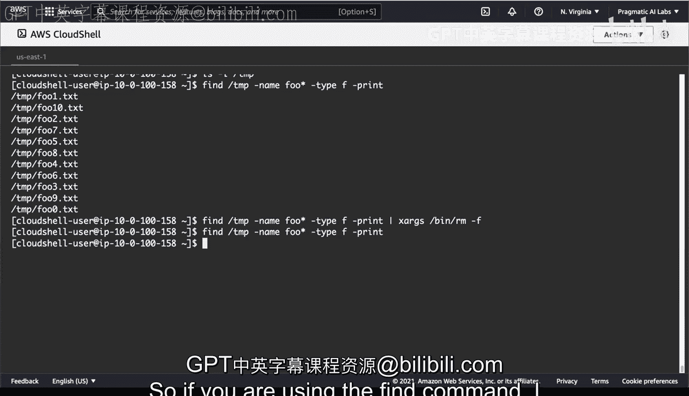

# 杜克大学｜Python、Bash和SQL数据工程基础2-4Python Bash and SQL Essentials for Data Engineering p56 56_04_07_使用xargs扩展Linux搜索能力.zh_en -BV1XS421X7tw_p56-

Let's take a look at another aspect of searching， which is what do you do once you found a file。

 So to start with what I'm going to do is I'm going to create a bunch of files in the temp directory。

And in particular here we have a F file， and I'll create a sequence of files。 in this case。

 we'll create 11 files， so 0 to 10。And if I go through and I create these files here。

This will give us the ability to take a look now at these 11 files。There you go。

 you can see they're all calledF with a number associated with them。Now。

 let's say that I had a huge section of these files over the file system。

 It could be a real problem if I had to do something to move them， clean them up， etc ce。

 And this is where the fine command really comes into play is that it is helpful to be able to find things on the file system。

 So first， let's go ahead and do that。 Let's go ahead and do a find temp dash name。

 F type F for file and then go ahead and print these out。 here we go。 we see these same files。 Now。

 I could even make things a little more interesting by going through to the temp directory and creating another file called。

F， let's say fooder or something like this。 And now what'll happen is if I do that search。

 notice that the directories doesn't show up because I'm doing the filtering。 So again。

 we have a great fine command here。 But let's say I wanted to get rid of these files。

 What would I do。 Well， what we can do here is actually pipe it into X As。

 And so let's go ahead and run this command up。And I'll use the pipe operator here。

 and what I'm going to do is I'm going to type in AR GS， X A R GS。Bin RM F。

 And what this is going to do is every time it finds a file in the search。

 it's going to perform this operation。 In this case， it's a remove。

 but it could be some other command， whatever it is you need to do， I don't know。

 find the metadata about it or archive it or etc。 But in this case I'll remove it。

 Now let's go ahead and let's run the command again， does a find。

 they're all gone right So this is really the power of using the X ags command is it accepts standard input and allows us to do more powerful things like perform some action based on that search。

 So if you are using the find command， it would also recommend you use X as。

