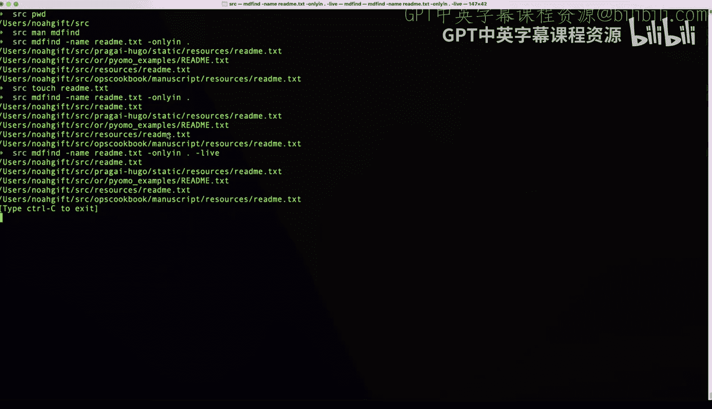
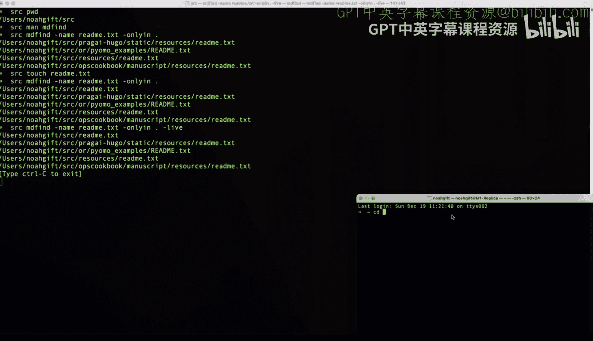
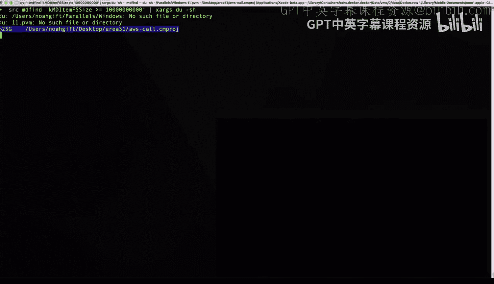

# 杜克大学｜Python、Bash和SQL数据工程基础2-4Python Bash and SQL Essentials for Data Engineering p57 57_04_08_在OS X上使用mdfind.zh_en -BV1XS421X7tw_p57-

Let's take a look at OS10， which has a very unique metada search offering called MDfin Here I'm in the source directory which the full path on my system is users know a gift source。

 And this is where I put a lot of source code and you know change around things with code。

 and what I'm going to start out with is first finding more information about the find command。

 the MDD find command for OS 10。 So if I do man Mfin。I can look at all the different things I can do。

 So what's unique about this is it has things that are available specifically to the OS10 operating system。

 You can see here this live allows me to do realtime metadata searches so it'll update the database I can count things I can also specify that I want to search in just a particular directory and then this is really fascinating is I can do very complex queries like look at the metadata of files。

 So there's a ton of really powerful things that you can do with MD find and once you find yourself using commands like locate or the find command itself you might also want to take a look at MD find Okay let's go ahead and get a first search here。

 What I'm going to do is I'm going run MD find and I'm gonna to say name I'm going to look for all the readme files that are only in this current working directory or below Here we go you can see that there's a few different readmes that I have in projects that I've been working on Okay that's pretty neat。

What happens if I go through and I create another read me file， What happens。Well。

 spotlight doesn't yet know about this， so it doesn't yet show up until I create that readme file。

Now spotlight was able to pick it up boom， we can also see this immediately。

 So what what's kind of neat about this is that by using the metadata search engine。

 it's able to really quickly pick up new things Now I can also do this which is I could have a live command。

 which I do which is this and notice that it's just going to sit here and it's going wait for files to be created And so what I could do is I can open up another tab below here and maybe put this right over here and then I could Cd into the source directory make this a little bit bigger Cd into the source directory and start seeing if things will show up so here we go let's go to source and and we'll make another readme file and we'll do this we'll say。

Read me。Let's first make a directory。Foo， and then we'll say touch foo。Read me TXT， what happens？

there we go query update six matches and then we're able to get new information as a result of this。

 So that's what's kind of cool is that you can also do these realtime style searches by using the himDfin command Now there's more though that we can do beyond that and one of the things that we can do is that I can actually look for date ranges as well So here what I'm gonna to do is I'm going to say MDdfin look for the name readme。

 txt and then I'm going to say only again look in here。

 but I want to look for the last 10 years at this date range。

 what do I see inside of here great notice how the new file that I created doesn't show up or the new directory with the file and it doesn't show up because the fact that I said only in this particular date range but if I wanted to change this I could go through here and I could say 2022 which would be into the future but it would also look at the stuff that was just created now we can see in fact that this new one I created。

Shows up and the original one that I created shows up so lots of very。

 very powerful things that you can do with MD find here with dates now a really interesting thing you can do that I think many people aren't aware of is that you can also look for files of a certain size and this is extremely useful so let's take a look here if I say on the entire file system not just the source directory because I'm not limitating it I want to find files that are basically 10 gigs or larger well here we go。

 we can see here that these I have some some Xcode files here that I may want to delete off of my system and look how quick it was just instantaneously found this query here on all the different you large files that are on my file system Well that's somewhat useful but what if I want to find out exactly how big that file is right because this just says over that size Well。

 we can use Xargs here。And XharGs has the ability to give us a command that's run against every one of the search results in this case I'm going to say do DU dashSH so show me a human readable summary of the size of this file okay here we go in fact we can see that this project right here is 25 gigabytes which seems like it's a little bit big here's another one that's 12 gigabytes here's another one's 11 gigabytes so again really really useful you know command here in fact if I wanted to I could even filtered a little bit more and I could look for only the things that have the word Xcode in it。

Like this。And now we've actually got a nice clean output here that shows us the ability to look for only things that have the word Xcode in it perfect right。

 we have 15 gig files， 12 gig files， 11 gig files so there's a ton of really awesome things you can do with this emptyfin you command and because it has the real-time metadata search。

 it allows you to look both inside of files and the metadata but also look at things in real time。

