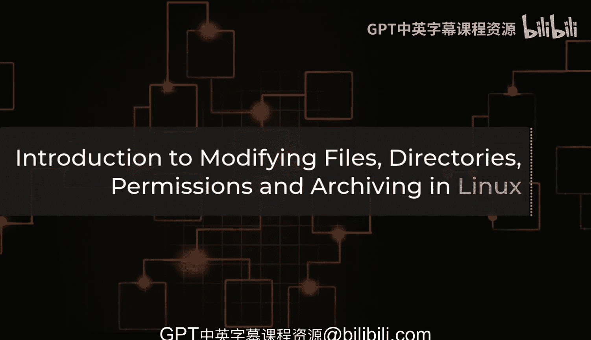
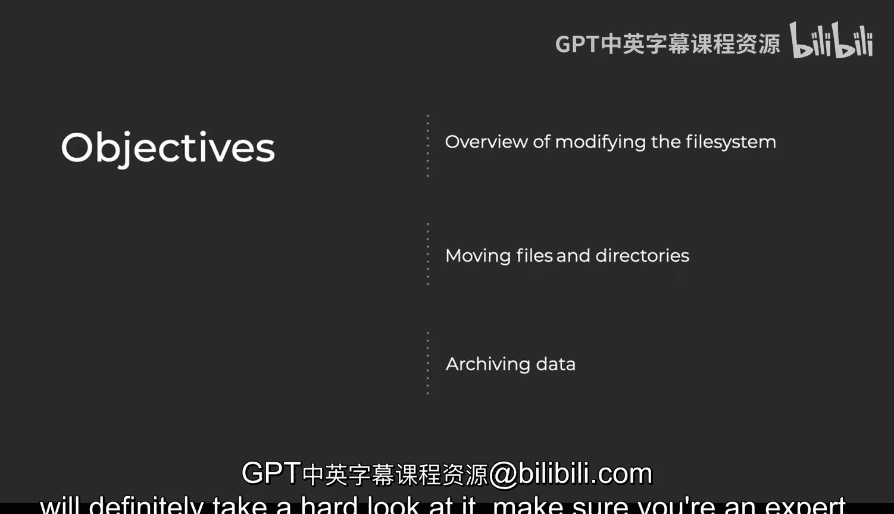

# 杜克大学｜Python、Bash和SQL数据工程基础2-4Python Bash and SQL Essentials for Data Engineering p58 58_04_02_Linux文件、目录、权限修改与归档入门.zh_en -BV1XS421X7tw_p58-

In this lesson we modify files， directories， permissions and also archive data。

 these are core capabilities of using the terminal and we'll go through and make sure you're an expert。

Next we're going to talk about the objectives， we're going to modify the file system that's one of the core components of this lesson。

 also we'll talk about how to move files and directors around and some of the key aspects of that。

And also we'll talk about archiving data， this is something that comes up a lot and will definitely take a hard look at it。

 make sure you're an expert。

