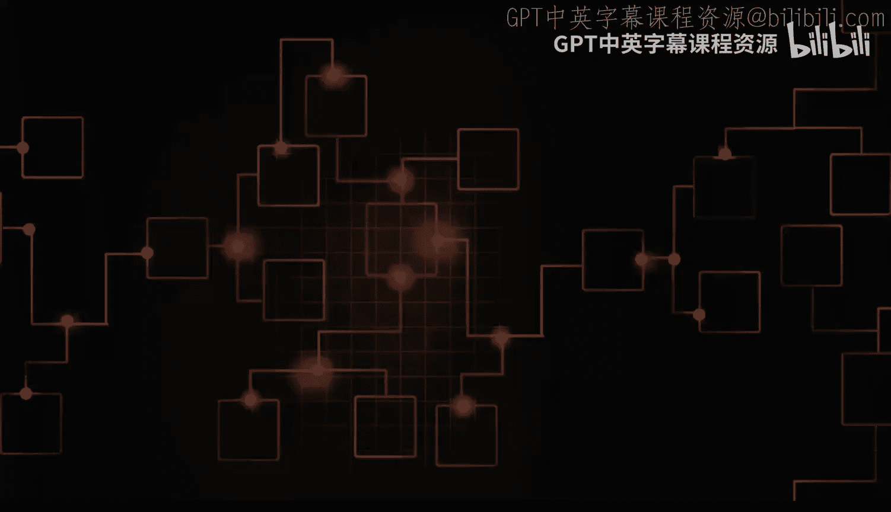
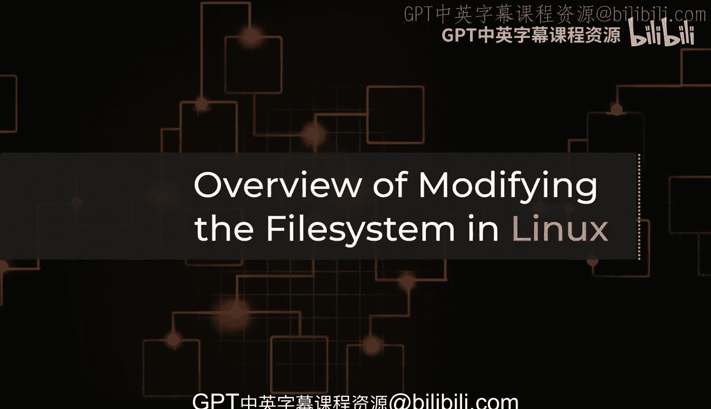
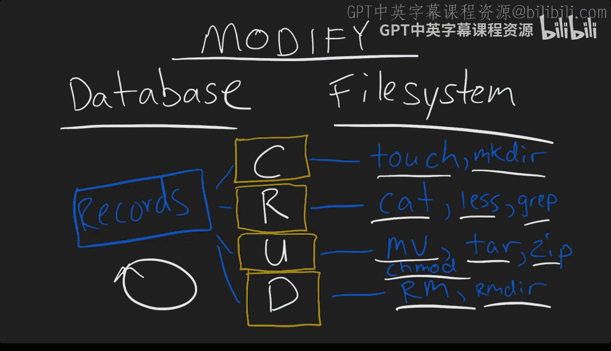

# 杜克大学｜Python、Bash和SQL数据工程基础2-4Python Bash and SQL Essentials for Data Engineering p59 59_04_03_Linux文件系统修改概览.zh_en -BV1XS421X7tw_p59-

We're in a new era now with data engineering where a centralized file system is making a comeback。

 we see this with many cloud platforms and a lot of data engineering workflows really are going to involve this idea of a hierarchical structure on disk and this is a lot similar to what I did in the film industry where we would actually take data migration scripts and look at a tri of data and move it around because we could assume there was a convention on disk。

 it's not always the case that you can assume there will be some structure on disk。

 but it is the case that you can assume that you're going to need to do some type of manipulation of data archiving data taking maybe all of a file type and putting them together and then doing some kind of processing for example。

 with big data so having the ability to manipulate data on the file system in particular。

 especially with the centralized file systems is an important skill to have for data engineering。

 I'm going talk about a few of the techniques that are important to do processing on disk。

Let's take a look at a common acronym crud that you hear a lot as a software engineer and when I was developing web applications。

 mobile applications， you would hear this acronym because it stands for C create or read you update D delete and when you're working with a database system what happens is that you'll create a record you'll read a record you'll update a record and you'll delete a record so this is really common。

 there's a feedback loop here where you're operating on things and you need to make services that interact with the database Now with the file system。

 there are similar types of operations but they have different words and they're a little bit different So in terms of creating you may touch a file that'll create an empty file or if the file art exists it won't do anything you can make directories and that's what the makeD command does there are other commands that can also do creates and that's one of the beauties of the Linux file system is that you can create。

So many different things There's also the ability to read you can run the CAAT command。

 which will put the output into your standard out。 there's also less whichll let you page through you can grab things。

 these are all readbased operations likewise you can update many things on the file system You could for example。

 move things from one location to another or rename something It's actually synonymous with move you can tar or zip something which will compress it。

 archive it， put it into a bundle so you can maybe upload it to a mail system and you can also change the permissions on a file and that's what the Chaman system does。

 Finally we have the delete and similarly you can do RM which will remove a file or you can do RmD which will remove a directory so there are very similar types of operations both in databases and file systems but the commands are different。

