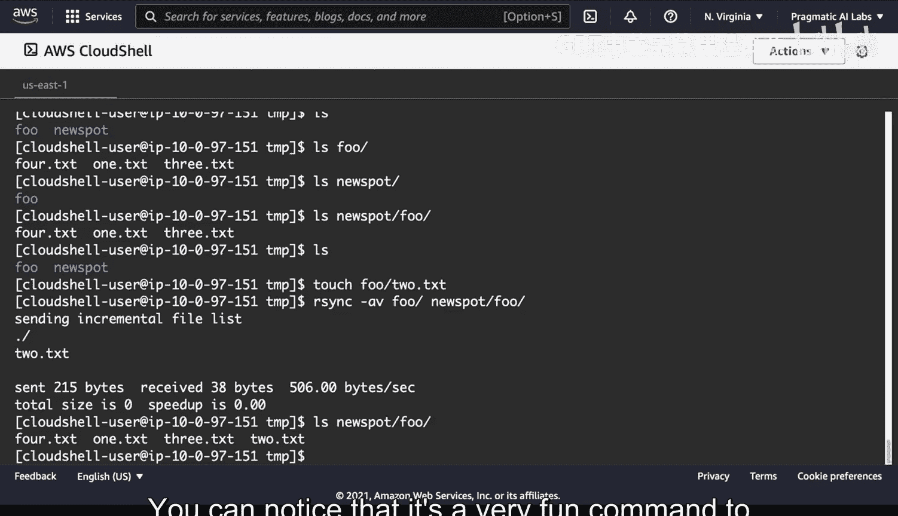
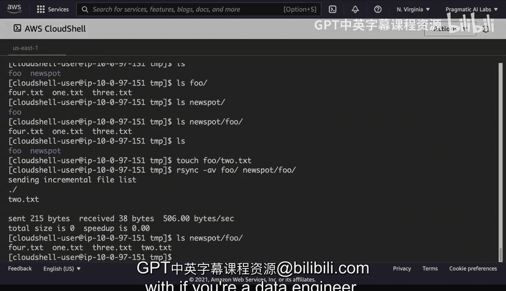

# 杜克大学｜Python、Bash和SQL数据工程基础2-4Python Bash and SQL Essentials for Data Engineering p60 60_04_04_Linux文件与目录移动.zh_en -BV1XS421X7tw_p60-

Let's go ahead and start to manipulate the file system I'm again in AWS Cloud 9 using their Linux environment。

 but this could work anywhere everything we're going to do is generic to a Linux or Unix based environment so let's go ahead and first make a directory let's call this directory F right so that's how you create a directory as you use the MKDIR command and then if we type in LSL。

You can see that that food directory is now available。

 The other thing we can do is we can actually make multiple directories as well。

 and one of the nice things about make D is it has an option dash P。

 And what this does is go through and create every single subdirecty that comes comes your way。

 So if I go here and I say make D dashp bar bam Bz。Now， if we go ahead and we do an LS of that。

 what we'll notice is that look and if I do an R to recursively look at it。

 notice that what it does is it shows me that it created all of those subdirecties for me。

 So that's a nice utility that you have at your disposal is you can create a whole tree of directories depending on what you want to do with the make dirtP command Now。

 if I want to go through here and create multiple files in these directories。

 how would I do this Well， one way to create files and this is a method I use a lot is I just go through here and put in the。

The actual touch command and this will go through here and again if I go through this directory you can see that it put it inside of the initial bar directory so it's a great way to just kind of lay a scaffolding down and if I run it multiple times it's item potent which means you can run the same command over and over again and it won't change the behavior it'll only do one operation once and this is a great utility for again creating a scaffolding on your disk now another thing we could do。

Is I could also go a little bit below this and I could actually make another file inside of here if I go to bar baAm right because that's a subdirecty I could put you know two in here and if I want to go even one directory below I can go through and go bar bam Bz and three right so this is kind of a typical thing that maybe someone would do if they're going to lay out again a file system and if I go through here and I say LS LAR so recursively show me what's going on you can see here that it will allow me to see everything that's going on on disk right this is the whole structure of what's happening。

Okay， so next what I'm going to do is I'm gonna move something。

 So how would I move things around Well， with the MV command， you can move one thing into another。

 So if we say bar， we can take this whole subdirecty files and move them into the temp directory And if we go through here and we do this now what happens there's nothing on disk anymore at least the bar directory and if I go into this temp directory notice now that that bar directory is right there and if I go in all those files that I just had before right they all are back here。

 So this is really a nicest thing to be aware of as the move directory will move physically move something from one location to another。

 Now you also。Can do a CP operation。That won't move things， they'll just copy them。 So for example。

 if I type in CP R， this will recursively copy everything。From this location on。 So if I do this。

 if I do CPD or bar bam。Notice what happens is that now I have the bar and the BM directory in the same location and if I go into BM。

Here we go， we see it's got the subdirecties below。

 so the CP command is really handy when you associate it with a dash R and I use it all the time if I want to you know copy something。

Okay let's take a look at one of the more interesting and useful commands that a data engineer can know。

 especially with a centralized file system and that's the aync command and if you type in a syncnc here and I just type in return you can see there's a huge list of things that you can do with R syncnc and it's extremely good at synchronizing two directories and that's really the main thing that it can do。

 it works very well over SSsh but I use it a lot if I'm going to deploy things to a mountpoint on my system Now here we have two directories and new spot let's go ahead and see what's inside of F so if I do that you can see it's got three files for do Txt1 do Txt and 3。

 Txt so there's a two do Txt missing right from the order now if I go in and I look at the new spot here if I type in LS new spot notice it's got itself a subdirecty and inside of this subdirecty。

It's inside。TheThe same structure。 So what I'm going to do is I want to manipulate one of these directories and then I'm going to synchronize only the changes and this is really where this arsing comes into play。

 We're using something that's very small but if we're talking about hundreds of thousands of files forget about it you're not going to be able to figure it out and so this is why this command is so important。

 So let's go ahead and in this first food directory here if I go through and I sayF。

And I say2 do Txt now these two files are actually different and so how would I want to synchronize these files well fortunately it's very straightforward and I've got the command right here in my history it's going to be aync AV so basically look at the directory and synchronize it and verboly show me what you're doing and then notice the slash here is critical with the aync command is it says basically take those two directories and keep them in sync okay let's go ahead and run it。

Now you can see it only incrementally sends the change， which is just that file to。

 how can we tell that this is the case， well， if I do LS New spot F。There we go。

 We have the2 TXT file， so extremely important to know the arsson command。

 one of the best ways to experiment with it is to play around。

 and you can notice that it's a very fun command to synchronize two directories with if you're a data engineer。

