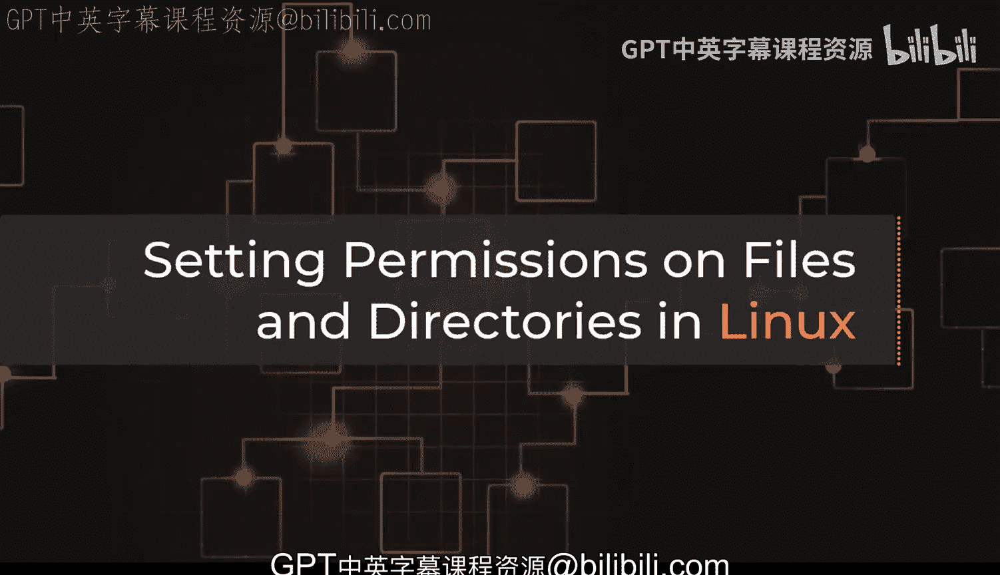
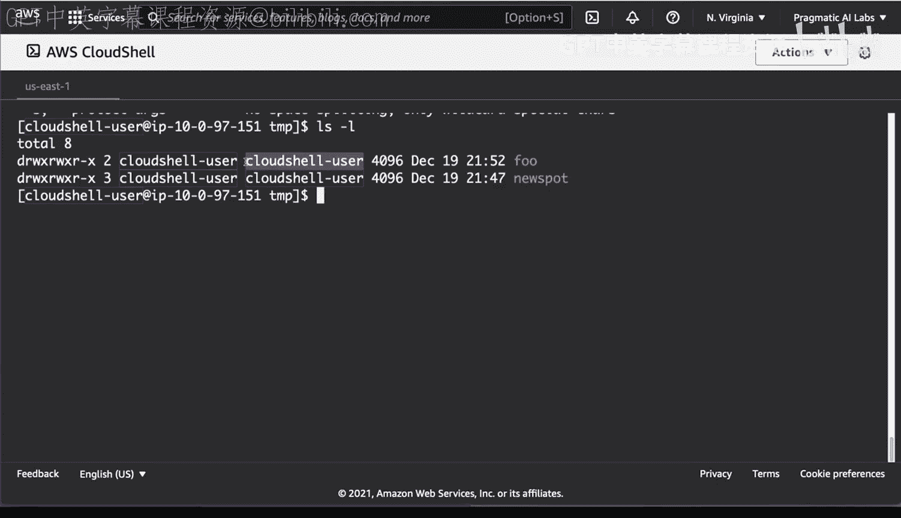
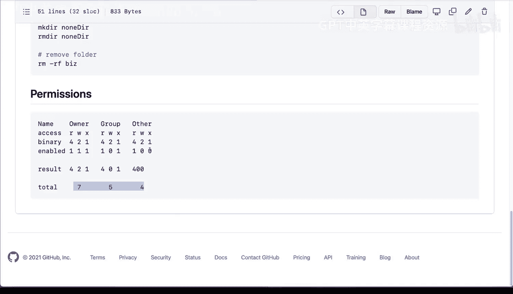
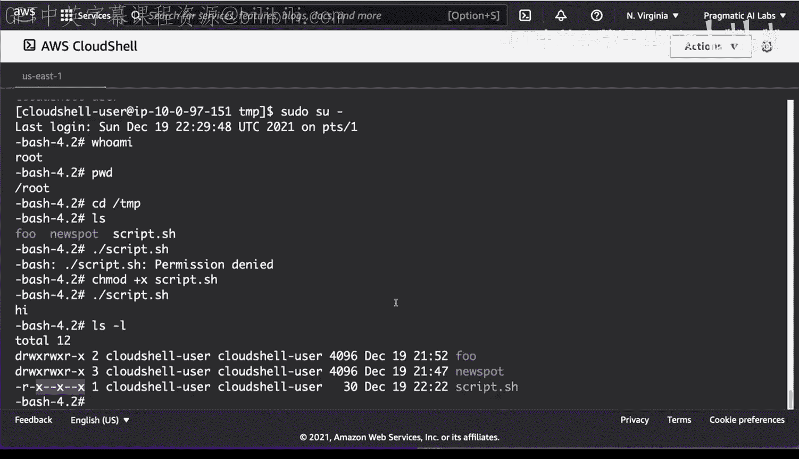
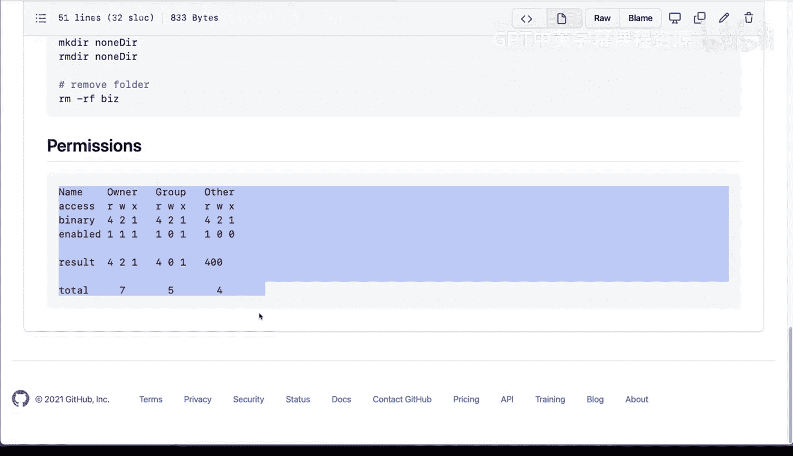

# 杜克大学｜Python、Bash和SQL数据工程基础2-4Python Bash and SQL Essentials for Data Engineering p61 61_04_05_Linux文件与目录权限设置.zh_en -BV1XS421X7tw_p61-

One of the more confusing things about Linux and permissions is this set of permissions that you see when you do an LS L in this directory notice here this is called the mode and this refers to a group of different permissions we have the user permissions we have the group permissions and then the last set here is the other permission so like basically anybody on the file system and then in this situation this is the owner and then this is the group of the file that's actually listed Now if we go back to a directory here and I look down and I look at。

A breakdown of what this is， this means that in order to get read level permissions。

 it would be a binary 4， it would be for write level permissions a binary 2 and executable。

 it would be binary 1 to enable it each of these flags if they're set will allow you to pass through so in this case4 to1 that's adds up to7 so that would mean the owner of a file if it was at7 they could read it。

 they could write it next they could execute it。Now if we go to this one。

 notice how the right level privileges are disabled for the group that this person is in and notice here then as a result this is only a five again。

 if this was enabled， it would have been a two and then this other permission which would be everybody that has access to this file other than the owner or the group they would have four in fact would be enabled so that would give them four。

 the right is not enabled so it's a zero， the executable is not enabled so that's a zero。

 so that would have754 so this would mean that the group user could not write and the other basically could not write or execute and so that's really the way to differentiate between different file systems。

Okay， if we do an LSL here， you can see that I'm the user and I'm in this group。

 they're both called Cloudhow user and Cloud Show Group。

 and you can notice here that the groups anyone else in the file system。

 they only have read access how can we change things a little bit if I do Chamod 777 script what happens？

We do LS。 look， everybody can do everything， right。 And so again。

 if I want to go through here and I want to tweak things around， I could do。

 I could do something like Chama， you know，400， for example。And what this would do。

 this would take away everybody's privileges， only the user that owns it can read it。

 but they can't even execute it， so if I go through here now and I try to run this script。

It's gonna say nope can't do it because even though you own it， you don't have executable privileges。

 How can I fix it， or I can go through here and I can say chma plus x script now go through and run it again。

 Now I can run it。 So this is really the way to navigate through here is to kind of go through here and change permissions Ref to that cheat sheet as well。

 Now one of the things that I'm going do is I'm going to change this back here。

 and let's change it back to 400， which will give only the the owner of the file read access right So very。

 very limited permissions here。 and I'm going to say who am I you can see this is Cloudto user So now I'm going to change it to a different user。

 which is the root user If we go through here I gonna type in who am I。It says root， if we do PwD。

 when you do the SU hyphen， it puts you into the roots home directory。

 so I'm going to go back into the tempier。And notice here if I go through and I try to run this。

 what happens， script。sh， oh it says that I can't run it and so one of the ways I could fix this。

As I can type in Chamod plus X script now the root user can do anything and so in this case I can just say I don't care what's going on。

 I'm gonna go through and I'm gonna give myself the ability to execute it。

 there we go and now how can we tell what happened if we do LS L you can see that now everybody on the everybody that's the owner。

 everybody that's the group and everybody else in the file system has the ability to make this executable so again this is probably one of the best ways to play around with it。

 do some of these things go back to the modify you know Gitthub repo。

 check out this cheat sheet here and play around with making your own UniX file permissions。

