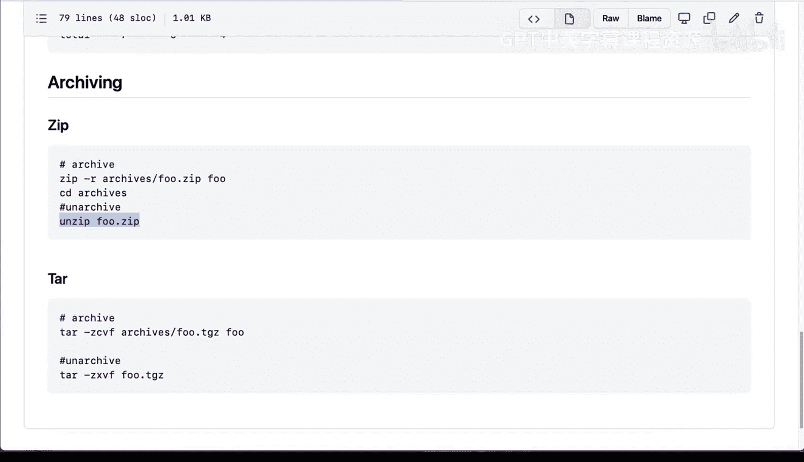
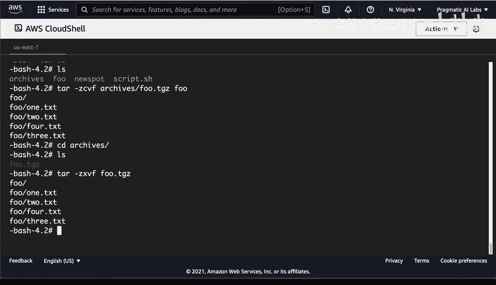
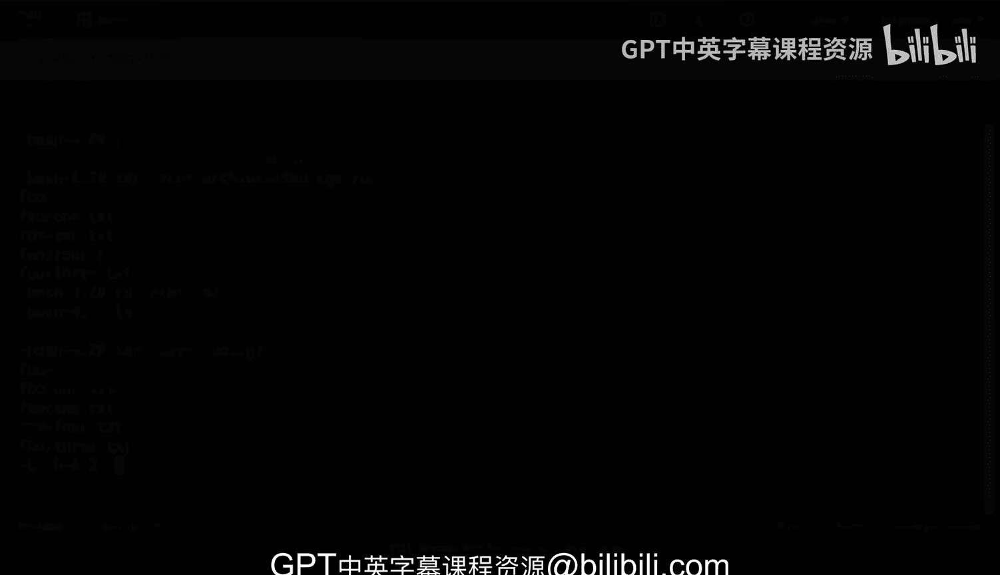

# 杜克大学｜Python、Bash和SQL数据工程基础2-4Python Bash and SQL Essentials for Data Engineering p62 62_04_06_Linux数据归档.zh_en -BV1XS421X7tw_p62-

Let's take a look here at how to archive data on the Linux command line。

 fortunately it's incredibly simple and there's a couple common ways there's a zip in a tar。

 the first off with a zip you would go through here and put the destination first and then the source in this case。

 if you do a dash R it'll recursively grab everything。And with a tar。

 you would just type in tar dash Z C V F， the same thing。 This would be where you want it to go。

 And this would be the source where you want to actually archive。

 And then you can untar it by doing tar space dash Z X V F。 And then if you want to unzip。

 you would do unzip。 So let's go ahead and do both of these operations here and take a look at how this works。

 So first off here， you can see I have a directory and inside this food directory。

 we've got a few file。 So let's say I want to archive this I might want to make a backup directory called archives。

 And this is really common。 In fact， in very real world。

 you want to start to archive things so that you don't lose your data。

 Now one of the things that I would start off with would be let's try the zip first。

 So we do zip R and we say archives。

This is where we would want to put this and maybe in the future you would want to put date stamp so you would know when it was actually backed up right now though I can just do this。

 I can say this is going to be the destination。And this is the source。 Okay。

 let's go ahead and try it out。 Notice that here we go。

 You can see that it put all of those inside of that archive。

 Let's go ahead and take a look at our archives directory and look， we've got a zipped file。

 Now this is really nice as well because I can take this and I can put it into， let's say。

 an email system and I don't have to get a warning message that says， hey。

 we can't give you that kind of attachment。 It gives you the ability to bundle things together and compress them。

 If I want to uncompress this and unpack this archive。

 I just type in unzip and we do this There we go。 now you can see that I've actually got that file structure created here。

 So what I'm going to do next here is just remove this So I'll say Rm RFf。Atic， right we removed it。

Now let's actually move on to the tar command。 So in order to tar it up， it again。

 it very similar to zip。 I just type in tar and I do hyphen Z C。V F。

 what I want to call it in this case we'll say archives F。 tgZ tarRg zip。

 and then we want to say where what is the thing we actually want to tar up。

 we'll go ahead and do the food directory。There you go。

 same thing it looks very similar here and if I go to archives There we go， we see aF。

 tgZ let's go ahead and untt， I'll just type in tar dash Z X VF There we go we've been able to uncompress it So you can see in both scenarios very straightforward they're both are similar type of archiving systems and once you understand how to both archive and unarch the whole world opens up to you。

