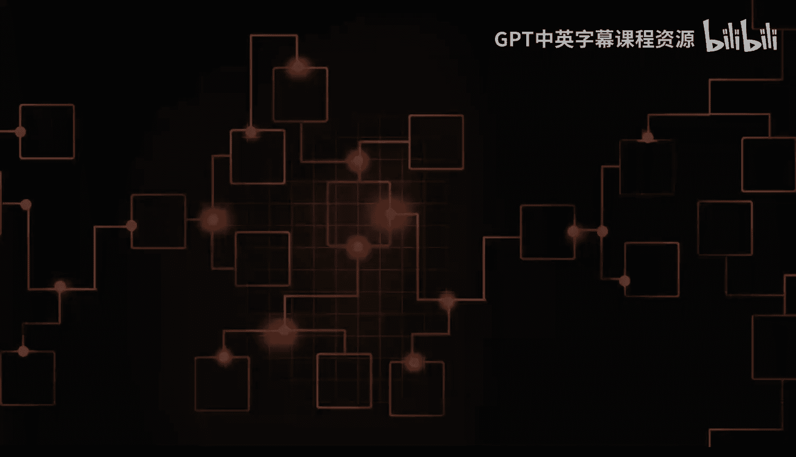
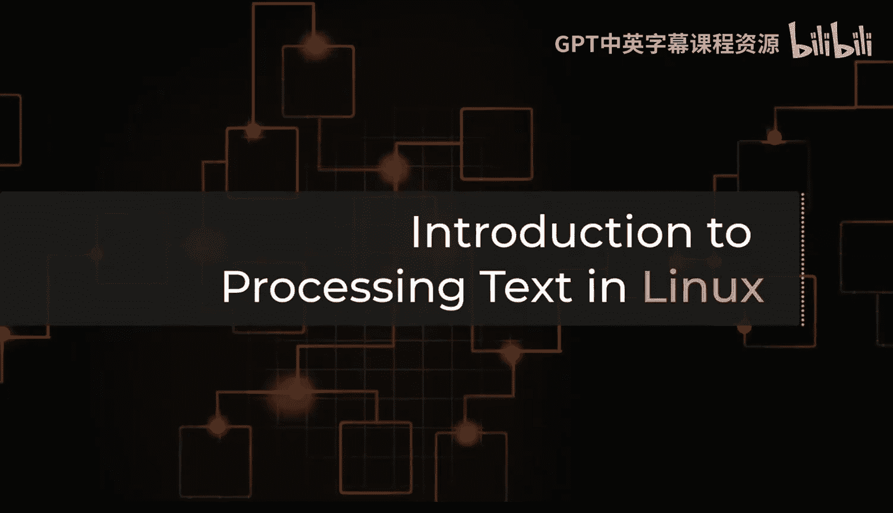
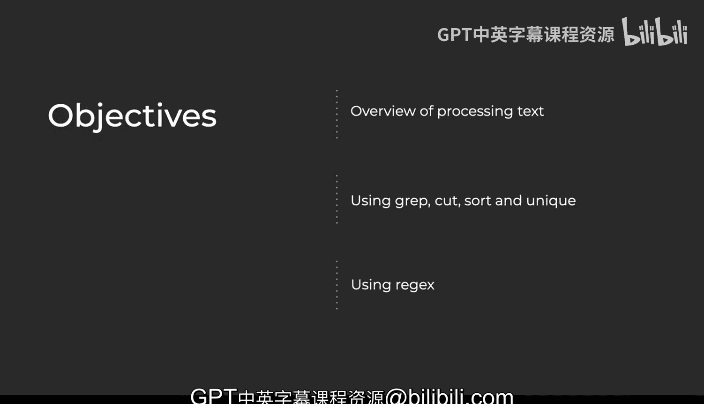

# 杜克大学｜Python、Bash和SQL数据工程基础2-4Python Bash and SQL Essentials for Data Engineering p63 63_04_02_Linux文本处理入门.zh_en -BV1XS421X7tw_p63-

In this lesson we talk about processing text， really when you get down to it。

 this is one of the most fundamental aspects of using bash using the terminal as processing text and streams of text let's talk through the objectives first we'll go through an overview what is processing text。

 make sure you understand the key components then we'll go through Gr。

 cut sort and unique really common commands that you can use to build really powerful tools and finally we'll dig into redXX and talk about how it can help you find patterns in text。

